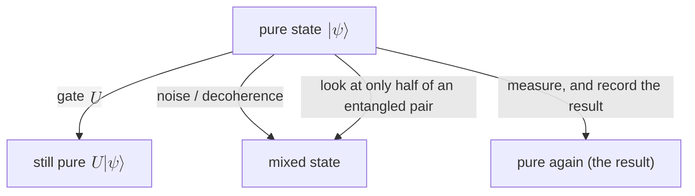

#pure_state #density_matrix #bloch_sphere
a **pure state** is a quantum state you know **completely**: there's no classical "maybe it's this one, maybe that one". the opposite is a mixed state, compared side by side in [[Pure and mixed states]]
## the idea
==a state is pure if you can write it as a single ket $|\psi\rangle$==
$$
|\psi\rangle=\alpha|0\rangle+\beta|1\rangle\qquad|\alpha|^2+|\beta|^2=1
$$
- $|0\rangle$, $|1\rangle$, $|+\rangle$, $|-\rangle$, $\frac1{\sqrt2}(|0\rangle+i|1\rangle)$ are **all pure**
- a superposition is still pure: $|+\rangle$ isn't "0 or 1, I don't know which", it's one definite state (it's $0$ for sure in the $+/-$ basis)
- a Bell state like $\frac1{\sqrt2}(|00\rangle+|11\rangle)$ is pure too, as a 2 qubit state
## as a density matrix
any pure state has the [[Density matrix|density matrix]]
$$
\rho=|\psi\rangle\langle\psi|=\begin{bmatrix}\alpha\\\beta\end{bmatrix}\begin{bmatrix}\alpha^*&\beta^*\end{bmatrix}=\begin{bmatrix}|\alpha|^2&\alpha\beta^*\\\alpha^*\beta&|\beta|^2\end{bmatrix}
$$
- **diagonal** = the $0/1$ probabilities
- **off diagonal** = the coherence (the "superposition part"). for a pure state it's as big as it can be: $|\rho_{01}|=|\alpha||\beta|$
> [!example] worked example: $|\psi\rangle=\sqrt{0.7}\,|0\rangle+\sqrt{0.3}\,|1\rangle$
> $$
> \begin{aligned}
> \rho&=\begin{bmatrix}0.7&\sqrt{0.21}\\\sqrt{0.21}&0.3\end{bmatrix}\approx\begin{bmatrix}0.7&0.458\\0.458&0.3\end{bmatrix}\\
> \text{tr}(\rho^2)&=0.7^2+0.3^2+2\times0.21=0.49+0.09+0.42=1\ ✅\\
> \vec r&=(2\,\text{Re}\,\rho_{01},\ -2\,\text{Im}\,\rho_{01},\ \rho_{00}-\rho_{11})=(0.917,\ 0,\ 0.4)\\
> |\vec r|^2&=0.84+0+0.16=1\ ✅\ \text{(on the surface)}
> \end{aligned}
> $$
> (checked numerically)

## phases: which ones matter
$$
\begin{aligned}
&e^{i\gamma}|\psi\rangle\ \text{ gives the same }\rho&&\text{global phase: doesn't matter, it's the same state}\\
&\tfrac1{\sqrt2}(|0\rangle+|1\rangle)\ \text{ vs }\ \tfrac1{\sqrt2}(|0\rangle-|1\rangle)&&\text{relative phase: different states }(|+\rangle\text{ vs }|-\rangle)
\end{aligned}
$$
the relative phase lives in the off diagonal: $\rho_{01}=+\frac12$ for $|+\rangle$, $-\frac12$ for $|-\rangle$
## on the Bloch sphere
every 1 qubit pure state can be written with 2 angles
$$
|\psi\rangle=\cos\tfrac\theta2\,|0\rangle+e^{i\varphi}\sin\tfrac\theta2\,|1\rangle
$$
==pure states are exactly the points **on the surface** of the [[Bloch sphere]]== (Bloch vector length 1). mixed states are inside
![[Bloch_sphere_meaning.png]]

| state | $\theta,\varphi$ | where |
|---|---|---|
| $\lvert0\rangle$ | $0$ | north pole |
| $\lvert1\rangle$ | $\pi$ | south pole |
| $\lvert+\rangle$ | $\frac\pi2,\ 0$ | $+x$ |
| $\frac1{\sqrt2}(\lvert0\rangle+i\lvert1\rangle)$ | $\frac\pi2,\ \frac\pi2$ | $+y$ |

## how to check if a state is pure

| test | pure | mixed |
|---|---|---|
| purity $\text{tr}(\rho^2)$ ([[Trace]]) | $=1$ | $<1$ |
| $\rho^2=\rho$? (is it a [[Projectors\|projector]]) | yes | no |
| eigenvalues of $\rho$ | one $1$, the rest $0$ | spread out |
| [[Von Neumann entropy]] | $0$ | $>0$ |
| Bloch vector length | $1$ | $<1$ |

^purity-tests

why $\rho^2=\rho$: $\rho^2=|\psi\rangle\langle\psi|\psi\rangle\langle\psi|=|\psi\rangle\cdot1\cdot\langle\psi|=\rho$, because $\langle\psi|\psi\rangle=1$. so $\rho$ is the projector onto $|\psi\rangle$
## measuring a pure state
the chance of result $i$ is
$$
P(i)=\langle\psi|\Pi_i|\psi\rangle=|\langle i|\psi\rangle|^2
$$
(same as $\text{tr}(\rho\,\Pi_i)$, which also works for mixed states). with $|\psi\rangle=\sqrt{0.7}|0\rangle+\sqrt{0.3}|1\rangle$
$$
\begin{aligned}
P(0)&=|\sqrt{0.7}|^2=0.7\\
P(+)&=\Big|\tfrac{\sqrt{0.7}+\sqrt{0.3}}{\sqrt2}\Big|^2\approx0.958
\end{aligned}
$$
> [!important] there's always a basis where a pure state is certain
> ==measure a pure state in a basis that contains $|\psi\rangle$ itself and you get that result **100%** of the time==. a mixed state has no such basis, that's the real difference

## pure states of 2 qubits
a 2 qubit pure state is either
- **a product state**: $|\psi\rangle=|a\rangle\otimes|b\rangle$, eg. $|+\rangle|0\rangle$. each qubit on its own is pure too
- **entangled**: eg. the Bell state $\frac1{\sqrt2}(|00\rangle+|11\rangle)$. the whole thing is pure, but each half on its own ([[Partial trace]]) is mixed
$$
\rho_{AB}=|\Phi^+\rangle\langle\Phi^+|\ \ (\text{tr}\rho^2=1)\qquad\Rightarrow\qquad\rho_A=\text{tr}_B\,\rho_{AB}=\frac I2\ \ (\text{tr}\rho_A^2=\tfrac12)
$$
> [!tip] the quick entanglement test
> for a pure 2 part state: **the halves are pure ⟺ it's a product state**. if a half comes out mixed, the pair is entangled (how mixed it is = [[Entanglement entropy]])

## what keeps a state pure, and what doesn't

- **gates** ([[Unitary Operation|unitaries]]) keep it pure: $\text{tr}\big((U\rho U^\dagger)^2\big)=\text{tr}(\rho^2)=1$
- **noise** ([[Quantum channels]]) pushes it into the Bloch ball, pure → mixed. this is decoherence
- **measuring** gives a pure state again (the result you saw). but if you measure and **forget** the result, you get a mixture

see also [[Pure and mixed states]], [[Density matrix]], [[Bloch sphere]], [[Projectors]]
