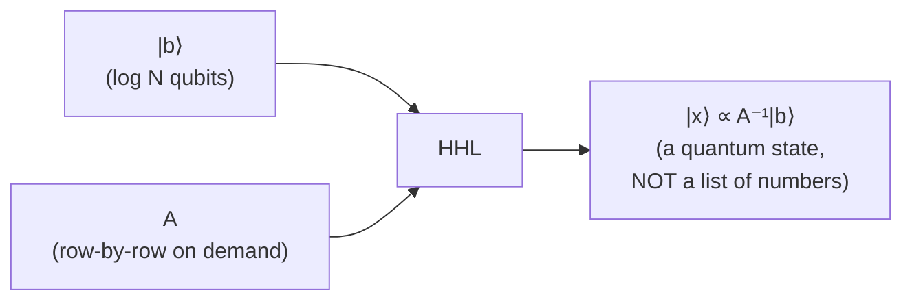
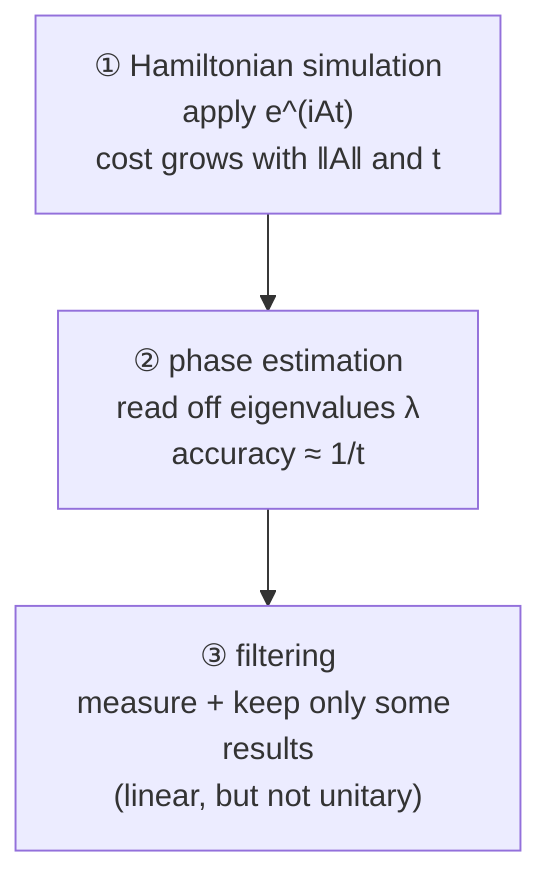
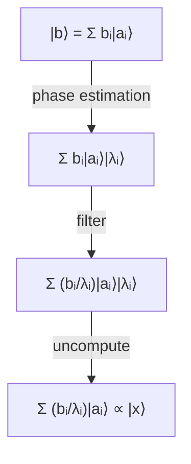

#HHL #linear_systems #quantum_algorithms
a quantum algorithm for solving huge linear systems $A\vec x=\vec b$ (named HHL after Harrow, Hassidim and Lloyd). follows on from [[Linear systems of equations]]
## the speed up

| | time |
|---|---|
| best classical (iterative) | $O\!\left(N\,s\,\kappa\log\frac1\epsilon\right)$ |
| quantum (HHL) | similar in $s$, $\kappa$ and $\epsilon$, but only $\log N$ instead of $N$ |

($N$ = size, $s$ = sparsity, $\kappa$ = condition number, see [[Linear systems of equations#the 3 numbers that decide how hard it is]])

for huge $N$, going from $N$ to $\log N$ is an **exponential** saving
## the catch: a different input and output
> [!important] never write down the whole thing
> ==writing down $\vec b$ or $\vec x$ as a list of $N$ numbers would already take $N$ steps.== so HHL doesn't
> - **input** $\vec b$ → given as a **quantum state** $|b\rangle$, with the numbers stored in its **amplitudes**. $N$ numbers fit in just $\log_2N$ qubits
> - **matrix** $A$ → not written down either ($Ns$ numbers). instead there's a procedure that, given a row number, spits out that row's non-zero entries and where they are ("computable on the fly")
> - **output** → a quantum state $|x\rangle$ with the answer in its amplitudes, **not** a list of numbers

so you **can't** just swap HHL in wherever a classical solver was used. you have to be able to meet these input and output requirements

> [!note] same trick as the QFT
> the classical FFT takes $N\log N$, the [[Quantum Fourier Transform]] takes about $(\log N)^2$. that's only possible because it transforms **amplitudes of a state**, not a list of numbers (see [[Discrete Fourier Transform#How fast is it?]]). HHL is the same deal
## the 3 building blocks
(for simplicity assume $A$ is **Hermitian**, the general case also works but wasn't covered)

1. **[[Hamiltonian simulation]]**: apply $e^{iAt}$. works for any matrix given in the row-by-row way above, not just the Hamiltonians of real physical systems. time grows like $\|A\|\,t$
2. **[[Quantum Phase Estimation|phase estimation]]**: if something gives a phase $e^{i\lambda t}$, estimate $\lambda$. accuracy $\approx\frac1t$, like **frequency–time uncertainty**: watch something for time $t$ and you can only tell frequencies apart to about $\frac1t$ (same idea as the QFT's phase resolution, see [[Quantum Fourier Transform#Phase Resolution]])
3. **filtering**: do a measurement and **only keep** the runs where it came out a certain way. it only works with some probability, but the state changes in a **linear, non-[[Unitary Operation|unitary]]** way (like a colour filter that dims some colours of light)
## how it works
the steps, in [[Eigenvalues and eigenvectors|A's eigenbasis]] (eigenvectors $|a_i\rangle$, eigenvalues $\lambda_i$)

**1. rewrite $|b\rangle$** (just maths, nothing physical happens)
$$
|b\rangle=\sum_ib_i\,|a_i\rangle
$$
**2. phase estimation on $e^{iAt}$**: each eigenvector picks up phase at its own rate $\lambda_i$, so phase estimation attaches an estimate of $\lambda_i$ in an extra register
$$
\sum_ib_i\,|a_i\rangle\,|\lambda_i\rangle
$$
(approximately, but the error can be bounded rigorously)

**3. filter with a $\frac1{\lambda_i}$**: accept or reject, with the chance of accepting depending on $\lambda_i$, so that if you keep only the accepted runs, each part gets a factor of $\frac1{\lambda_i}$
$$
\sum_i\frac{b_i}{\lambda_i}\,|a_i\rangle\,|\lambda_i\rangle
$$
**4. uncompute $\lambda_i$**: run step 2 backwards to erase the $|\lambda_i\rangle$ register (keeping it around could cause decoherence), but the $\frac1{\lambda_i}$ stays
$$
\sum_i\frac{b_i}{\lambda_i}\,|a_i\rangle\;\propto\;A^{-1}|b\rangle=|x\rangle\ ✅
$$
dividing each eigenvector's part by its eigenvalue **is** applying $A^{-1}$ (checked numerically on a random $4\times4$ Hermitian matrix)

> [!tip] not just inverting
> once each eigenvector has its eigenvalue attached, you could multiply by **any** function of $\lambda$, not just $\frac1\lambda$. other work uses this for other useful functions of matrices
## worked example: solving a system with HHL, step by step
**the equations**
$$
\begin{aligned}
1.5\,x_1+0.5\,x_2&=1\\
0.5\,x_1+1.5\,x_2&=0
\end{aligned}
\qquad\Longrightarrow\qquad
\underbrace{\begin{bmatrix}1.5&0.5\\0.5&1.5\end{bmatrix}}_{A}\begin{bmatrix}x_1\\x_2\end{bmatrix}=\underbrace{\begin{bmatrix}1\\0\end{bmatrix}}_{\vec b}
$$
(the answer we're aiming for: $x_1=0.75$, $x_2=-0.25$. I picked $A$ so its eigenvalues come out exactly, which keeps every step exact)

**step 0: what we need to know about $A$** (HHL doesn't compute these, the circuit finds them by itself; they're worked out here so we can follow along)

**(a) is $A$ Hermitian?** flip it across the diagonal and take complex conjugates ($A^\dagger$), and check nothing changes
$$
A^\dagger=\begin{bmatrix}1.5&0.5\\0.5&1.5\end{bmatrix}^{T*}=\begin{bmatrix}1.5&0.5\\0.5&1.5\end{bmatrix}=A\ ✅
$$
(real numbers and symmetric, so yes)

**(b) the eigenvalues**: solve $\det(A-\lambda I)=0$
$$
\begin{aligned}
\det\begin{bmatrix}1.5-\lambda&0.5\\0.5&1.5-\lambda\end{bmatrix}&=(1.5-\lambda)^2-0.5\times0.5=0\\
(1.5-\lambda)^2&=0.25\\
1.5-\lambda&=\pm0.5\\
\lambda_1=2,\quad\lambda_2&=1
\end{aligned}
$$
**(c) the eigenvectors**: for each $\lambda$, solve $(A-\lambda I)\vec v=0$
$$
\begin{aligned}
\lambda_1=2:&\quad\begin{bmatrix}-0.5&0.5\\0.5&-0.5\end{bmatrix}\begin{bmatrix}v_1\\v_2\end{bmatrix}=0\ \Rightarrow\ -0.5v_1+0.5v_2=0\ \Rightarrow\ v_1=v_2\ \Rightarrow\ |a_1\rangle=\tfrac{|0\rangle+|1\rangle}{\sqrt2}\\
\lambda_2=1:&\quad\begin{bmatrix}0.5&0.5\\0.5&0.5\end{bmatrix}\begin{bmatrix}v_1\\v_2\end{bmatrix}=0\ \Rightarrow\ 0.5v_1+0.5v_2=0\ \Rightarrow\ v_1=-v_2\ \Rightarrow\ |a_2\rangle=\tfrac{|0\rangle-|1\rangle}{\sqrt2}
\end{aligned}
$$
(the $\frac1{\sqrt2}$ makes each one length 1). **check**: $A\binom11=\binom{1.5+0.5}{0.5+1.5}=\binom22=2\binom11$ ✅ and $A\binom1{-1}=\binom{1.5-0.5}{0.5-1.5}=\binom1{-1}=1\cdot\binom1{-1}$ ✅

**(d) the condition number**: biggest eigenvalue ÷ smallest (in size)
$$
\kappa=\frac{\lambda_{\max}}{\lambda_{\min}}=\frac21=2\qquad\text{(close to 1, so nicely conditioned: HHL's filter will work often)}
$$

**step 1: load $\vec b$ as a state.** $\vec b=(1,0)$ is already length 1, so $|b\rangle=|0\rangle$. we need 4 qubits: $b$ (1 qubit, holds the vector), a **clock** (2 qubits, will hold the eigenvalue) and an **ancilla** (the filter)
$$
|0\rangle_{\text{anc}}\,|00\rangle_{\text{clock}}\,|0\rangle_b
$$
**step 2: rewrite $|b\rangle$ in $A$'s eigenvectors** (nothing happens physically, it's just maths). each coefficient is an inner product, $b_i=\langle a_i|b\rangle$
$$
\begin{aligned}
b_1&=\langle a_1|0\rangle=\tfrac1{\sqrt2}\begin{bmatrix}1&1\end{bmatrix}\begin{bmatrix}1\\0\end{bmatrix}=\tfrac1{\sqrt2}\qquad b_2=\langle a_2|0\rangle=\tfrac1{\sqrt2}\begin{bmatrix}1&-1\end{bmatrix}\begin{bmatrix}1\\0\end{bmatrix}=\tfrac1{\sqrt2}\\
|0\rangle_b&=\tfrac1{\sqrt2}|a_1\rangle+\tfrac1{\sqrt2}|a_2\rangle
\end{aligned}
$$
check: $\frac1{\sqrt2}\cdot\frac{(1,1)}{\sqrt2}+\frac1{\sqrt2}\cdot\frac{(1,-1)}{\sqrt2}=\frac{(1,1)+(1,-1)}2=(1,0)$ ✅
**step 3: phase estimation** with $U=e^{iAt}$ and $t=\frac\pi2$. each eigenvector picks up its own phase
$$
U|a_1\rangle=e^{i\cdot2\cdot\frac\pi2}|a_1\rangle=e^{2\pi i\cdot\frac24}|a_1\rangle\qquad U|a_2\rangle=e^{i\cdot1\cdot\frac\pi2}|a_2\rangle=e^{2\pi i\cdot\frac14}|a_2\rangle
$$
so the clock reads $\frac24\to|10\rangle$ for $\lambda=2$ and $\frac14\to|01\rangle$ for $\lambda=1$ (the clock counts in quarters). after $H$s on the clock, controlled $U$ and $U^2$, and an inverse [[Quantum Fourier Transform|QFT]] ([[Quantum Phase Estimation]]):
$$
\tfrac1{\sqrt2}|a_1\rangle|10\rangle_{\text{clock}}+\tfrac1{\sqrt2}|a_2\rangle|01\rangle_{\text{clock}}
$$
each eigenvector now has its eigenvalue **written next to it**

**step 4: the filter (controlled rotation).** rotate the ancilla so its $|1\rangle$ amplitude is $\frac C\lambda$, with $C=1$ (it must be $\leq\lambda_{\min}=1$)

| clock | $\lambda$ | $\frac C\lambda$ | ancilla becomes | gate |
|---|---|---|---|---|
| $\lvert10\rangle$ | 2 | 0.5 | $0.866\lvert0\rangle+0.5\lvert1\rangle$ | $R_y(\frac\pi3)$ |
| $\lvert01\rangle$ | 1 | 1 | $0\lvert0\rangle+1\lvert1\rangle$ | $R_y(\pi)$ |

$$
\tfrac1{\sqrt2}|a_1\rangle|10\rangle\big(0.866|0\rangle+0.5|1\rangle\big)+\tfrac1{\sqrt2}|a_2\rangle|01\rangle\big(0|0\rangle+1|1\rangle\big)
$$
**step 5: measure the ancilla, keep only "1"**
$$
\begin{aligned}
P(1)&=\Big(\tfrac{0.5}{\sqrt2}\Big)^2+\Big(\tfrac1{\sqrt2}\Big)^2=0.125+0.5=0.625\\
\text{left over}&\ \propto\ \tfrac{0.5}{\sqrt2}|a_1\rangle|10\rangle+\tfrac1{\sqrt2}|a_2\rangle|01\rangle
\end{aligned}
$$
62.5% of runs succeed. the other 37.5% you throw away and run again

**step 6: uncompute** (run phase estimation backwards, $\text{QPE}^\dagger$): the clock goes back to $|00\rangle$, but the $\frac1\lambda$ factors stay
$$
\propto\ 0.5\,|a_1\rangle+1\,|a_2\rangle
$$
**step 7: what state is that?** put the eigenvectors back in
$$
\begin{aligned}
0.5\cdot\tfrac{|0\rangle+|1\rangle}{\sqrt2}+\tfrac{|0\rangle-|1\rangle}{\sqrt2}&=\tfrac1{\sqrt2}\big(1.5|0\rangle-0.5|1\rangle\big)\\
\text{normalise}:\quad|x\rangle&=\frac{3|0\rangle-|1\rangle}{\sqrt{10}}\approx0.949|0\rangle-0.316|1\rangle
\end{aligned}
$$
the true answer $(0.75,-0.25)$ is $0.25\times(3,-1)$: **the same direction** ✅

![[HHL_2x2_circuit.png]]
(the whole circuit. the controlled $R_y$s only need one clock bit each, because only $|01\rangle$ and $|10\rangle$ ever show up here)

**step 8: reading the answer out**
- measure $b$: you get $0$ **90%** of the time and $1$ **10%**, so $x_1^2:x_2^2=9:1$
- the **sign** ($x_2$ is negative) doesn't show up in a plain measurement, you'd need an extra interference trick
- the **size** of $\vec x$ isn't in the state, but here it hides in the success rate: $P(1)=C^2\|\vec x\|^2=0.75^2+0.25^2=0.625$ ✅
- so for a 2×2 this is silly (you'd solve it in your head), but the same circuit on $\log_2N$ qubits handles an $N\times N$ system, as long as you only need something like "the ratio $x_1^2:x_2^2$" and not every number

(every step checked by simulating the 4 qubit circuit numerically)

## the same problem done classically
the 2×2 example from [[Week 3 formulas#8. the HHL algorithm]], solved the normal way, to compare
$$
A=\begin{bmatrix}1&\frac12\\\frac12&1\end{bmatrix}\qquad\vec b=\begin{bmatrix}1\\0\end{bmatrix}
$$
**way 1: the inverse** (for a $2\times2$: swap the diagonal, negate the rest, divide by the determinant)
$$
\begin{aligned}
\det A&=1\cdot1-\tfrac12\cdot\tfrac12=\tfrac34\\
A^{-1}&=\frac1{3/4}\begin{bmatrix}1&-\frac12\\-\frac12&1\end{bmatrix}=\begin{bmatrix}\frac43&-\frac23\\-\frac23&\frac43\end{bmatrix}\\
\vec x&=A^{-1}\vec b=\begin{bmatrix}\frac43\\-\frac23\end{bmatrix}
\end{aligned}
$$
**way 2: exactly HHL's steps, but on paper** (eigenvalues $\frac32$ and $\frac12$, eigenvectors $\vec a_1=\frac{(1,1)}{\sqrt2}$, $\vec a_2=\frac{(1,-1)}{\sqrt2}$)
$$
\begin{aligned}
&\text{1. rewrite }\vec b:&&\vec b=\tfrac1{\sqrt2}\vec a_1+\tfrac1{\sqrt2}\vec a_2\\
&\text{2. find the eigenvalues:}&&\lambda_1=\tfrac32,\ \lambda_2=\tfrac12\quad\text{(HHL: phase estimation)}\\
&\text{3. divide each part by its }\lambda:&&\vec x=\tfrac1{\sqrt2}\cdot\tfrac23\,\vec a_1+\tfrac1{\sqrt2}\cdot2\,\vec a_2\quad\text{(HHL: the filter)}\\
&\text{4. add up:}&&\vec x=\tfrac13\begin{bmatrix}1\\1\end{bmatrix}+\begin{bmatrix}1\\-1\end{bmatrix}=\begin{bmatrix}\frac43\\-\frac23\end{bmatrix}\ ✅
\end{aligned}
$$
> [!important] what each one gives you
> - **classical**: the actual numbers $x_1=\frac43$, $x_2=-\frac23$. but finding eigenvalues or inverting costs about $N^3$
> - **HHL**: the **state** $|x\rangle=\frac{2|0\rangle-|1\rangle}{\sqrt5}$ (normalised, so the overall size is lost). measuring it gives $0$ with chance $\frac45$ and $1$ with chance $\frac15$, so to read every entry you'd need many runs, which kills the speed up. ==it's only worth it if you need a **property** of $\vec x$, not $\vec x$ itself==
## things to watch out for (extra, not in the lecture)
> [!warning]- the fine print
> - **the filter doesn't always work**: strictly, the **amplitude** gets the $\frac1{\lambda_i}$ (so the chance goes like $\frac1{\lambda_i^2}$), and in the worst case the success chance is only about $\frac1{\kappa^2}$, so you repeat it or use a trick called amplitude amplification. that's part of why $\kappa$ still matters a lot (in my $4\times4$ check it worked 35% of the time)
> - **loading $|b\rangle$** has to be fast too, or it eats the speed up
> - **reading $|x\rangle$**: you can't read out all $N$ numbers (that would take $N$ measurements again). you can only get things like overall properties or averages of $\vec x$
> - the lecture said there are issues the classical algorithm doesn't have, so these will probably come up next

see also [[Linear systems of equations]], [[Quantum Phase Estimation]], [[Quantum Fourier Transform]]
