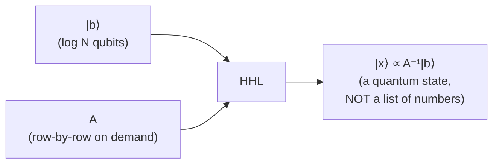
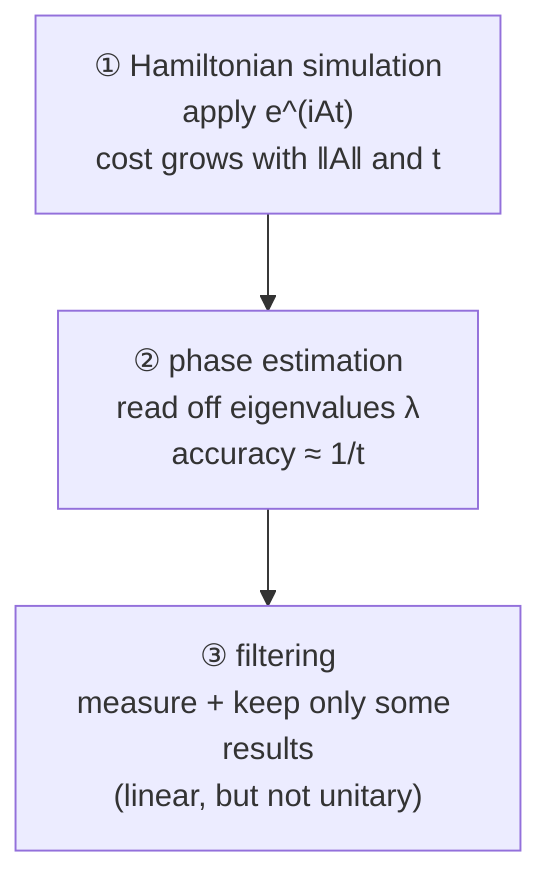
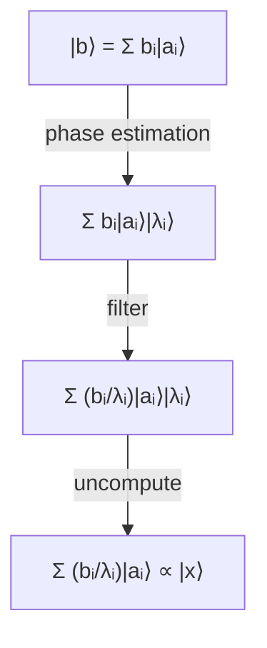

#HHL #linear_systems #quantum_algorithms
a quantum algorithm for solving huge linear systems $A\vec x=\vec b$ (named HHL after Harrow, Hassidim and Lloyd). follows on from [[Linear systems of equations]]
## the speed up

| | time |
|---|---|
| best classical (iterative) | $O\!\left(N\,s\,\kappa\log\frac1\epsilon\right)$ |
| quantum (HHL) | similar in $s$, $\kappa$ and $\epsilon$, but only $\log N$ instead of $N$ |

($N$ = size, $s$ = sparsity, $\kappa$ = condition number, see [[Linear systems of equations#the 3 numbers that decide how hard it is]])

for huge $N$, going from $N$ to $\log N$ is an **exponential** saving
## the catch: a different input and output
> [!important] never write down the whole thing
> ==writing down $\vec b$ or $\vec x$ as a list of $N$ numbers would already take $N$ steps.== so HHL doesn't
> - **input** $\vec b$ → given as a **quantum state** $|b\rangle$, with the numbers stored in its **amplitudes**. $N$ numbers fit in just $\log_2N$ qubits
> - **matrix** $A$ → not written down either ($Ns$ numbers). instead there's a procedure that, given a row number, spits out that row's non-zero entries and where they are ("computable on the fly")
> - **output** → a quantum state $|x\rangle$ with the answer in its amplitudes, **not** a list of numbers

so you **can't** just swap HHL in wherever a classical solver was used. you have to be able to meet these input and output requirements

> [!note] same trick as the QFT
> the classical FFT takes $N\log N$, the [[Quantum Fourier Transform]] takes about $(\log N)^2$. that's only possible because it transforms **amplitudes of a state**, not a list of numbers (see [[Discrete Fourier Transform#How fast is it?]]). HHL is the same deal

## the 3 building blocks
(for simplicity assume $A$ is **Hermitian**, the general case also works but wasn't covered)

1. **[[Hamiltonian simulation]]**: apply $e^{iAt}$. works for any matrix given in the row-by-row way above, not just the Hamiltonians of real physical systems. time grows like $\|A\|\,t$
2. **[[Quantum Phase Estimation|phase estimation]]**: if something gives a phase $e^{i\lambda t}$, estimate $\lambda$. accuracy $\approx\frac1t$, like **frequency–time uncertainty**: watch something for time $t$ and you can only tell frequencies apart to about $\frac1t$ (same idea as the QFT's phase resolution, see [[Quantum Fourier Transform#Phase Resolution]])
3. **filtering**: do a measurement and **only keep** the runs where it came out a certain way. it only works with some probability, but the state changes in a **linear, non-[[Unitary Operation|unitary]]** way (like a colour filter that dims some colours of light)
## how it works
the steps, in [[Eigenvalues and eigenvectors|A's eigenbasis]] (eigenvectors $|a_i\rangle$, eigenvalues $\lambda_i$)

**1. rewrite $|b\rangle$** (just maths, nothing physical happens)
$$
|b\rangle=\sum_ib_i\,|a_i\rangle
$$
**2. phase estimation on $e^{iAt}$**: each eigenvector picks up phase at its own rate $\lambda_i$, so phase estimation attaches an estimate of $\lambda_i$ in an extra register
$$
\sum_ib_i\,|a_i\rangle\,|\lambda_i\rangle
$$
(approximately, but the error can be bounded rigorously)

**3. filter with a $\frac1{\lambda_i}$**: accept or reject, with the chance of accepting depending on $\lambda_i$, so that if you keep only the accepted runs, each part gets a factor of $\frac1{\lambda_i}$
$$
\sum_i\frac{b_i}{\lambda_i}\,|a_i\rangle\,|\lambda_i\rangle
$$
**4. uncompute $\lambda_i$**: run step 2 backwards to erase the $|\lambda_i\rangle$ register (keeping it around could cause decoherence), but the $\frac1{\lambda_i}$ stays
$$
\sum_i\frac{b_i}{\lambda_i}\,|a_i\rangle\;\propto\;A^{-1}|b\rangle=|x\rangle\ ✅
$$
dividing each eigenvector's part by its eigenvalue **is** applying $A^{-1}$ (checked numerically on a random $4\times4$ Hermitian matrix)

> [!tip] not just inverting
> once each eigenvector has its eigenvalue attached, you could multiply by **any** function of $\lambda$, not just $\frac1\lambda$. other work uses this for other useful functions of matrices

## worked example: solving a system with HHL, step by step
**the equations**
$$
\begin{aligned}
1.5\,x_1+0.5\,x_2&=1\\
0.5\,x_1+1.5\,x_2&=0
\end{aligned}
\qquad\Longrightarrow\qquad
\underbrace{\begin{bmatrix}1.5&0.5\\0.5&1.5\end{bmatrix}}_{A}\begin{bmatrix}x_1\\x_2\end{bmatrix}=\underbrace{\begin{bmatrix}1\\0\end{bmatrix}}_{\vec b}
$$
(the answer we're aiming for: $x_1=0.75$, $x_2=-0.25$. I picked $A$ so its eigenvalues come out exactly, which keeps every step exact)

**step 0: what we need to know about $A$** (HHL doesn't compute these, the circuit finds them by itself; they're worked out here so we can follow along)

**(a) is $A$ Hermitian?** flip it across the diagonal and take complex conjugates ($A^\dagger$), and check nothing changes
$$
A^\dagger=\begin{bmatrix}1.5&0.5\\0.5&1.5\end{bmatrix}^{T*}=\begin{bmatrix}1.5&0.5\\0.5&1.5\end{bmatrix}=A\ ✅
$$
(real numbers and symmetric, so yes)

**(b) the eigenvalues**: solve $\det(A-\lambda I)=0$
$$
\begin{aligned}
\det\begin{bmatrix}1.5-\lambda&0.5\\0.5&1.5-\lambda\end{bmatrix}&=(1.5-\lambda)^2-0.5\times0.5=0\\
(1.5-\lambda)^2&=0.25\\
1.5-\lambda&=\pm0.5\\
\lambda_1=2,\quad\lambda_2&=1
\end{aligned}
$$
**(c) the eigenvectors**: for each $\lambda$, solve $(A-\lambda I)\vec v=0$
$$
\begin{aligned}
\lambda_1=2:&\quad\begin{bmatrix}-0.5&0.5\\0.5&-0.5\end{bmatrix}\begin{bmatrix}v_1\\v_2\end{bmatrix}=0\ \Rightarrow\ -0.5v_1+0.5v_2=0\ \Rightarrow\ v_1=v_2\ \Rightarrow\ |a_1\rangle=\tfrac{|0\rangle+|1\rangle}{\sqrt2}\\
\lambda_2=1:&\quad\begin{bmatrix}0.5&0.5\\0.5&0.5\end{bmatrix}\begin{bmatrix}v_1\\v_2\end{bmatrix}=0\ \Rightarrow\ 0.5v_1+0.5v_2=0\ \Rightarrow\ v_1=-v_2\ \Rightarrow\ |a_2\rangle=\tfrac{|0\rangle-|1\rangle}{\sqrt2}
\end{aligned}
$$
(the $\frac1{\sqrt2}$ makes each one length 1). **check**: $A\binom11=\binom{1.5+0.5}{0.5+1.5}=\binom22=2\binom11$ ✅ and $A\binom1{-1}=\binom{1.5-0.5}{0.5-1.5}=\binom1{-1}=1\cdot\binom1{-1}$ ✅

**(d) the condition number**: biggest eigenvalue ÷ smallest (in size)
$$
\kappa=\frac{\lambda_{\max}}{\lambda_{\min}}=\frac21=2\qquad\text{(close to 1, so nicely conditioned: HHL's filter will work often)}
$$

**step 1: load $\vec b$ as a state.** a quantum state has to have length 1, so divide by the length
$$
|b\rangle=\frac{\vec b}{\|\vec b\|}=\frac{(1,0)}{\sqrt{1^2+0^2}}=(1,0)=|0\rangle
$$
(if $\vec b$ were $(3,4)$, you'd load $\frac{(3,4)}5$ and remember the 5 for later). we need 4 qubits: $b$ (1 qubit holds a 2 number vector, $\log_22=1$), a **clock** (2 qubits, will hold the eigenvalue) and an **ancilla** (the filter)
$$
|0\rangle_{\text{anc}}\,|00\rangle_{\text{clock}}\,|0\rangle_b
$$
**step 2: rewrite $|b\rangle$ in $A$'s eigenvectors** (nothing happens physically, it's just maths). each coefficient is an inner product, $b_i=\langle a_i|b\rangle$
$$
\begin{aligned}
b_1&=\langle a_1|0\rangle=\tfrac1{\sqrt2}\begin{bmatrix}1&1\end{bmatrix}\begin{bmatrix}1\\0\end{bmatrix}=\tfrac1{\sqrt2}\qquad b_2=\langle a_2|0\rangle=\tfrac1{\sqrt2}\begin{bmatrix}1&-1\end{bmatrix}\begin{bmatrix}1\\0\end{bmatrix}=\tfrac1{\sqrt2}\\
|0\rangle_b&=\tfrac1{\sqrt2}|a_1\rangle+\tfrac1{\sqrt2}|a_2\rangle
\end{aligned}
$$
check: $\frac1{\sqrt2}\cdot\frac{(1,1)}{\sqrt2}+\frac1{\sqrt2}\cdot\frac{(1,-1)}{\sqrt2}=\frac{(1,1)+(1,-1)}2=(1,0)$ ✅
**step 3: phase estimation**, in 4 small steps. because everything is linear, we can follow $|a_1\rangle$ and $|a_2\rangle$ **separately** and add them up at the end

**3a. choose $U=e^{iAt}$ with $t=\frac\pi2$.** on an eigenvector, $e^{iAt}$ just multiplies by $e^{i\lambda t}$ (that's what being an eigenvector means)
$$
U|a_1\rangle=e^{i\cdot2\cdot\frac\pi2}|a_1\rangle=e^{i\pi}|a_1\rangle=-|a_1\rangle\qquad U|a_2\rangle=e^{i\cdot1\cdot\frac\pi2}|a_2\rangle=e^{i\pi/2}|a_2\rangle=i\,|a_2\rangle
$$
written as "fractions of a full turn" $e^{2\pi i\varphi}$: $\varphi_1=\frac24$ and $\varphi_2=\frac14$. a 2 qubit clock counts in quarters ($00,01,10,11=\frac04,\frac14,\frac24,\frac34$), so both fit **exactly**. ($t$ was picked to make this happen)

**3b. Hadamards on both clock qubits**: an equal mix of all 4 clock readings $c=0,1,2,3$
$$
|00\rangle\ \to\ \tfrac12\big(|00\rangle+|01\rangle+|10\rangle+|11\rangle\big)
$$
**3c. controlled $U$ (from clock bit 0) and controlled $U^2$ (from clock bit 1).** clock reading $c$ ends up applying $U$ a total of $c$ times. on an eigenvector, $U^c$ just gives the number $e^{2\pi i\varphi c}$, and that number moves onto the **clock** (this is **phase kickback**: the eigenvector itself doesn't change)
$$
\begin{aligned}
|a_1\rangle\ (\text{each }U=-1):&\quad\tfrac12\big(|00\rangle-|01\rangle+|10\rangle-|11\rangle\big)\,|a_1\rangle&&(1,-1,1,-1)\\
|a_2\rangle\ (\text{each }U=i):&\quad\tfrac12\big(|00\rangle+i|01\rangle-|10\rangle-i|11\rangle\big)\,|a_2\rangle&&(1,i,-1,-i)
\end{aligned}
$$
**3d. inverse QFT on the clock.** these patterns are exactly what the [[Quantum Fourier Transform|QFT]] makes from a single number: $(1,-1,1,-1)$ = "turns by $\frac24$ each step" and $(1,i,-1,-i)$ = "turns by $\frac14$ each step". so $\text{QFT}^\dagger$ turns them back into that number
$$
\tfrac12(1,-1,1,-1)\ \to\ |10\rangle\ (=2)\qquad\qquad\tfrac12(1,i,-1,-i)\ \to\ |01\rangle\ (=1)
$$
**3e. add the 2 parts back up** (with their $\frac1{\sqrt2}$s from step 2)
$$
\tfrac1{\sqrt2}|a_1\rangle|10\rangle_{\text{clock}}+\tfrac1{\sqrt2}|a_2\rangle|01\rangle_{\text{clock}}
$$
each eigenvector now has its eigenvalue **written next to it** ($10$ = two quarters → $\lambda=2$, $01$ = one quarter → $\lambda=1$). this is [[Quantum Phase Estimation]]

**step 4: the filter (controlled rotation).** we want the ancilla's $|1\rangle$ amplitude to be $\frac C\lambda$, with $C=1$ ($C$ can't be bigger than $\lambda_{\min}=1$, or $\frac C\lambda$ would be over 1, which isn't a valid amplitude)

**4a. which rotation?** an $R_y(\theta)$ gate does
$$
R_y(\theta)|0\rangle=\cos\tfrac\theta2\,|0\rangle+\sin\tfrac\theta2\,|1\rangle\qquad\text{so we need}\qquad\sin\tfrac\theta2=\frac C\lambda\ \Rightarrow\ \theta=2\arcsin\frac C\lambda
$$
**4b. the 2 angles**
$$
\begin{aligned}
\lambda=2:&\quad\theta=2\arcsin(0.5)=2\times30°=60°=\tfrac\pi3&&\to\ \cos30°|0\rangle+\sin30°|1\rangle=0.866|0\rangle+0.5|1\rangle\\
\lambda=1:&\quad\theta=2\arcsin(1)=2\times90°=180°=\pi&&\to\ \cos90°|0\rangle+\sin90°|1\rangle=0|0\rangle+1|1\rangle
\end{aligned}
$$
**4c. controlled by the clock**: do $R_y(\frac\pi3)$ only when the clock says $10$, and $R_y(\pi)$ only when it says $01$

| clock | $\lambda$ | $\frac C\lambda$ | gate | ancilla becomes |
|---|---|---|---|---|
| $\lvert10\rangle$ | 2 | 0.5 | $R_y(\frac\pi3)$ | $0.866\lvert0\rangle+0.5\lvert1\rangle$ |
| $\lvert01\rangle$ | 1 | 1 | $R_y(\pi)$ | $0\lvert0\rangle+1\lvert1\rangle$ |

$$
\tfrac1{\sqrt2}|a_1\rangle|10\rangle\big(0.866|0\rangle+0.5|1\rangle\big)+\tfrac1{\sqrt2}|a_2\rangle|01\rangle\big(0|0\rangle+1|1\rangle\big)
$$
**step 5: measure the ancilla, keep only "1"**

**5a. the chance of 1** = add up the squared amplitudes of every term where the ancilla is $|1\rangle$
$$
P(1)=\Big(\tfrac1{\sqrt2}\times0.5\Big)^2+\Big(\tfrac1{\sqrt2}\times1\Big)^2=0.125+0.5=0.625
$$
**5b. what's left if you got 1**: keep only those terms, then divide by $\sqrt{0.625}$ so the length is 1 again
$$
\frac{\frac{0.5}{\sqrt2}|a_1\rangle|10\rangle+\frac1{\sqrt2}|a_2\rangle|01\rangle}{\sqrt{0.625}}=0.447\,|a_1\rangle|10\rangle+0.894\,|a_2\rangle|01\rangle
$$
see what happened: before, $|a_1\rangle$ and $|a_2\rangle$ had equal amplitudes. now $|a_2\rangle$ (with $\lambda=1$) has **twice** as much as $|a_1\rangle$ (with $\lambda=2$). ==that ratio $1:\frac12$ is exactly "divide by $\lambda$"==. 62.5% of runs succeed, the other 37.5% you throw away and run again

**step 6: uncompute** (run phase estimation backwards, $\text{QPE}^\dagger$)

**6a. what it does**: step 3 took $|a_1\rangle|00\rangle\to|a_1\rangle|10\rangle$ and $|a_2\rangle|00\rangle\to|a_2\rangle|01\rangle$. running the same gates in reverse undoes exactly that
$$
0.447\,|a_1\rangle|10\rangle+0.894\,|a_2\rangle|01\rangle\ \to\ \big(0.447\,|a_1\rangle+0.894\,|a_2\rangle\big)|00\rangle
$$
the clock is clean again, and the $1:\frac12$ ratio stays because it's in the **amplitudes**, not the clock

**6b. why bother?** if you skip it, $|a_1\rangle$ is still tied to clock $10$ and $|a_2\rangle$ to clock $01$, so they can't interfere. $b$ on its own is then a **mixture**: $0.2$ of $|a_1\rangle$ and $0.8$ of $|a_2\rangle$, which measures as **50/50** instead of the right 90/10 (checked numerically). the clock "knowing" which eigenvector you're in ruins the answer

**step 7: what state is that?** put the eigenvectors back in
$$
\begin{aligned}
0.447\cdot\tfrac{|0\rangle+|1\rangle}{\sqrt2}+0.894\cdot\tfrac{|0\rangle-|1\rangle}{\sqrt2}&=\tfrac{0.447+0.894}{\sqrt2}|0\rangle+\tfrac{0.447-0.894}{\sqrt2}|1\rangle\\
&=0.949\,|0\rangle-0.316\,|1\rangle\\
&=\frac{3|0\rangle-|1\rangle}{\sqrt{10}}&&\text{(since }\tfrac3{\sqrt{10}}=0.949,\ \tfrac1{\sqrt{10}}=0.316)
\end{aligned}
$$
**compare to the real answer**: $(0.75,-0.25)=0.25\times(3,-1)$. normalised that's $\frac{(3,-1)}{\sqrt{10}}$: **the same** ✅. HHL gives the right **direction**, scaled to length 1

![[HHL_2x2_circuit.png]]
(the whole circuit. the controlled $R_y$s only need one clock bit each, because only $|01\rangle$ and $|10\rangle$ ever show up here)

**step 8: reading the answer out**
- **the ratio**: measure $b$ and you get $0$ with chance $0.949^2=0.9$ and $1$ with chance $0.316^2=0.1$. so $x_1^2:x_2^2=9:1$, ie. $|x_1|=3|x_2|$
- **the sign** ($x_2$ is negative) doesn't show up in a plain 0/1 measurement. you'd need to measure in another basis (eg. $+/-$, where $\frac{3|0\rangle-|1\rangle}{\sqrt{10}}$ gives $+$ only 20% of the time, but $\frac{3|0\rangle+|1\rangle}{\sqrt{10}}$ would give 80%)
- **the size**: the state has length 1, so the real size is lost. but it hides in step 5's success rate: $P(1)=C^2\|\vec x\|^2$, and $0.75^2+0.25^2=0.625$ ✅. so counting how often the filter works tells you $\|\vec x\|=\sqrt{0.625}=0.79$
- for a 2×2 this is silly (you'd solve it in your head), but the same circuit on $\log_2N$ qubits handles an $N\times N$ system, as long as you only need something like "the ratio $x_1^2:x_2^2$" and not every number

(every step checked by simulating the 4 qubit circuit numerically)

## the same problem done classically
the **same** system as the worked example above, solved 3 normal ways so you can compare
$$
\begin{aligned}
1.5\,x_1+0.5\,x_2&=1&&(1)\\
0.5\,x_1+1.5\,x_2&=0&&(2)
\end{aligned}
$$
**way 1: substitution** (the school way)
$$
\begin{aligned}
\text{from (2)}:&\quad0.5x_1=-1.5x_2\ \Rightarrow\ x_1=-3x_2\\
\text{put into (1)}:&\quad1.5(-3x_2)+0.5x_2=1\ \Rightarrow\ -4.5x_2+0.5x_2=1\ \Rightarrow\ -4x_2=1\\
&\quad x_2=-0.25\qquad x_1=-3(-0.25)=0.75
\end{aligned}
$$
**way 2: the inverse matrix.** for any $2\times2$: swap the 2 diagonal numbers, flip the sign of the other 2, divide by the determinant
$$
\begin{bmatrix}a&b\\c&d\end{bmatrix}^{-1}=\frac1{ad-bc}\begin{bmatrix}d&-b\\-c&a\end{bmatrix}
$$
$$
\begin{aligned}
\det A&=1.5\times1.5-0.5\times0.5=2.25-0.25=2\\
A^{-1}&=\frac12\begin{bmatrix}1.5&-0.5\\-0.5&1.5\end{bmatrix}=\begin{bmatrix}0.75&-0.25\\-0.25&0.75\end{bmatrix}\\
\vec x&=A^{-1}\vec b=\begin{bmatrix}0.75\cdot1+(-0.25)\cdot0\\-0.25\cdot1+0.75\cdot0\end{bmatrix}=\begin{bmatrix}0.75\\-0.25\end{bmatrix}
\end{aligned}
$$
check $AA^{-1}=I$: top left $1.5(0.75)+0.5(-0.25)=1.125-0.125=1$ ✅, top right $1.5(-0.25)+0.5(0.75)=0$ ✅

**way 3: exactly HHL's steps, but on paper** (using the eigenvalues and eigenvectors from step 0)
$$
\begin{aligned}
&\text{1. rewrite }\vec b\text{ (HHL step 2):}&&\vec b=\tfrac1{\sqrt2}\vec a_1+\tfrac1{\sqrt2}\vec a_2\\
&\text{2. know each eigenvalue (HHL step 3):}&&\lambda_1=2,\ \lambda_2=1\\
&\text{3. divide each part by its }\lambda\text{ (HHL steps 4–5):}&&\vec x=\tfrac1{\sqrt2}\cdot\tfrac12\,\vec a_1+\tfrac1{\sqrt2}\cdot\tfrac11\,\vec a_2\\
&\text{4. put the eigenvectors in:}&&\vec x=\tfrac1{2\sqrt2}\cdot\tfrac{(1,1)}{\sqrt2}+\tfrac1{\sqrt2}\cdot\tfrac{(1,-1)}{\sqrt2}=\tfrac{(1,1)}4+\tfrac{(1,-1)}2\\
&\text{5. add up:}&&\vec x=(0.25+0.5,\ 0.25-0.5)=(0.75,\,-0.25)\ ✅
\end{aligned}
$$
(why step 3 works: $A$ multiplies each eigenvector by its $\lambda$, so $A^{-1}$ must **divide** each one by its $\lambda$)

> [!important] what each one gives you
> - **classical**: the actual numbers $x_1=0.75$, $x_2=-0.25$. but for an $N\times N$ system, inverting or finding eigenvalues costs about $N^3$
> - **HHL**: the **state** $|x\rangle=\frac{3|0\rangle-|1\rangle}{\sqrt{10}}$ (normalised, so the overall size is lost). measuring it gives $0$ with chance $0.9$ and $1$ with chance $0.1$, so to read every entry you'd need many runs, which kills the speed up. ==it's only worth it if you need a **property** of $\vec x$, not $\vec x$ itself==

## things to watch out for (extra, not in the lecture)
> [!warning]- the fine print
> - **the filter doesn't always work**: strictly, the **amplitude** gets the $\frac1{\lambda_i}$ (so the chance goes like $\frac1{\lambda_i^2}$), and in the worst case the success chance is only about $\frac1{\kappa^2}$, so you repeat it or use a trick called amplitude amplification. that's part of why $\kappa$ still matters a lot (in my $4\times4$ check it worked 35% of the time)
> - **loading $|b\rangle$** has to be fast too, or it eats the speed up
> - **reading $|x\rangle$**: you can't read out all $N$ numbers (that would take $N$ measurements again). you can only get things like overall properties or averages of $\vec x$
> - the lecture said there are issues the classical algorithm doesn't have, so these will probably come up next

see also [[Linear systems of equations]], [[Quantum Phase Estimation]], [[Quantum Fourier Transform]]
