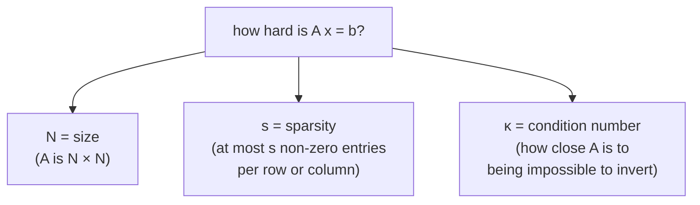

#linear_systems #condition_number #classical_algorithms
solving $A\vec x=\vec b$, and how hard that is for normal computers. the setup for a **quantum** algorithm for huge linear systems ([[HHL algorithm]]), which uses the [[Hamiltonian simulation]] algorithms. part of [[Realistic quantum computation]]
## the problem
we want unknowns $x_1,x_2,\ldots,x_N$ ([[Complex numbers|complex numbers]], but real works too) that make **all** the equations true at once, eg.
$$
3x_1+x_3=5\qquad x_2-ix_3=0\qquad\ldots
$$
it's neater as a matrix equation
$$
A\,\vec x=\vec b
$$
- $A$: an $N\times N$ matrix we're **given**
- $\vec x$: the vector of **unknowns**
- $\vec b$: a vector we're **given**
## the 3 numbers that decide how hard it is

### sparsity $s$
most useful big matrices are **mostly zeros**. $s$ can be as big as $N$ (a "dense" matrix), but often it's small, and algorithms can use that to be much faster
### condition number $\kappa$
$$
\kappa=\frac{\text{largest singular value of }A}{\text{smallest singular value of }A}
$$
(singular values are like [[Eigenvalues and eigenvectors|eigenvalues]] for any matrix: how much $A$ stretches things in each direction)
- a [[Unitary Operation|unitary]] matrix has $\kappa=1$, the smallest possible (it doesn't stretch anything)
- as $A$ gets closer to **not invertible**, $\kappa\to\infty$
- scaling $A$ by a number doesn't change $\kappa$

> [!important] κ = how unstable the answer is
> ==if you nudge $\vec b$ a tiny bit, how much does $\vec x$ change?==
> - small $\kappa$ → small change in $\vec b$ gives a small change in $\vec x$ ✓
> - big $\kappa$ → some tiny changes in $\vec b$ give **huge** changes in $\vec x$ ✗

> [!example] try it (checked numerically)
>
> | $A$ | $\kappa$ | $\vec x$ | after changing $b_2$ by $0.001$ |
> |---|---|---|---|
> | $\begin{bmatrix}2&0\\0&1\end{bmatrix}$ | 2 | $(1,\ 1)$ | $(1,\ 1.001)$, barely moves |
> | $\begin{bmatrix}1&1\\1&1.001\end{bmatrix}$ | about 4000 | $(1,\ 1)$ | $(0,\ 2)$, completely different! |
>
> the second matrix is almost not invertible (its 2 rows are nearly the same), so its $\kappa$ is huge

## classical algorithm 1: iterative solvers
start with a guess and **keep improving** it. easiest to think of as **minimizing** how wrong you are
$$
\min_{\vec x}\ \|A\vec x-\vec b\|
$$
(this is even useful when there's **no** exact answer, eg. **linear regression**: finding the best straight line through data points)

the error is shaped like a giant bowl, so **gradient descent** (keep walking downhill) finds the bottom

![[Gradient_descent_condition.png]]
the level sets are ellipses, and $\kappa$ is how **stretched** they are (longest axis ÷ shortest). the more stretched, the more gradient descent **zigzags**, and the slower it gets to the middle

| | cost |
|---|---|
| number of steps to get within error $\epsilon$ | $\kappa\log\frac1\epsilon$ |
| each step: multiply $A$ by a vector | $Ns$ (the number of non-zero entries) |
| **total** | $O\!\left(Ns\,\kappa\log\frac1\epsilon\right)$ |

$\log\frac1\epsilon$ isn't bad, but it grows **linearly with $\kappa$**, which is why $\kappa$ measures how hard the problem is
### worked example: conjugate gradient, step by step
**conjugate gradient** is the smart version of gradient descent that real solvers use: each step goes downhill, but in a direction that doesn't undo the earlier steps, so an $N\times N$ system is solved in at most $N$ steps
$$
\begin{aligned}
4x_1+x_2&=1\\
x_1+3x_2&=2
\end{aligned}
\qquad\Longrightarrow\qquad
A=\begin{bmatrix}4&1\\1&3\end{bmatrix}\qquad\vec b=\begin{bmatrix}1\\2\end{bmatrix}\qquad\text{start guess: }\vec x_0=\begin{bmatrix}0\\0\end{bmatrix}
$$
**the 3 things it keeps track of**
- $\vec x$: the current guess
- $\vec r=\vec b-A\vec x$: the **residual**, how wrong the guess is (it's also the downhill direction). $\vec r=\vec0$ means solved
- $\vec p$: the direction it'll walk next

**the recipe** (repeat until $\vec r=\vec0$)
$$
\begin{aligned}
&\text{1. how far to walk:}&&\alpha=\frac{\vec r\cdot\vec r}{\vec p\cdot A\vec p}&&\text{(the exact distance to the lowest point along }\vec p)\\
&\text{2. walk:}&&\vec x_{\text{new}}=\vec x+\alpha\vec p\\
&\text{3. new residual:}&&\vec r_{\text{new}}=\vec r-\alpha A\vec p&&\text{(cheaper than recomputing }\vec b-A\vec x)\\
&\text{4. new direction:}&&\vec p_{\text{new}}=\vec r_{\text{new}}+\beta\,\vec p,\quad\beta=\frac{\vec r_{\text{new}}\cdot\vec r_{\text{new}}}{\vec r\cdot\vec r}&&\text{(downhill, bent so it doesn't undo the last step)}
\end{aligned}
$$
**step 1**

1a. the residual of the starting guess, and the first direction (just straight downhill)
$$
\vec r_0=\vec b-A\vec x_0=\begin{bmatrix}1\\2\end{bmatrix}-\begin{bmatrix}0\\0\end{bmatrix}=\begin{bmatrix}1\\2\end{bmatrix}\qquad\vec p_0=\vec r_0=\begin{bmatrix}1\\2\end{bmatrix}
$$
1b. multiply $A$ by the direction (row times column)
$$
A\vec p_0=\begin{bmatrix}4\cdot1+1\cdot2\\1\cdot1+3\cdot2\end{bmatrix}=\begin{bmatrix}6\\7\end{bmatrix}
$$
1c. how far
$$
\vec r_0\cdot\vec r_0=1^2+2^2=5\qquad\vec p_0\cdot A\vec p_0=1\cdot6+2\cdot7=20\qquad\alpha_0=\frac5{20}=0.25
$$
1d. walk, and the new residual
$$
\begin{aligned}
\vec x_1&=\begin{bmatrix}0\\0\end{bmatrix}+0.25\begin{bmatrix}1\\2\end{bmatrix}=\begin{bmatrix}0.25\\0.5\end{bmatrix}\\
\vec r_1&=\begin{bmatrix}1\\2\end{bmatrix}-0.25\begin{bmatrix}6\\7\end{bmatrix}=\begin{bmatrix}1-1.5\\2-1.75\end{bmatrix}=\begin{bmatrix}-0.5\\0.25\end{bmatrix}
\end{aligned}
$$
not zero yet, so keep going

**step 2**

2a. the new direction
$$
\begin{aligned}
\vec r_1\cdot\vec r_1&=0.25+0.0625=0.3125\qquad\beta_0=\frac{0.3125}{5}=0.0625\\
\vec p_1&=\begin{bmatrix}-0.5\\0.25\end{bmatrix}+0.0625\begin{bmatrix}1\\2\end{bmatrix}=\begin{bmatrix}-0.4375\\0.375\end{bmatrix}
\end{aligned}
$$
2b. multiply by $A$
$$
A\vec p_1=\begin{bmatrix}4(-0.4375)+1(0.375)\\1(-0.4375)+3(0.375)\end{bmatrix}=\begin{bmatrix}-1.375\\0.6875\end{bmatrix}
$$
2c. how far
$$
\vec p_1\cdot A\vec p_1=(-0.4375)(-1.375)+(0.375)(0.6875)=0.6016+0.2578=0.8594\qquad\alpha_1=\frac{0.3125}{0.8594}\approx0.364
$$
2d. walk
$$
\vec x_2=\begin{bmatrix}0.25\\0.5\end{bmatrix}+0.364\begin{bmatrix}-0.4375\\0.375\end{bmatrix}=\begin{bmatrix}0.25-0.159\\0.5+0.136\end{bmatrix}=\begin{bmatrix}0.0909\\0.6364\end{bmatrix}=\begin{bmatrix}\frac1{11}\\\frac7{11}\end{bmatrix}
$$
**check** in the original equations: $4\cdot\frac1{11}+\frac7{11}=\frac{11}{11}=1$ ✅ and $\frac1{11}+3\cdot\frac7{11}=\frac{22}{11}=2$ ✅

exact after **2 steps** for a $2\times2$ (checked numerically). each step is just one multiplication by $A$ plus a few dot products, which is cheap when $A$ is sparse. for huge $N$ you stop early once $\vec r$ is small enough, after about $\sqrt\kappa\log\frac1\epsilon$ steps
## classical algorithm 2: direct solvers
the method from school: **Gaussian elimination** (or LU decomposition). better with $\kappa$, but much worse with size
$$
O(N^3)
$$
great for small systems, but way too slow for huge ones, so big problems use iterative solvers
### worked example: Gaussian elimination, step by step
$$
\begin{aligned}
2x+y-z&=8&&(R_1)\\
-3x-y+2z&=-11&&(R_2)\\
-2x+y+2z&=-3&&(R_3)
\end{aligned}
$$
**the idea**: adding a multiple of one equation to another keeps every equation true (you're adding equal things to both sides). use that to make a "staircase" where the last equation has only $z$

**forward step 1: remove $x$ from $R_2$ and $R_3$** using $R_1$ (its $x$ coefficient, $2$, is the "pivot")
- $R_2$ has $-3x$. to cancel it, add $\frac32R_1$ (because $\frac32\times2x=3x$)
$$
\begin{aligned}
\tfrac32R_1:&\quad3x+1.5y-1.5z=12\\
R_2+\tfrac32R_1:&\quad(-3+3)x+(-1+1.5)y+(2-1.5)z=-11+12\\
&\quad0.5y+0.5z=1&&(R_2')
\end{aligned}
$$
- $R_3$ has $-2x$. add $1\times R_1$
$$
\begin{aligned}
R_3+R_1:&\quad(-2+2)x+(1+1)y+(2-1)z=-3+8\\
&\quad2y+z=5&&(R_3')
\end{aligned}
$$
**forward step 2: remove $y$ from $R_3'$** using $R_2'$ (pivot $0.5$). $R_3'$ has $2y$, and $2=4\times0.5$, so subtract $4R_2'$
$$
\begin{aligned}
4R_2':&\quad2y+2z=4\\
R_3'-4R_2':&\quad(2-2)y+(1-2)z=5-4\\
&\quad-z=1&&(R_3'')
\end{aligned}
$$
**the staircase** (each row has one fewer unknown)
$$
\begin{aligned}
2x+y-z&=8\\
0.5y+0.5z&=1\\
-z&=1
\end{aligned}
$$
**backwards: solve from the bottom up**, plugging in what you already know
$$
\begin{aligned}
-z=1&\ \Rightarrow\ z=-1\\
0.5y+0.5(-1)=1\ \Rightarrow\ 0.5y=1.5&\ \Rightarrow\ y=3\\
2x+3-(-1)=8\ \Rightarrow\ 2x+4=8&\ \Rightarrow\ x=2
\end{aligned}
$$
**check** all 3: $R_1$: $4+3+1=8$ ✅, $R_2$: $-6-3-2=-11$ ✅, $R_3$: $-4+3-2=-3$ ✅

**why it costs $N^3$**: for each of the $N$ columns, you update every row below it (up to $N$ rows), each with up to $N$ numbers: about $N\times N\times N$, more precisely $\frac{N^3}3$ multiplications. $N=3$ is nothing, but $N=10^6$ is $3\times10^{17}$
## comparing

| | time | good for |
|---|---|---|
| iterative (eg. gradient descent) | $O(Ns\,\kappa\log\frac1\epsilon)$ | **huge**, sparse, well conditioned systems |
| direct (Gaussian elimination, LU) | $O(N^3)$ | small systems |

either way the time grows at least with $N$, because you have to at least **write down** all $N$ numbers of $\vec x$. the quantum algorithm ([[HHL algorithm]]) gets around that in a clever (but catchy) way, coming next

see also [[Realistic quantum computation]], [[Eigenvalues and eigenvectors]]
