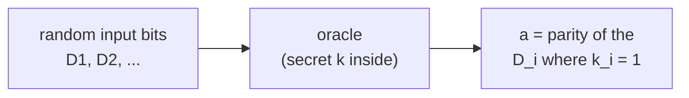
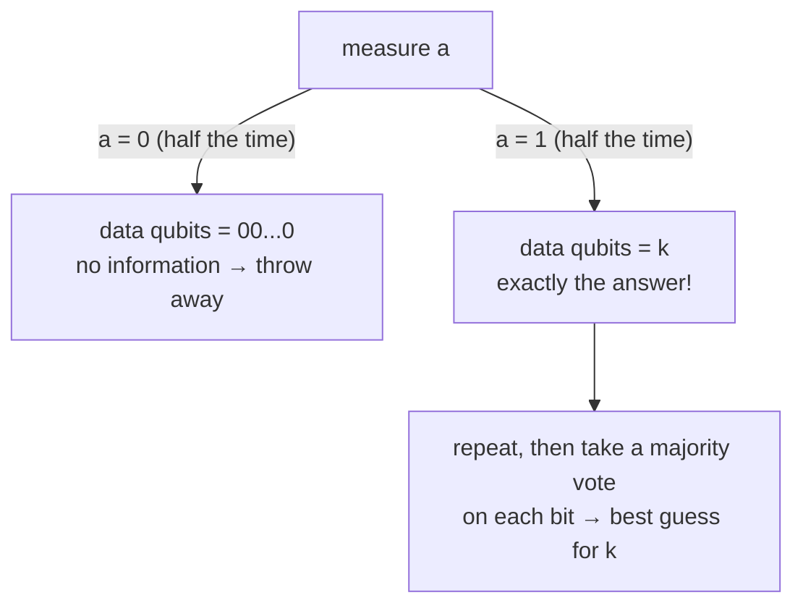
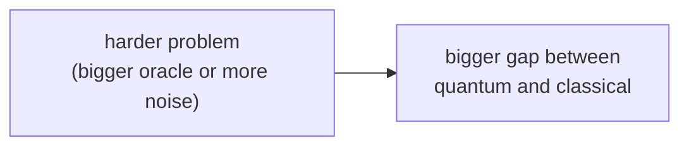

#NISQ #quantum_advantage #quantum_machine_learning #LPN
an experiment (Raytheon BBN + IBM) that showed a **clear quantum advantage** using only **a few, very noisy** qubits. part of [[Realistic quantum computation]], a real example of what [[NISQ]] machines can do
## the problem: learning parity with noise (LPN)
there's a black box (an **oracle**) with a secret bit string $k$ hidden inside. you feed it random input bits $D$ and it gives back one result bit $a$
$$
a=D\cdot k\bmod2=\bigoplus_{i:\,k_i=1}D_i
$$
in words: it looks at the input bits $D_i$ where $k_i=1$, and outputs their **parity** (XOR, see [[Modular arithmetic#mod 2 and XOR]])

the goal: figure out $k$ by watching what the oracle does

### example: 2 bits, $k=11$

| $D_1$ | $D_2$ | $a$ |
|---|---|---|
| 0 | 0 | 0 |
| 0 | 1 | 1 |
| 1 | 0 | 1 |
| 1 | 1 | 0 |

after a few tries it's obvious that $a=D_1\oplus D_2$, so $k=11$
### with noise it gets hard
now say any of $D_1$, $D_2$ or $a$ gets **flipped** by accident sometimes. the pattern gets buried, and classically the number of queries you need grows **nearly exponentially** with the amount of noise
## the quantum oracle
the same oracle as a quantum circuit: data qubits $D_1\ldots D_n$ and one result qubit $a$
![[LPN_oracle_circuit.png]]
(a CNOT from every $D_i$ with $k_i=1$ onto $a$, drawn here for $k=11$)
- the [[Hadamard Gate|Hadamards]] put the inputs in an equal superposition of **every** input at once
- a [[CNOT gate|CNOT]] from each $D_i$ with $k_i=1$ onto $a$ writes the parity into $a$, exactly like the classical oracle
### the hardware
an IBM **5 qubit** superconducting chip. each qubit has a microwave resonator for control and readout. the middle qubit is $a$, and it's connected to the other 4 through extra resonators, which is what makes the CNOTs possible
## 2 ways to learn $k$
![[LPN_outcomes.png]]
(the ideal outcomes for the course's example, $k=11$, checked numerically. classical: 4 outcomes at $\frac14$ each, which on their own say little. quantum: half the time you get the key directly)
### classical learner
measure everything after each query and collect the (classical) results, then find the $k$ that fits the data best. even though the oracle is quantum, the **learning is completely classical**
> [!example] the classical learner, step by step ($n=3$, secret $k=101$)
> **the mod 2 rules** (only 0 and 1 exist): $0+0=0$, $0+1=1$, $1+1=0$. so subtracting is the same as adding ($-1=1$)
>
> **1. each query is one equation.** the oracle returns $a=D\cdot k=D_1k_1+D_2k_2+D_3k_3\pmod2$, and wherever $D_i=0$ that term drops out
> $$
> \begin{aligned}
> D=110,\ a=1:&\quad1k_1+1k_2+0k_3=1\ \Rightarrow\ k_1+k_2=1\\
> D=011,\ a=1:&\quad0k_1+1k_2+1k_3=1\ \Rightarrow\ k_2+k_3=1\\
> D=111,\ a=0:&\quad1k_1+1k_2+1k_3=0\ \Rightarrow\ k_1+k_2+k_3=0
> \end{aligned}
> $$
> **2. Gaussian elimination, mod 2.** take the 3rd equation minus the 1st: the $k_1$ and $k_2$ cancel
> $$
> \begin{aligned}
> (k_1+k_2+k_3)-(k_1+k_2)&=0-1\\
> k_3&=-1=1\pmod2
> \end{aligned}
> $$
> **3. back substitute**
> $$
> \begin{aligned}
> \text{2nd: }k_2+1=1&\ \Rightarrow\ k_2=0\\
> \text{1st: }k_1+0=1&\ \Rightarrow\ k_1=1
> \end{aligned}
> $$
> so $k=101$ ✅. check every query: $110\cdot101=1+0+0=1$ ✅, $011\cdot101=0+0+1=1$ ✅, $111\cdot101=1+0+1=2=0$ ✅. without noise, $n$ independent queries are enough
>
> **4. now add noise**: say the 3rd answer gets flipped, $a=1$ instead of $0$. redo the same steps
> $$
> k_3=1-1=0\qquad k_2=1-0=1\qquad k_1=1-1=0\qquad\Rightarrow\ k=010\ ✗
> $$
> the nasty part: $010$ fits **all 3** (wrong) answers perfectly ($110\cdot010=1$, $011\cdot010=1$, $111\cdot010=1$), so nothing warns you
>
> **5. the classical fix: more queries + vote.** add 2 more (both correct): $D=100,\ a=1$ and $D=001,\ a=1$. now score each possible key by how many of the 5 answers it agrees with
>
> | candidate | $110\to1$ | $011\to1$ | $111\to1$ (flipped) | $100\to1$ | $001\to1$ | agrees |
> |---|---|---|---|---|---|---|
> | $101$ | ✅ | ✅ | ✗ | ✅ | ✅ | **4/5** |
> | $010$ | ✅ | ✅ | ✅ | ✗ | ✗ | 3/5 |
>
> $101$ wins. but to be sure you have to score **every** candidate, and there are $2^n$ of them (8 here, but $2^{100}$ for 100 bits). that's why LPN is hard classically, while the quantum learner just reads $k$ off directly and majority votes each bit separately

### quantum learner
before measuring, do **one more** [[Hadamard Gate|Hadamard]] on **every** qubit. the state becomes entangled between $a$ and the data qubits
$$
\frac1{\sqrt2}\Big(|0\ldots0\rangle|0\rangle_a+|k\rangle|1\rangle_a\Big)
$$

(checked numerically for $k=01,10,11,101$: exactly 50% "$a=0$, data all 0" and 50% "$a=1$, data $=k$")

> [!note] same trick as Bernstein–Vazirani
> "Hadamards, oracle, Hadamards, read off the secret string" is the idea behind the [[Bernstein-Vazirani algorithm]]

## the results
- **2 data bits**: both learners do about the same for $k=00, 01, 10$. for $k=11$ (the hardest, with 2 noisy CNOTs) the quantum learner starts to pull ahead
- **3 data bits**: the quantum learner keeps its advantage and the **gap grows** with the size of the oracle
- **extra noise** on reading out $a$ (probability $\eta$): the queries needed for 1% error grow only **slowly** for the quantum learner, but up to **100×** (2 orders of magnitude) for the classical one

> [!important] why it matters
> a real experimental **quantum advantage** with today's noisy hardware, and the advantage gets **bigger** as the problem gets harder, either with a bigger oracle or more noise. the quantum learner is naturally robust because it just throws away the useless runs and majority votes on the rest

## further reading
> [!quote]- Ristè et al. 2017: Demonstration of quantum advantage in machine learning
> *npj Quantum Information* **3**, 16 (2017), https://doi.org/10.1038/s41534-017-0017-3 ([arXiv:1512.06069](https://arxiv.org/abs/1512.06069)). the paper behind the experiment in this lecture (Raytheon BBN + IBM)
> - a **5 qubit superconducting** processor runs the oracle $f(D,k)=D\cdot k\bmod2$ on random inputs, with oracles of $n=2$, 3 and 4 data qubits
> - classical (C) and quantum (Q) learners get the **same** oracle. C just reads the outputs, Q applies Hadamards before measuring
> - Q needs far fewer queries for the same error, and the gap **grows** with more noise and with bigger $n$: at $n=3$ the best classical solver needs almost **10×** more queries
> - a trick that helped both: use the **analog** measurement signals instead of rounding each one to 0/1, then average before deciding each bit
> - in theory: Q needs a **logarithmic** number of queries and linear runtime, C needs a **linear** number of queries and nearly exponential runtime
> - takeaway: a quantum advantage can appear in today's noisy hardware, before full error correction
>
> ![[Riste 2017 - Demonstration of quantum advantage in machine learning.pdf#height=500]]

see also [[NISQ]], [[Quantum volume]], [[Quantum machine learning]]
