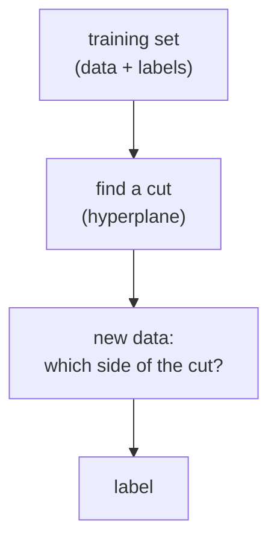
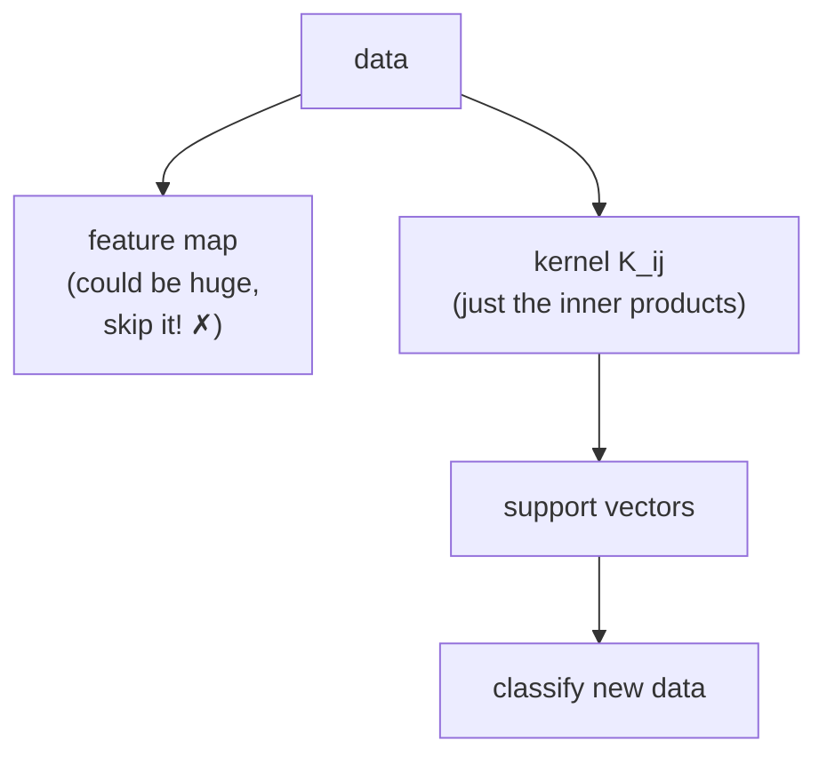

#machine_learning #SVM #classification #kernel
the classical machine learning method that the [[Quantum kernel SVM]] builds on. part of [[Quantum machine learning]]
## the problem: classification
- the data: vectors with $n$ numbers each (the **features**)
- each one belongs to one of **2 classes**
- we get a **training set** where we know the labels, and want to label **new** data

if the data is **linearly separable**, a flat cut (a line in 2D, a plane in 3D, a **hyperplane** in general) can split the 2 classes
## which cut is best?
lots of cuts can separate the training set. a **support vector machine** (SVM) picks the one that's **as far as possible** from the closest points of both classes (the biggest **margin**), so it's most likely to get new data right

![[SVM_margin.png]]
> [!important] support vectors
> ==the points **closest** to the cut are the hardest to classify, and they're the only ones that decide where the cut goes.== they're called the **support vectors** (that's where the name comes from). find them and you've found the cut

### worked example: training an SVM by hand
class $-1$: $(0,0),(1,0),(0,1)$. class $+1$: $(2,2),(3,2),(2,3)$

**1. find the closest points across the gap.** both groups sit along the diagonal, so measure each point by $x_1+x_2$ (how far along the diagonal it is)

| point | class | $x_1+x_2$ |
|---|---|---|
| $(0,0)$ | $-1$ | 0 |
| $(1,0)$ | $-1$ | **1** |
| $(0,1)$ | $-1$ | **1** |
| $(2,2)$ | $+1$ | **4** |
| $(3,2)$ | $+1$ | 5 |
| $(2,3)$ | $+1$ | 5 |

the $-1$ class reaches up to 1, the $+1$ class starts at 4. the points at the edges, $(1,0)$, $(0,1)$ and $(2,2)$, are the **support vectors**

**2. guess the direction of $\vec w$.** $\vec w$ points **across** the gap (it's perpendicular to the cut). the gap is along the diagonal, so $\vec w=(a,a)$ for some number $a$. then $\vec w\cdot\vec x=a(x_1+x_2)$

**3. put the support vectors exactly on the margin lines.** the SVM rule is $\vec w\cdot\vec x+b=+1$ for the closest $+1$ points and $-1$ for the closest $-1$ points
$$
\begin{aligned}
(2,2):&\quad a(2+2)+b=+1\ \Rightarrow\ 4a+b=1\\
(1,0):&\quad a(1+0)+b=-1\ \Rightarrow\ a+b=-1\\
\text{subtract the 2nd from the 1st}:&\quad3a=2\ \Rightarrow\ a=\tfrac23\\
\text{put back into }a+b=-1:&\quad b=-1-\tfrac23=-\tfrac53
\end{aligned}
$$
so $\vec w=(\frac23,\frac23)$ and $b=-\frac53$. the cut is where $\vec w\cdot\vec x+b=0$: $\frac23(x_1+x_2)=\frac53$, ie. the line $x_1+x_2=2.5$, exactly halfway between 1 and 4

**4. check every point** obeys $y_i(\vec w\cdot\vec x_i+b)\geq1$ (right side of the cut, and not inside the margin)
$$
\begin{aligned}
(0,0),\ y=-1:&\quad-1\cdot\big(\tfrac23\cdot0-\tfrac53\big)=\tfrac53\geq1\ ✅\\
(1,0),(0,1),\ y=-1:&\quad-1\cdot\big(\tfrac23\cdot1-\tfrac53\big)=-1\cdot(-1)=1\ ✅\ \text{(exactly on the margin)}\\
(2,2),\ y=+1:&\quad\tfrac23\cdot4-\tfrac53=\tfrac83-\tfrac53=1\ ✅\ \text{(exactly on the margin)}\\
(3,2),(2,3),\ y=+1:&\quad\tfrac23\cdot5-\tfrac53=\tfrac{10}3-\tfrac53=\tfrac53\ ✅
\end{aligned}
$$
**5. the margin**
$$
\|\vec w\|=\sqrt{\big(\tfrac23\big)^2+\big(\tfrac23\big)^2}=\tfrac23\sqrt2\qquad\text{margin}=\frac2{\|\vec w\|}=\frac2{\frac23\sqrt2}=\frac3{\sqrt2}\approx2.12
$$
sanity check: the distance between the parallel lines $x_1+x_2=1$ and $x_1+x_2=4$ is $\frac{4-1}{\sqrt{1^2+1^2}}=\frac3{\sqrt2}$ ✅

**6. classify new points**: work out $\vec w\cdot\vec x+b$ and look at the sign
$$
(2,0):\ \tfrac23\cdot2-\tfrac53=-\tfrac13<0\ \to\ \text{class }-1\qquad(2,1):\ \tfrac23\cdot3-\tfrac53=+\tfrac13>0\ \to\ \text{class }+1
$$
> [!note] the same answer in kernel form
> the theory says $\vec w=\sum_i\alpha_iy_i\vec x_i$, with $\alpha_i\neq0$ only for support vectors, and $\sum_i\alpha_iy_i=0$
> 1. by symmetry $(1,0)$ and $(0,1)$ get the same $\alpha$; call it $\alpha$, and call $(2,2)$'s one $\beta$
> 2. $\sum\alpha_iy_i=0$: $-\alpha-\alpha+\beta=0$, so $\beta=2\alpha$
> 3. match $\vec w$: $-\alpha(1,0)-\alpha(0,1)+\beta(2,2)=(-\alpha+2\beta,\ -\alpha+2\beta)=(3\alpha,3\alpha)$, which must be $(\frac23,\frac23)$, so $\alpha=\frac29$ and $\beta=\frac49$
>
> so $f(\vec x)=\text{sign}\big(\sum_i\alpha_iy_i\,\vec x_i\cdot\vec x+b\big)$, and swapping $\vec x_i\cdot\vec x$ for a kernel $K(\vec x_i,\vec x)$ is the whole kernel trick. real software finds the $\alpha_i$ by solving this optimisation iteratively (eg. the SMO algorithm), since by hand only works for tiny examples (all checked numerically)

## when a flat cut doesn't work: feature maps
some data can't be split with a flat cut. the trick: **map** the data into more dimensions until it can be
![[Feature_map_1D_to_2D.png]]
this is called a **feature map**. the harder the problem, the bigger the new space might need to be
## the kernel trick
to classify you don't actually need to know **where** each point ends up, only **how close** the points are to each other

the tool for "how close" is the **inner product** (like $\langle\phi|\psi\rangle$ in [[Math/Dirac notation]])

> [!important] the kernel
> ==the **kernel** is the table of inner products between every pair of training points, **after** the feature map==
> $$
> K_{ij}=\langle\phi(x_i),\phi(x_j)\rangle
> $$
> - it's a symmetric matrix with no negative [[Eigenvalues and eigenvectors|eigenvalues]] (positive semidefinite)
> - if you can get the kernel, you **never have to do the feature map itself**
> - from the kernel you can find the support vectors, and then classify anything

the only hard part is **getting the kernel**. that's where a quantum computer can help, see [[Quantum kernel SVM]]

see also [[Quantum kernel SVM]], [[Quantum machine learning]]
