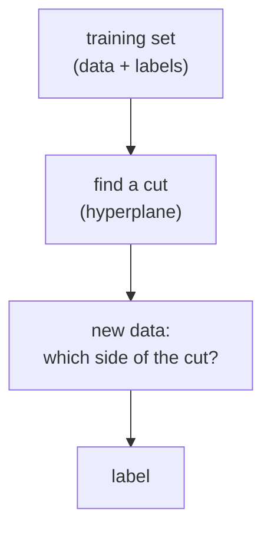
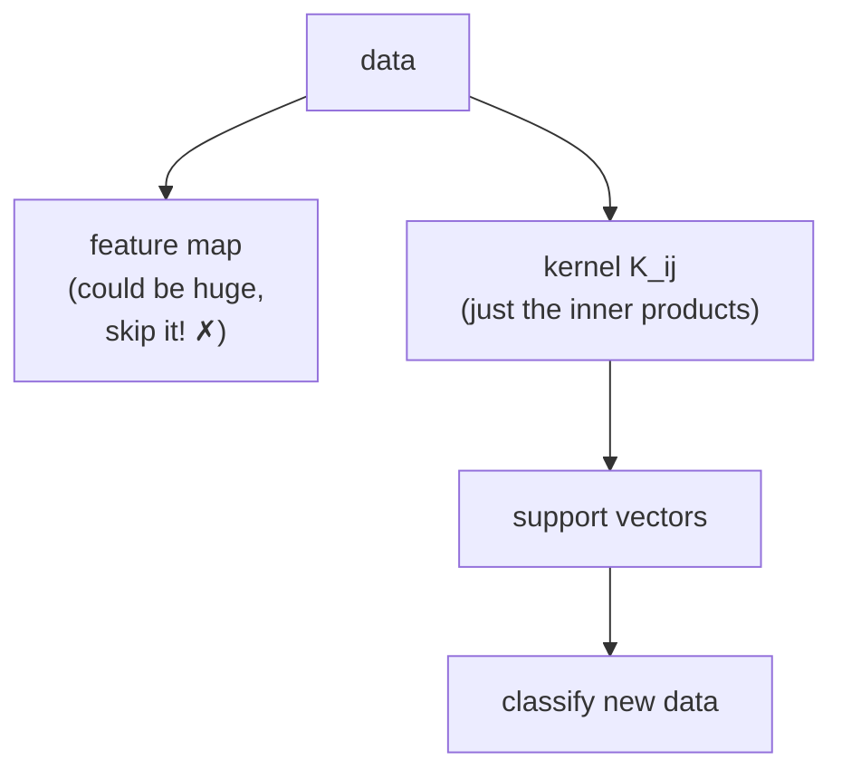

#machine_learning #SVM #classification #kernel
the classical machine learning method that the [[Quantum kernel SVM]] builds on. part of [[Quantum machine learning]]
## the problem: classification
- the data: vectors with $n$ numbers each (the **features**)
- each one belongs to one of **2 classes**
- we get a **training set** where we know the labels, and want to label **new** data

if the data is **linearly separable**, a flat cut (a line in 2D, a plane in 3D, a **hyperplane** in general) can split the 2 classes
## which cut is best?
lots of cuts can separate the training set. a **support vector machine** (SVM) picks the one that's **as far as possible** from the closest points of both classes (the biggest **margin**), so it's most likely to get new data right

![[SVM_margin.png]]
> [!important] support vectors
> ==the points **closest** to the cut are the hardest to classify, and they're the only ones that decide where the cut goes.== they're called the **support vectors** (that's where the name comes from). find them and you've found the cut
### worked example: training an SVM by hand
class $-1$: $(0,0),(1,0),(0,1)$. class $+1$: $(2,2),(3,2),(2,3)$

**1. find the closest points across the gap**: $(1,0)$ and $(0,1)$ (with $x_1+x_2=1$) and $(2,2)$ (with $x_1+x_2=4$). these will be the support vectors

**2. guess the direction**: the closest points are lined up along $x_1+x_2$, so $\vec w=(a,a)$

**3. put the support vectors exactly on the margin** ($\vec w\cdot\vec x+b=\pm1$)
$$
\begin{aligned}
(2,2):&\quad4a+b=+1\\
(1,0):&\quad a+b=-1\\
\text{subtract}:&\quad3a=2\ \Rightarrow\ a=\tfrac23,\ b=-\tfrac53
\end{aligned}
$$
so the cut is $\frac23x_1+\frac23x_2-\frac53=0$, ie. the line $x_1+x_2=2.5$, halfway across the gap

**4. check every point** has $y_i(\vec w\cdot\vec x_i+b)\geq1$: $(0,0)\to\frac53$, $(1,0),(0,1),(2,2)\to1$ (the support vectors, exactly on the margin), $(3,2),(2,3)\to\frac53$ ✅

**5. the margin**: $\frac2{\|\vec w\|}=\frac2{\frac23\sqrt2}=\frac3{\sqrt2}\approx2.12$, the same as the distance between the lines $x_1+x_2=1$ and $x_1+x_2=4$ ✅

**6. classify new points**: $(2,0)\to\frac43-\frac53=-\frac13<0$, class $-1$. $(2,1)\to2-\frac53=+\frac13>0$, class $+1$

> [!note] the same answer in kernel form
> $\vec w=\sum_i\alpha_iy_i\vec x_i$ with only the support vectors: $\alpha=\frac29$ for $(1,0)$ and $(0,1)$, $\frac49$ for $(2,2)$. check: $-\frac29(1,0)-\frac29(0,1)+\frac49(2,2)=(\frac23,\frac23)$ ✅. so $f(\vec x)=\text{sign}\big(\sum_i\alpha_iy_i\,\vec x_i\cdot\vec x+b\big)$, and swapping $\vec x_i\cdot\vec x$ for a kernel $K(\vec x_i,\vec x)$ is the whole kernel trick. real software finds the $\alpha_i$ by solving this optimisation iteratively (eg. the SMO algorithm), since by hand only works for tiny examples (all checked numerically)
## when a flat cut doesn't work: feature maps
some data can't be split with a flat cut. the trick: **map** the data into more dimensions until it can be
![[Feature_map_1D_to_2D.png]]
this is called a **feature map**. the harder the problem, the bigger the new space might need to be
## the kernel trick
to classify you don't actually need to know **where** each point ends up, only **how close** the points are to each other

the tool for "how close" is the **inner product** (like $\langle\phi|\psi\rangle$ in [[Math/Dirac notation]])

> [!important] the kernel
> ==the **kernel** is the table of inner products between every pair of training points, **after** the feature map==
> $$
> K_{ij}=\langle\phi(x_i),\phi(x_j)\rangle
> $$
> - it's a symmetric matrix with no negative [[Eigenvalues and eigenvectors|eigenvalues]] (positive semidefinite)
> - if you can get the kernel, you **never have to do the feature map itself**
> - from the kernel you can find the support vectors, and then classify anything

the only hard part is **getting the kernel**. that's where a quantum computer can help, see [[Quantum kernel SVM]]

see also [[Quantum kernel SVM]], [[Quantum machine learning]]
