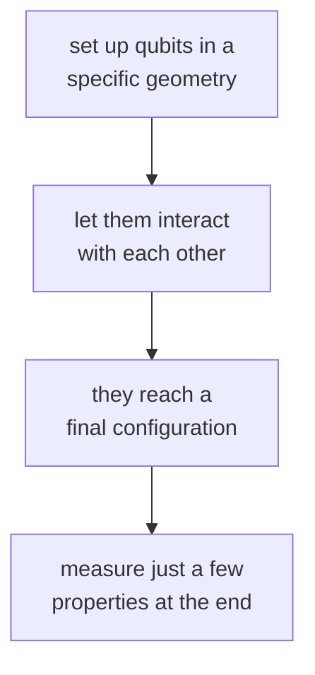
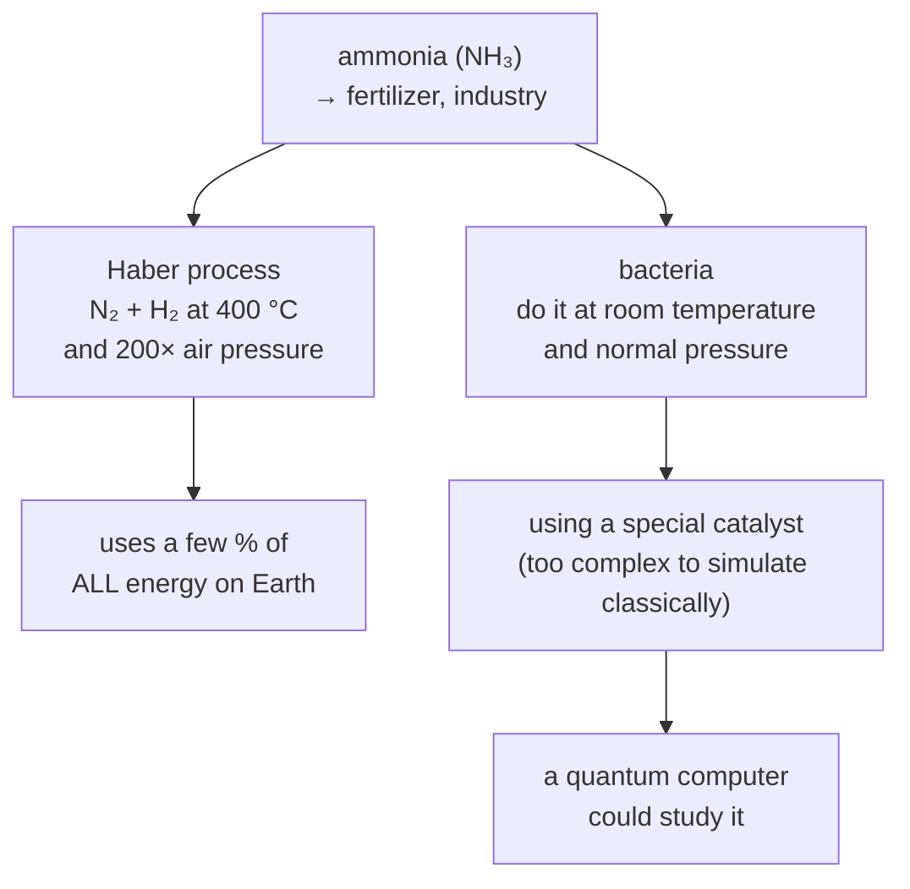

#quantum_simulation #NISQ #quantum_chemistry
using a quantum computer to simulate **other quantum systems** (molecules, materials...), Feynman's original idea and one of the best bets for useful [[NISQ]] computers. part of [[Realistic quantum computation]]
## where the hardware is
- quantum mechanics works for **big** things too, not just atoms, eg. electrical circuits made of superconducting metal ([[Superconducting qubits]])
- in about 10 years their coherence times went from a **few nanoseconds** to almost a **millisecond**
- they act like real qubits: they can be in a superposition, and measuring collapses it

> [!question] so why not just print thousands of them?
> Feynman said there's "plenty of room at the bottom" (lots of space at the nano scale for qubits), but there **isn't much room at the top**: every qubit needs wires and electronics, and fitting all of those in gets really hard, even at ~100 qubits
>
> so a universal, error-corrected quantum computer is still **several orders of magnitude** away in qubit count and lifetime. meanwhile, people look for algorithms that work on NISQ hardware

## the idea

- the quantum hardware **is** the system being simulated, so you never have to write down every possible arrangement
- a classical computer **would** have to track them all, which needs an exponentially large amount of numbers. that's the basic reason these problems are impossible classically
- the quantum simulator only needs you to measure a **few** properties at the end
## what it could simulate
- energy levels (**spectra**) of **molecules**
- complex materials like **high temperature superconductors** and **quantum magnets**
- how energy moves in natural and artificial **light harvesting** systems (like in photosynthesis)
- even models of the **cosmos**, testing ideas from quantum field theory and gravity
## why classical computers can't keep up
### example: a tiny bit of matter
a grid of **80 electrons**, each described with **100 orbitals** (treating them as distinguishable particles for now). describing every arrangement takes
$$
100^{80}=10^{160}\text{ numbers}
$$

| | how many |
|---|---|
| particles in a mole (a handful of stuff) | $\approx6\times10^{23}$ |
| particles in the **whole universe** | $\approx10^{80}$ |
| numbers to describe 80 electrons | $10^{160}$ |

that's more numbers than there are particles in the universe, **squared**
### how a classical computer simulates qubits, step by step
store all $2^n$ amplitudes in a list, and multiply by each gate's matrix. making a Bell state on 2 qubits:

**1. the starting list.** 2 qubits have 4 basis states, always in the order $|00\rangle,|01\rangle,|10\rangle,|11\rangle$. starting in $|00\rangle$ means all the amplitude is on the first one
$$
\vec\psi=(1,0,0,0)
$$
**2. build the matrix for "$H$ on qubit 1, nothing on qubit 2"**: that's $H\otimes I$ ([[Tensor product]]: each entry of $H$ times a whole copy of $I$)
$$
H\otimes I=\frac1{\sqrt2}\begin{bmatrix}1\cdot I&1\cdot I\\1\cdot I&-1\cdot I\end{bmatrix}=\frac1{\sqrt2}\begin{bmatrix}1&0&1&0\\0&1&0&1\\1&0&-1&0\\0&1&0&-1\end{bmatrix}
$$
**3. multiply** (each new entry = a row of the matrix times the list; only the first column matters because the list is $(1,0,0,0)$)
$$
\frac1{\sqrt2}\begin{bmatrix}1&0&1&0\\0&1&0&1\\1&0&-1&0\\0&1&0&-1\end{bmatrix}\begin{bmatrix}1\\0\\0\\0\end{bmatrix}=\frac1{\sqrt2}\begin{bmatrix}1\\0\\1\\0\end{bmatrix}\qquad\text{ie. }\tfrac{|00\rangle+|10\rangle}{\sqrt2}
$$
(qubit 1 is now in $|+\rangle$, qubit 2 still $|0\rangle$)

**4. CNOT** (qubit 1 controls, qubit 2 flips): $|10\rangle\to|11\rangle$ and $|11\rangle\to|10\rangle$, while $|00\rangle,|01\rangle$ stay. in the list that just **swaps the 3rd and 4th entries**
$$
\tfrac1{\sqrt2}(1,0,\underbrace{1,0}_{\text{swap}})\ \to\ \tfrac1{\sqrt2}(1,0,0,1)=\frac{|00\rangle+|11\rangle}{\sqrt2}\ ✅\ \text{a Bell state}
$$
**5. measuring**: the chance of each outcome is its amplitude squared: $|00\rangle$ and $|11\rangle$ each $\frac12$, the others 0

**the cost**: every gate has to update **all** $2^n$ amplitudes, and storing them takes $16\times2^n$ bytes

| qubits | amplitudes | memory |
|---|---|---|
| 2 | 4 | 64 bytes |
| 30 | $\approx10^9$ | 17 GB (a big laptop) |
| 50 | $\approx10^{15}$ | 18 PB (the biggest supercomputers) |
| 80 | $\approx10^{24}$ | more than all the computer memory on Earth |

a quantum computer just **is** the state: 80 qubits hold all $2^{80}$ amplitudes for free
### what classical methods can do

| method | how big | catch |
|---|---|---|
| solving the Schrödinger equation exactly | **fewer than 10 atoms** | exact but tiny |
| [[Density functional theory]] (DFT) | way more atoms | **approximate**, not accurate for every material |
| the biggest supercomputers (petabytes of memory) | about **50 qubits** worth | memory runs out |
| clever tricks ([[Tensor networks|tensor networks]], renormalization group) | about **70** | still nowhere near real complex materials |

![[Classical_simulation_memory.png]]
every extra qubit **doubles** the memory needed ($2^n$ numbers, see [[Tensor product#for states]]). a laptop runs out around 30, the biggest supercomputers around 50 (checked: $2^{50}$ amplitudes × 16 bytes ≈ 18 petabytes)
## a grand challenge: making ammonia

> [!important] why it matters
> ==if a quantum computer could figure out how the bacteria's catalyst works, we might make fertilizer without the huge energy cost of the Haber process.== still some distance away from today's machines, but it would have a **huge** impact on the world

see also [[NISQ]], [[Realistic quantum computation]], [[VQE]]
