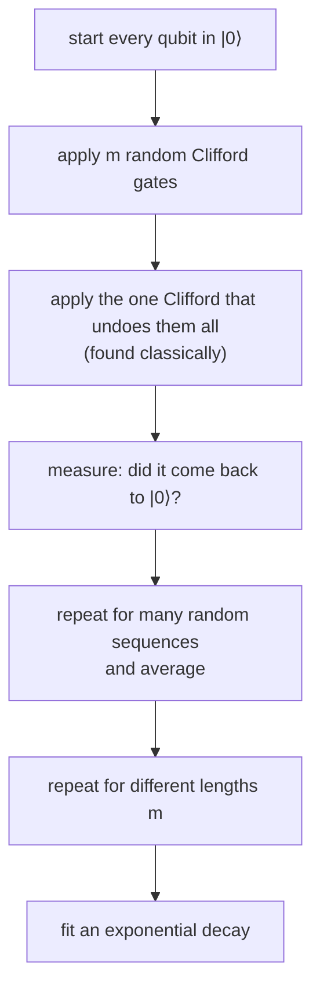

#benchmarking #randomized_benchmarking #gate_fidelity #clifford
a **scalable** way to check that gates work as they should, without fully characterizing them. it gives **one number**: the average fidelity of the gates. part of [[Benchmarking quantum systems]]
## why not just use tomography?
- [[Process tomography]] needs an **exponential** number of measurements ($16^n$ numbers in the process matrix)
- it has lots of built-in **assumptions**: it rebuilds a process from slices of data, and assumes you can prepare inputs and measure outputs perfectly
- often you don't need the whole process, just **how close** the gate is to the one you wanted: a grade, not a full report ([[Gate fidelity]])

randomized benchmarking (RB) gets that grade with far less work, and it isn't fooled by preparation and measurement errors
## the Clifford group
RB builds its circuits out of gates picked at random from the **[[Clifford group]]**
- it's a mathematical **group**: a sequence of Clifford gates is itself a Clifford gate
- it contains everyday gates: the $\pi$ pulse ([[X gate|X]]), the $\frac\pi2$ pulse, the [[Hadamard Gate|Hadamard]], and the 2 qubit [[CNOT gate|CNOT]]. it's enough to make a maximally entangled [[Bell states|Bell state]] ($H$ then CNOT)
- for 1 qubit there are exactly **24** of them (up to a global phase), all built from $H$ and $S$ (extra, checked numerically)

2 properties make it right for RB
> [!important] 1. easy to compute classically
> ==the gate a long sequence of Cliffords adds up to can be worked out quickly on a normal computer== (the [[Gottesman-Knill theorem]]). so you can always find the **one** Clifford that undoes the whole sequence
>
> the flip side: Cliffords alone **aren't** a universal gate set (anything you can simulate easily can't give a quantum speed up). add just the $T$ gate (a $\frac\pi4$ rotation about $z$, see [[Phase shift]]) and they are. so Cliffords are still a fair, representative set of gates to test

> [!important] 2. fair sampling of the Bloch sphere
> ==random Cliffords move the state around the whole [[Bloch sphere]] evenly==: on 1 qubit they shuffle the 6 states $\pm x,\pm y,\pm z$ among themselves. averaged over many random sequences, **any** kind of error looks like plain [[Depolarizing channel|depolarizing]] noise (this averaging is called twirling, see [[Pauli channel]]), and that's what makes the decay a clean exponential

## the experiment

the whole long sequence is designed to do **nothing**. that's the point: any change from $|0\rangle$ is caused by errors

![[Randomized_benchmarking_circuits.png]]
(top: standard RB. bottom: interleaved RB, below)

on the Bloch sphere: the state starts at $|0\rangle$, gets thrown around the sphere by the random gates, and ideally lands back at $|0\rangle$. each gate's small error knocks it a little off course, so
- the **longer** the sequence, the less likely it gets back to $|0\rangle$
- for very long sequences it's **completely depolarized**: 50/50 between up and down (the centre of the Bloch ball)
## the decay
average the chance of getting back to $|0\rangle$ over many random sequences of length $m$, and fit
$$
F(m)=A\,p^m+B
$$
^rb-decay

- $p$ = the **depolarizing parameter**: the fraction of the Bloch vector that survives each gate
- $A$ and $B$ soak up the preparation and measurement (**SPAM**) errors

> [!important] SPAM errors don't matter
> ==a bad state preparation or a biased measurement only changes $A$ and $B$, not $p$==. that's the big advantage over tomography, where the same errors get mixed into the answer

**from $p$ to the gate fidelity** ($d=2^n$, so $d=2$ for 1 qubit)
$$
r=\frac{(d-1)(1-p)}d\qquad\qquad\bar F=1-r
$$
$r$ is the average error per gate, and $\bar F$ is the **average gate fidelity** from [[Gate fidelity#3. average gate fidelity]]. since the gates were random Cliffords, it's the average fidelity of the **average Clifford gate**

(gate fidelity = the [[State fidelity]] between the real gate's output and the ideal gate's output, averaged over all inputs. for pure states, state fidelity is the squared overlap $|\langle\psi|\phi\rangle|^2$)
## a simulated example
1 qubit, the 24 Cliffords picked at random, 40 random sequences per length. each gate has a small over-rotation plus depolarizing noise (true average gate fidelity **0.98964**). on top of that, I made the state preparation 3% wrong and the measurement flip 4% of the time
![[Randomized_benchmarking_decay.png]]

**working it out**
$$
\begin{aligned}
\text{the fit gives:}&\quad A=0.423,\quad p=0.97937,\quad B=0.500\\
r&=\frac{(2-1)(1-0.97937)}2=0.0103\\
\bar F&=1-0.0103=0.98968\qquad(\text{true: }0.98964\ ✅)
\end{aligned}
$$
- the curve starts at **0.914**, not near 1, because of the SPAM errors. but they only changed $A$ ($0.423$ instead of $0.5$), and $p$ still came out right
- each random sequence (faint dots) gives a slightly different answer, because the over-rotation affects different sequences differently. the **average** follows the exponential
- by $m\approx250$ the curve sits at $0.5$: completely depolarized

(all simulated in Python with exact density matrices)
## variants
**interleaved RB**: to measure **one particular** Clifford gate $G$, run normal RB, then run it again with $G$ inserted after every random Clifford. the extra decay is $G$'s fault
$$
r_G=\frac{(d-1)\big(1-p_G/p\big)}d
$$
> [!example] the simulation, interleaving an X gate with error 0.005
> $p_G=0.96927$, so $r_G=\frac{1-0.96927/0.97937}2=0.00516$ (true $0.005$ ✅), and the X gate's fidelity is $0.9948$ (the orange curve above)

**simultaneous RB**: run separate RB experiments **at the same time** on different qubits. if the numbers get worse than running them one at a time, the qubits are disturbing each other: a way to get a **qualitative** picture of **cross-talk**
## what RB doesn't tell you
- it doesn't say **what** the errors are or **how to fix** them: it's one number for the average performance, like a grade on a test
- so in practice it's part of a bigger toolbox, alongside error amplification and detection methods (and [[Process tomography]] when you really need the details)
- the error rates quoted for real devices, and the inputs to things like [[Quantum volume]], usually come from RB

| | process tomography | randomized benchmarking |
|---|---|---|
| gives | the whole process ($\chi$ matrix) | one number ($\bar F$) |
| cost | exponential in $n$ | scalable |
| SPAM errors | mixed into the answer | don't affect $p$ |
| tells you how to fix it? | yes, in principle | no |

see also [[Gate fidelity]], [[Process tomography]], [[State tomography]], [[Benchmarking quantum systems]]
