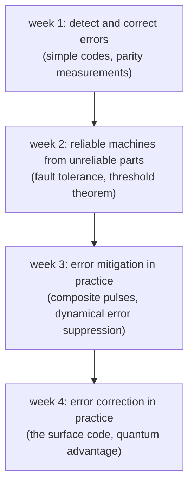
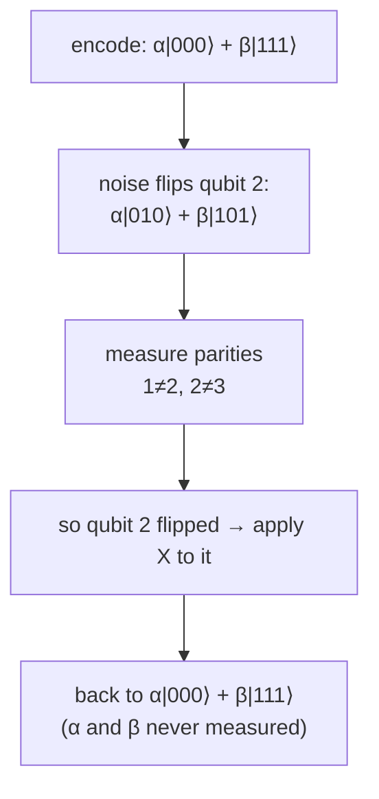

#quantum_error_correction #fault_tolerance #NISQ
Course 4: **Requirements for Large Scale Universal Quantum Computation**. what it takes to run **big** quantum computers for a **long** time without the noise winning

> [!important] the one idea
> ==every real qubit and gate is unreliable, so a large quantum computer has to be built so that it works anyway==: spot the errors and fix them faster than they pile up. that's error correction and fault tolerance, and it's what this whole course is about

## recap: course 3
course 3 was about running the algorithms and cryptography from courses 1 and 2 on the **small, error prone** machines we have today

| week | what we did | notes |
|---|---|---|
| **1** noise | noise is everywhere. how to describe it, and noisy qubits with the density matrix. classical vs quantum noise, and seeing **dephasing** and **energy decay** on the Bloch sphere | [[Noise in quantum systems]]: [[Density matrix]], [[Noise Processes]], [[Systematic noise]], [[Stochastic noise]], [[Dephasing channel]], [[Amplitude damping channel]] |
| **2** communication | entanglement again: making and detecting Bell states, real Bell tests. photons get lost in fibres, so we need repeaters. QKD needs bright sources and fast, good detectors for a high key rate | [[Quantum Communication]]: [[CHSH game]], [[Long-distance quantum communication]], [[Quantum repeaters]], [[QKD in practice]], [[Increasing the key rate]] |
| **3** NISQ | what we can run **now** with noisy, short circuits: machine learning, SVMs, VQE, and a deep dive on linear systems | [[Realistic quantum computation]]: [[NISQ]], [[Quantum kernel SVM]], [[VQE]], [[HHL algorithm]] |
| **4** benchmarking | how good is a real machine? state and process tomography, and the fidelity of states and gates | [[Benchmarking quantum systems]]: [[State tomography]], [[Process tomography]], [[State fidelity]], [[Gate fidelity]] |

## why we can't stop at NISQ
a NISQ machine has no error correction, so every gate adds a bit of error and they multiply up

> [!eg] a gate error of 0.1%
> each gate works with probability $1-p=0.999$, so a circuit of $N$ gates works with
> $$
> \begin{aligned}
> P_{\text{success}}&=(1-p)^N\approx e^{-pN}\\
> N=100:\quad P&\approx e^{-0.1}=0.90\\
> N=10\,000:\quad P&\approx e^{-10}=4.5\times10^{-5}
> \end{aligned}
> $$
> ==100 gates is fine, 10 000 gates almost never works==. [[Shor's algorithm]] on a useful number needs billions of gates, so just making the gates a bit better is never enough

that's why the circuits in [[Realistic quantum computation]] had to be **short**. to go deep, you need qubits that **protect themselves**

## course 4 plan

| week | topic | to-do notes |
|---|---|---|
| **1** | strategies for **detecting and correcting** errors: simple quantum error correcting codes, and why **parity measurements** matter | [[Detecting and correcting errors]] (hub): [[Bit flip code]], [[Parity measurement]], [[Phase flip code]], [[Shor code]], [[Logical qubit]] |
| **2** | how reliable classical **and** quantum machines are built from unreliable components: the **threshold theorem** and the principles of **fault tolerance** | [[Fault-tolerant quantum computing]], [[Threshold theorem]] |
| **3** | quantum **error mitigation**: composite pulses, dynamical error suppression | [[Composite pulses]], [[Dynamical decoupling]] |
| **4** | quantum **error correction** in practice: fault tolerant computing with the **surface code**, computational complexity, and what it means to show **quantum advantage** ("quantum supremacy") | [[Surface code]], [[Quantum supremacy]] |

## a taste of week 1
the simplest code, the [[Bit flip code]], spreads each qubit over three and takes a majority vote ([[Quantum Error Correction#The classical idea: repetition code]]). it only fails if **2 or more** of the 3 flip

![[Bit flip code#^logical-error]]

> [!eg] qubits that flip 1% of the time
> $p_L=3(10^{-4})-2(10^{-6})=2.98\times10^{-4}$, 33× better. but it only helps if $p_L<p$, which is true for $p<\frac12$. ==a code only helps if the physical errors are already below some threshold==, and that's the seed of the [[Threshold theorem|threshold theorem]] in week 2

for qubits you can't just look at the three copies, that would destroy the superposition. instead you measure **parities**: "are qubits 1 and 2 the same?" and "are qubits 2 and 3 the same?". the answers say **which** qubit flipped without saying **what** the state is. that's why [[Parity measurement|parity measurements]] are the heart of quantum error detection

> [!exercise] try these
> ① a gate has error $p=10^{-4}$. roughly how many gates can you run before the success chance drops to $e^{-1}\approx37\%$?
> ② with the 3-bit repetition code, what's $p_L$ for $p=0.1$? is the code still worth it?
> ③ why can't a quantum code just copy the qubit three times, like the classical one?

> [!answer]-
> ① $e^{-pN}=e^{-1}$ when $N=\frac1p=10\,000$ gates
> ② $p_L=3(0.01)-2(0.001)=0.028$, still better than $0.1$, so yes (it's worth it for any $p<\frac12$)
> ③ the [[No-cloning theorem|no-cloning theorem]] says you can't copy an unknown state. $\alpha|000\rangle+\beta|111\rangle$ isn't three copies, it's one **entangled** state

see also [[Quantum Error Correction]], [[Noise Processes]], [[NISQ]], [[Quantum volume]], [[Randomized benchmarking]]

previous course: [[Benchmarking quantum systems]] (course 3, week 4)
