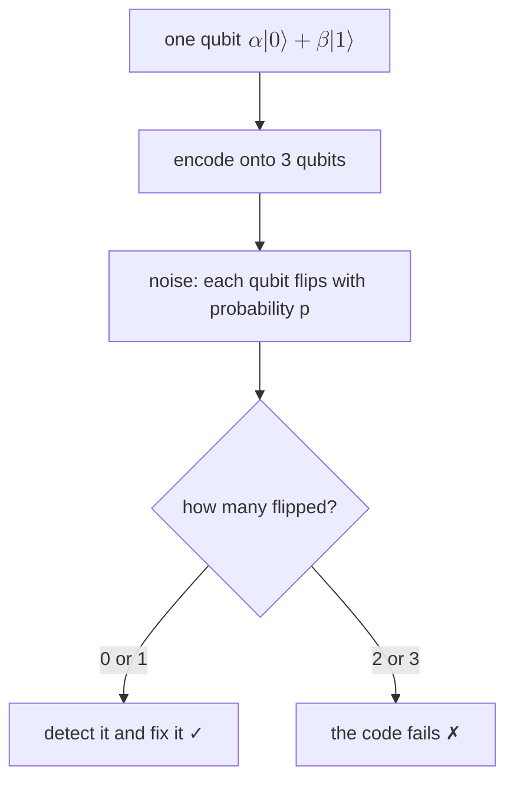
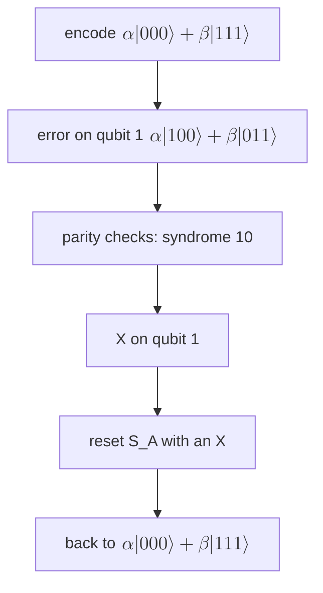

#quantum_error_correction #bit_flip_code #threshold
## why we need error correction
quantum computers, like normal computers, have to be built from **robust** parts

| | error rate (per operation) |
|---|---|
| a transistor | ~1 in $10^{20}$ |
| today's qubits | ~1 in $10^3$ to $10^4$ |

useful, large scale algorithms need **way more** than 1000 or 10 000 gates ([[Requirements for large scale quantum computation#why we can't stop at NISQ]]), so what can we do?
- find algorithms that give a [[Quantum advantage|quantum advantage]] even on noisy devices, working as a co-processor with a normal computer ([[NISQ]], course 3). still being researched
- for large scale, [[Fault-tolerant quantum computing|fault tolerant]] computing: make the devices **more resilient to errors**

and it's not just quantum: most classical electronics and communication systems get errors too. either way, one fix is **error correction**

> [!important] the one idea
> ==if each device is already good enough, adding redundancy (more copies of the same device) makes the whole system more reliable==. the price is **overhead**: more devices and more operations

systems are built from devices, devices can be faulty. imagine a device that shrugs off **small** input errors but gets less resilient with **bigger** ones. if it's individually good enough, building in redundancy makes it more reliable
## the bit flip code
works on classical bits **and** qubits. start with one physical qubit
- it has a probability $p$ of an error (~$10^{-3}$ to $10^{-4}$)
- it's in a superposition $\alpha|0\rangle+\beta|1\rangle$

add redundancy by **encoding** it onto 3 qubits
$$
\alpha|0\rangle+\beta|1\rangle\ \longrightarrow\ \alpha|000\rangle+\beta|111\rangle\qquad|0_L\rangle=|000\rangle,\quad|1_L\rangle=|111\rangle
$$
^encoding

the **code words** $|000\rangle$ and $|111\rangle$ stand for the **logical** states $|0_L\rangle$ and $|1_L\rangle$ (a [[Logical qubit|logical qubit]] made of 3 physical ones)

> [!warning] this is not three copies
> $\alpha|000\rangle+\beta|111\rangle$ is one **entangled** state, not $(\alpha|0\rangle+\beta|1\rangle)^{\otimes3}$. you can't copy an unknown qubit ([[No-cloning theorem]]), and you don't need to

## the encoding circuit
start with three qubits
- qubit 1 in the state we want to protect, $\alpha|0\rangle+\beta|1\rangle$
- qubits 2 and 3 in $|0\rangle$

then two [[CNOT gate|CNOTs]], both controlled by qubit 1, with qubits 2 and 3 as the targets

![[Bit_flip_encoding_circuit.png]]

a CNOT flips the target only if the control is $|1\rangle$, otherwise it leaves it alone (target → target XOR control)

![[CNOT gate#^truth-table]]

one gate at a time
$$
\begin{aligned}
&(\alpha|0\rangle+\beta|1\rangle)_{Q1}\otimes|0\rangle_{Q2}\otimes|0\rangle_{Q3}\\
\xrightarrow{\text{CNOT }1\to2}\ &\alpha|0\rangle_{Q1}|0\rangle_{Q2}|0\rangle_{Q3}+\beta|1\rangle_{Q1}|1\rangle_{Q2}|0\rangle_{Q3}\\
\xrightarrow{\text{CNOT }1\to3}\ &\alpha|0\rangle_{Q1}|0\rangle_{Q2}|0\rangle_{Q3}+\beta|1\rangle_{Q1}|1\rangle_{Q2}|1\rangle_{Q3}\\
=\ &\alpha|000\rangle+\beta|111\rangle
\end{aligned}
$$
- after the first CNOT, $|0\rangle$ of qubit 2 goes with $\alpha$ and $|1\rangle$ goes with $\beta$
- the second CNOT does the same for qubit 3
- the result is an **entangled** state. from now on, drop the $\otimes$ and the labels and write one ket for all three

- **protects against** one bit flip ($|0\rangle\leftrightarrow|1\rangle$) on any **one** of the qubits: we can detect it happened and fix it
- **fails** if there are **two or more** flips
## when does the code fail?

| flips | probability | result |
|---|---|---|
| 0 | $(1-p)^3$ | fine |
| 1 | $3p(1-p)^2$ | fixed ✓ |
| 2 | $3p^2(1-p)$ | fails ✗ (3 ways to pick the 2) |
| 3 | $p^3$ | fails ✗ |

add up the failures
$$
\begin{aligned}
p_L&=3p^2(1-p)+p^3\\
&=3p^2-2p^3\\
&\approx cp^2
\end{aligned}
$$
^logical-error

to leading order in $p$ (here $c=3$). the constant $c$ holds
- the **number of ways** the errors can happen
- the **overhead** used in the code

> [!eg] a real qubit, $p=10^{-3}$
> $$
> \begin{aligned}
> p_L&=3(10^{-3})^2-2(10^{-3})^3\\
> &=3\times10^{-6}-2\times10^{-9}\approx3\times10^{-6}
> \end{aligned}
> $$
> 3 qubits instead of 1, and the error goes down **~330×**. errors that were 1 in 1000 are now 1 in 330 000
## the threshold
is the encoding a net win? only if the encoded error is smaller than the single qubit one
$$
cp^2<p\quad\Longleftrightarrow\quad p<\frac1c=p_{th}
$$
^threshold

> [!important] the threshold
> ==if the single qubit error rate is below the threshold $p_{th}$, adding more qubits (redundancy) lowers the overall error rate. above it, the extra qubits just add more ways to fail==

the turning point, where one qubit becomes good enough for error correction to work, is the **threshold probability** (or just **the threshold**). here the conceptual threshold is $\frac1c$, and the cost of going below it is the **overhead** of the error correction

![[Bit_flip_code_threshold.png]]

- leading order: $p_{th}=\frac1c=\frac13$
- exact: $3p^2-2p^3<p$ for $p<\frac12$ (the curves cross at $\frac12$)
- the formal definition, and how it connects to codes you can keep scaling up, comes later in the course ([[Threshold theorem]])

> [!eg] above and below the threshold
> $p=0.2$: $p_L=3(0.04)-2(0.008)=0.104$, about half of $0.2$, the code helps
> $p=0.6$: $p_L=3(0.36)-2(0.216)=0.648$, **worse** than $0.6$. with that many flips, the majority is usually wrong

> [!extra] real thresholds are much lower
> the $\frac13$ here is way too generous: it assumes the encoding and the checking are perfect. in a real code the extra gates and measurements can fail too, which makes $c$ much bigger. that's why real thresholds are more like ~1% (the [[Surface code|surface code]]), and why today's $10^{-3}$ qubits are only just good enough

## finding the error
measure the **parities** of qubits 1, 2 and of qubits 2, 3 onto two ancillas, $S_A$ and $S_B$. the two answers (the **syndrome**) say which qubit flipped without revealing $\alpha$ or $\beta$, see [[Parity measurement]]. (or, without ancillas, run the encoder backwards and measure: [[Decoding the bit flip code]])

![[Parity measurement#^syndrome-table]]

## correcting the error
the code only expects **single bit flips**, so the fix is easy: apply an $X$ gate to the qubit the syndrome points at, to flip it back. then **reset** the ancillas to $|0\rangle$ (an $X$ on each one that reads 1) so they're ready for the next round

| syndrome $s_As_B$ | error on | fix | reset |
|---|---|---|---|
| $00$ | nothing | do nothing | nothing |
| $10$ | qubit 1 | $X$ on qubit 1 | $X$ on $S_A$ |
| $11$ | qubit 2 | $X$ on qubit 2 | $X$ on $S_A$ and $S_B$ |
| $01$ | qubit 3 | $X$ on qubit 3 | $X$ on $S_B$ |

^correction

==we never learn whether the bad qubit was wrongly in $|0\rangle$ or $|1\rangle$, only that it's wrong and needs flipping==, so the quantum information survives

## when it breaks
with **two or more** errors the syndrome points at the wrong qubit, and the scheme breaks down

> [!eg] flips on qubits 1 and 2
> $$
> \begin{aligned}
> \alpha|000\rangle+\beta|111\rangle\ &\xrightarrow{\text{errors on 1, 2}}\ \alpha|110\rangle+\beta|001\rangle\\
> \text{syndrome }01\ &\Rightarrow\ \text{"qubit 3", apply }X_3\\
> &\longrightarrow\ \alpha|111\rangle+\beta|000\rangle
> \end{aligned}
> $$
> no syndrome warns us, and the logical qubit has flipped: $\alpha|0_L\rangle+\beta|1_L\rangle\to\alpha|1_L\rangle+\beta|0_L\rangle$, a logical $X$ error. that's what the $cp^2$ counts
## doing better
two ways to go further
### more redundancy
use more qubits per logical qubit: with **5 qubits and 4 ancillas** (parity checks on each neighbouring pair), the code corrects up to **two** bit flips, and only fails with 3 or more

> [!eg] the 5 qubit bit flip code at $p=10^{-3}$
> the leading failure is 3 flips, and there are $\binom53=10$ ways to pick them, so $p_L\approx10p^3=10\times10^{-9}=10^{-8}$ (vs $3\times10^{-6}$ with 3 qubits)
### more levels (recursion)
take each qubit of the level 1 logical encoding and encode **it** with its own bit flip code, and so on (concatenation). each level squares the error: $p\to cp^2\to c(cp^2)^2\to\dots$
$$
\begin{aligned}
p^{(k)}&=\frac{(cp)^{2^k}}c\\
p=10^{-3},\ c=3:\quad p^{(1)}&=3\times10^{-6}\quad\text{(3 qubits)}\\
p^{(2)}&=2.7\times10^{-11}\quad\text{(9 qubits)}\\
p^{(3)}&=2.2\times10^{-21}\quad\text{(27 qubits)}
\end{aligned}
$$
^concatenation

==the error drops doubly exponentially while the qubits only grow exponentially==, so 27 qubits beat a transistor. this only works when $cp<1$, ie. below the threshold. that's the idea behind the [[Threshold theorem]]
## summary
> [!summary] the bit flip code captures the key ideas of error correction
> - one qubit with error probability $p$, **redundantly encoded** onto three
> - it detects and corrects **at most one** bit flip, so the logical state survives unless 2 or more errors happen, with probability $cp^2$
> - so there's a **threshold** $\frac1c$: how good single qubits must at least be for adding more of them to be a net win
> - errors are detected with **parity measurements**, combined into a **syndrome** that says if and where an error happened, without ever revealing the quantum information
> - from the syndrome we fix single errors and keep the logical state. with 2 or more errors the syndrome lies and the scheme breaks down
## what it can't do (yet)
- it only fixes **bit flips** ($X$ errors). a qubit can also get a **phase flip** ($|1\rangle\to-|1\rangle$, a $Z$ error, the [[Dephasing channel|dephasing]] from course 3), and the bit flip code can't see it: a $Z$ on any one qubit is a $Z$ on the encoded qubit, 3× as likely as on one qubit ([[Phase flip code#how bad are phase errors?]]). a related code fixes those ([[Phase flip code]]), and better codes fix both at once ([[Shor code]])
- it assumes the encoding, the parity checks and the fixes are **perfect**. handling errors wherever they happen, even during the detection and correction itself, is **fault tolerance** ([[Fault-tolerant quantum computing]])
- the channel it's built for is the [[Binary symmetric channel]] (each bit flips with probability $p$), the quantum version is the [[Bit flip channel]]

> [!exercise] try these
> ① a qubit has $p=10^{-4}$. what's $p_L$ with the bit flip code, and how many times better is that?
> ② a different code has $c=100$. what's its threshold? would it help a qubit with $p=10^{-3}$?
> ③ why does the code fail with 2 flips, eg. $|000\rangle\to|011\rangle$?
> ④ with more levels of recursion, how many levels does a $p=10^{-3}$ qubit need to get below $10^{-15}$?
> ⑤ the syndrome reads $11$. what do you do, step by step?

> [!answer]-
> ① $p_L\approx3(10^{-4})^2=3\times10^{-8}$, about $3300\times$ better (a smaller $p$ gains more, since $\frac{p}{p_L}=\frac1{cp}$)
> ② $p_{th}=\frac1{100}=1\%$. yes: $cp^2=100\times10^{-6}=10^{-4}<10^{-3}$, a $10\times$ improvement
> ③ $|011\rangle$ is closer to $|111\rangle$ than to $|000\rangle$, so the majority vote "fixes" it to $|111\rangle$: a logical $0$ becomes a logical $1$ and nobody notices
> ④ from the [[#^concatenation|recursion formula]], $p^{(2)}=2.7\times10^{-11}$ is not enough, $p^{(3)}=2.2\times10^{-21}$ is: **3 levels**, 27 qubits
> ⑤ qubit 2 flipped: apply $X$ to qubit 2, then $X$ to both $S_A$ and $S_B$ to reset them to $|00\rangle$

see also [[Quantum Error Correction]], [[Noise Processes]], [[Gate fidelity]], [[Randomized benchmarking]]

week hub: [[Detecting and correcting errors]]
