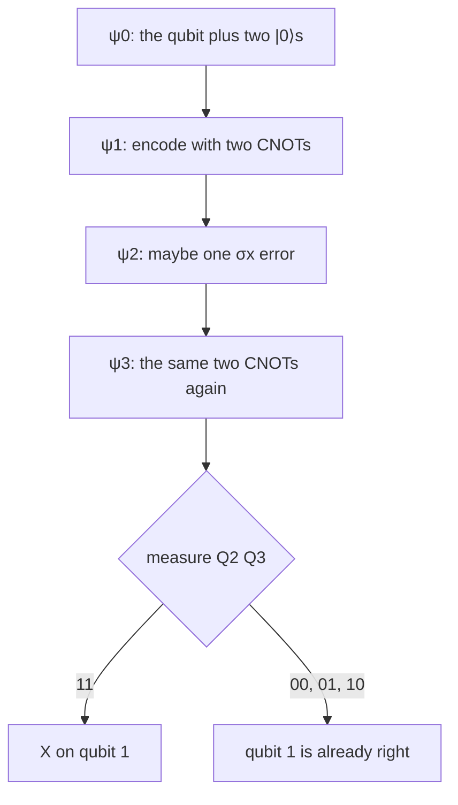

#quantum_error_correction #bit_flip_code #worked_example
the course's "Bit-Flip Code I: Recovering the State" exercise, worked through. encode, let at most one $\sigma_x$ hit, decode, and find out when qubit 1 needs fixing. it's the no-ancilla version from [[Decoding the bit flip code]], with the course's labels $|\psi_0\rangle$ to $|\psi_3\rangle$
## the circuit
![[Bit_flip_practice_circuit.png]]

(the course's figure stops at the measurements. the "If" box is the answer to the question below: `0x3` means the two measured bits are $11$)

## step 1 and 2: encode
start with the qubit we want to protect and two helpers
$$
\begin{aligned}
|\psi\rangle&=\alpha|0\rangle+\beta|1\rangle\\
|\psi_0\rangle&=|\psi\rangle|0\rangle|0\rangle\\
\xrightarrow{\text{CNOT }1\to2,\ 1\to3}\ |\psi_1\rangle&=\alpha|0\rangle|0\rangle|0\rangle+\beta|1\rangle|1\rangle|1\rangle
\end{aligned}
$$
the same as [[Bit flip code#^encoding]]
## step 3: the error
a bit flip is an $X$ gate: $X|0\rangle=|1\rangle$ and $X|1\rangle=|0\rangle$. it hits **at most one** qubit, so there are four cases

$$
\begin{aligned}
\text{(a) no error:}\quad|\psi_2^a\rangle&=\alpha|000\rangle+\beta|111\rangle\\
\text{(b) qubit 3:}\quad|\psi_2^b\rangle&=\alpha|001\rangle+\beta|110\rangle\\
\text{(c) qubit 2:}\quad|\psi_2^c\rangle&=\alpha|010\rangle+\beta|101\rangle\\
\text{(d) qubit 1:}\quad|\psi_2^d\rangle&=\alpha|100\rangle+\beta|011\rangle
\end{aligned}
$$
## step 4: decode
the third and fourth CNOTs (the encoder again, a CNOT is its own inverse). each one flips its target only in the parts where qubit 1 is $|1\rangle$
$$
\begin{aligned}
|\psi_3^a\rangle&=\alpha|000\rangle+\beta|100\rangle=(\alpha|0\rangle+\beta|1\rangle)|0\rangle|0\rangle\\
|\psi_3^b\rangle&=\alpha|001\rangle+\beta|101\rangle=(\alpha|0\rangle+\beta|1\rangle)|0\rangle|1\rangle\\
|\psi_3^c\rangle&=\alpha|010\rangle+\beta|110\rangle=(\alpha|0\rangle+\beta|1\rangle)|1\rangle|0\rangle\\
|\psi_3^d\rangle&=\alpha|111\rangle+\beta|011\rangle=(\alpha|1\rangle+\beta|0\rangle)|1\rangle|1\rangle
\end{aligned}
$$
in every case qubits 2 and 3 **factor out** into a definite state, so measuring them never touches $\alpha$ and $\beta$. this is the [[Decoding the bit flip code#^decoding-table|decoding table]], just with the course's labels
## the question
> [!question] in which case(s) should a $\sigma_x$ be applied to the first qubit to recover $|\psi\rangle$?
> only when the ancillas are measured in $|1\rangle|1\rangle$ (case d). in a, b and c qubit 1 already holds $\alpha|0\rangle+\beta|1\rangle$, and in d it holds $\alpha|1\rangle+\beta|0\rangle=X|\psi\rangle$, so one more $X$ undoes it

==only an error on qubit 1 needs a fix, because qubit 1 is where the decoded state comes out==. an error on qubit 2 or 3 just changes what you measure, and those qubits get thrown away

> [!warning] errata in the video
> at 4:42 in the "Quantum Error Correction Codes: Introduction" video, the blackboard says "measure (0,1)" at the bottom. it should say **"measure (1,1)"**

> [!exercise] try these
> ① $\sigma_x$ on qubits 1 **and** 3. work out $|\psi_2\rangle$ and $|\psi_3\rangle$. what do you measure, and does the circuit fix it?
> ② why can't the answer be "measured $|0\rangle|1\rangle$"?
> ③ a $\sigma_y$ hits qubit 1 instead ($Y|0\rangle=i|1\rangle$, $Y|1\rangle=-i|0\rangle$). what comes out of qubit 1 after the fix?

> [!answer]-
> ① $|\psi_2\rangle=\alpha|101\rangle+\beta|010\rangle$. CNOT $1\to2$: $\alpha|111\rangle+\beta|010\rangle$. CNOT $1\to3$: $\alpha|110\rangle+\beta|010\rangle=(\alpha|1\rangle+\beta|0\rangle)|1\rangle|0\rangle$. you measure $10$, do nothing, and qubit 1 is left flipped: 2 errors fool it ([[Bit flip code#when it breaks]])
> ② $01$ is case b, an error on qubit 3. qubit 1 is already $\alpha|0\rangle+\beta|1\rangle$, so an $X$ would **add** an error
> ③ $|\psi_2\rangle=i\alpha|100\rangle-i\beta|011\rangle$, decode to $(i\alpha|1\rangle-i\beta|0\rangle)|11\rangle$, measure $11$, $X$ gives $i(\alpha|0\rangle-\beta|1\rangle)$. the $i$ is a global phase, but $\alpha|0\rangle-\beta|1\rangle$ is a **phase flip** the code can't see. that's why we need the [[Phase flip code]] and the [[Shor code]]

see also [[Decoding the bit flip code]], [[Parity measurement]] (the version that keeps the state encoded), [[Phase flip code practice]]

week hub: [[Detecting and correcting errors]]
