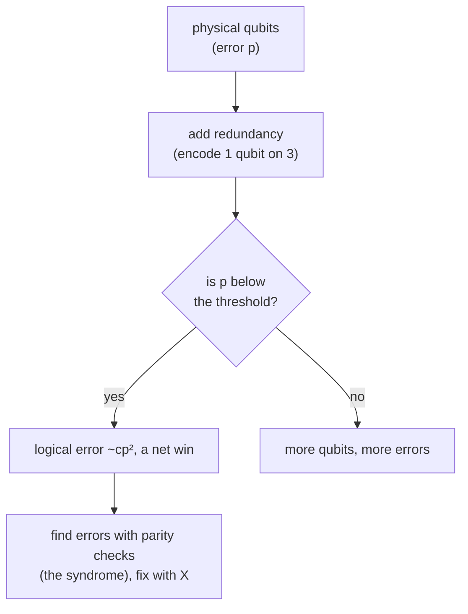

#quantum_error_correction #noise
Course 4, Week 1: **strategies for detecting and correcting errors** in quantum systems. simple quantum error correcting codes, and why parity measurements matter
## the problem
- a transistor fails about 1 in $10^{20}$ times, a qubit about 1 in $10^3$ to $10^4$
- big algorithms need far more gates than that, so we need qubits that are more **resilient**
- the fix: **redundancy**, spread one qubit over several, at the cost of **overhead**

## this week's notes
- [[Bit flip code]] → encode $\alpha|0\rangle+\beta|1\rangle$ as $\alpha|000\rangle+\beta|111\rangle$ with two CNOTs, it fixes 1 flip, fails with $3p^2-2p^3$, the **threshold** $p<\frac1c$, correcting with $X$ gates, more redundancy and more levels
- [[Parity measurement]] → parity checks onto ancillas give the **syndrome** (if and where an error happened) without revealing $\alpha$ or $\beta$
- [[Decoding the bit flip code]] → the no-ancilla way: run the encoder backwards, measure qubits 2 and 3, fix qubit 1. and why a $\sigma_z$ on any qubit is a $\sigma_z$ on the encoded qubit
- [[Phase flip code]] → the bit flip code with Hadamards around it: $|0_L\rangle$ = even states, $|1_L\rangle$ = odd states. fixes one $\sigma_z$, but makes $\sigma_x$ errors 3× worse
- [[Shor code]] → concatenate the two: a phase code of bit codes, 9 qubits. fixes any $\sigma_x$, $\sigma_y$ or $\sigma_z$ on one qubit, and so **any** one qubit error (the Paulis are a basis, and the measurement makes the error discrete)
- [[Computational capacity]] → Shannon's channel capacity: below it, codes make the error exponentially close to 0. the setup for the **threshold** for noisy computers
- [[Triple modular redundancy]] → von Neumann's question for **gates** plus noise: repeat a circuit 3 times and majority vote. it helps if $p<\frac13$, but the vote is a single point of failure and there's **no threshold** ($p<\frac1{3N}$ moves with circuit size)

coming up: [[Threshold theorem]], [[Logical qubit]]

see also [[Quantum Error Correction]] (the intro from course 3), [[Noise Processes]], [[Quantum channels]]

course overview: [[Requirements for large scale quantum computation]]
