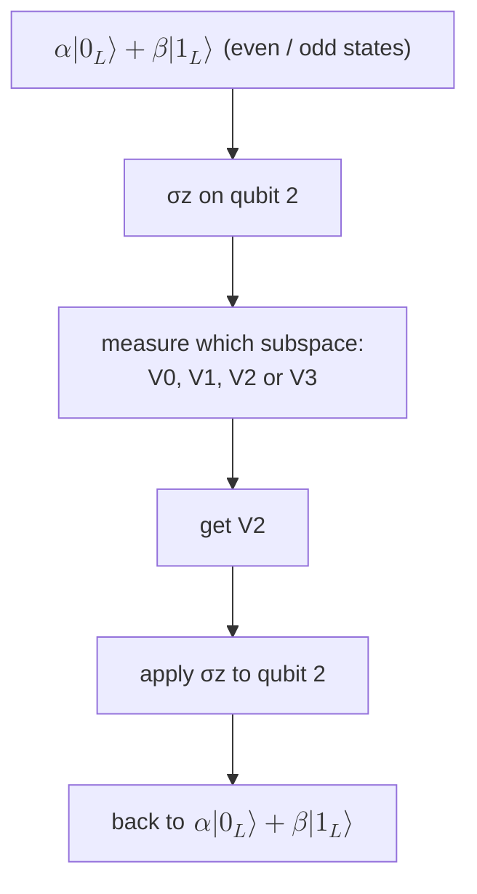

#quantum_error_correction #phase_flip_code #dephasing
## how bad are phase errors?
send each of the three qubits of the [[Bit flip code]] through a [[Dephasing channel]]
- probability $1-q$ → do nothing
- probability $q$ → apply $\sigma_z$

a $\sigma_z$ on any one qubit is a $\sigma_z$ on the encoded qubit ([[Decoding the bit flip code#what about phase errors?]]). two $\sigma_z$'s cancel ($Z^2=I$), so you get an error if an **odd** number of qubits get a $\sigma_z$, and no error for an even number
$$
\begin{aligned}
P(\text{logical }Z)&=3q(1-q)^2+q^3\\
&\approx3q
\end{aligned}
$$
^z-on-bit-code

**three times** the chance of a $\sigma_z$ error on an uncoded qubit. compare a **bit flip** channel (probability $q$ of $\sigma_x$): then you need at least **two** wrong qubits to get an error

![[Bit flip code#^logical-error]]

which is quadratically small if $q$ is small (with $p=q$)

> [!eg] $q=0.01$
> - bit errors: $3q^2-2q^3=2.98\times10^{-4}$, much better than $0.01$
> - phase errors: $3(0.01)(0.99)^2+10^{-6}=0.0294$, about **3×** worse than $0.01$
>
> ==we've corrected the bit errors and made the phase errors even worse==
## Hadamard the code
the [[Hadamard Gate|Hadamard]] swaps bit errors and phase errors: $HXH=Z$ and $HZH=X$ (a bit flip in the $|0\rangle,|1\rangle$ basis is a phase flip in the $|+\rangle,|-\rangle$ basis, see [[Bit flip channel]]). so put Hadamards in front of everything, and you should get a code that corrects **phase** errors but makes **bit** errors 3× worse

> [!important] the one idea
> ==the phase flip code is the bit flip code with Hadamards around it==: it fixes any one $\sigma_z$, and gets fooled by any one $\sigma_x$

the bit code was $|0\rangle\to|000\rangle$, $|1\rangle\to|111\rangle$. the **phase code** does it in the Hadamard basis
$$
\text H|0\rangle\to\text H^{\otimes3}|000\rangle\qquad\text H|1\rangle\to\text H^{\otimes3}|111\rangle
$$
$\text H^{\otimes3}$ puts a $-1$ on every state with an **odd** number of 1s ([[Simon's algorithm]] uses the same thing):
$$
\begin{aligned}
\tfrac1{\sqrt2}(|0\rangle+|1\rangle)\ &\to\ \tfrac1{\sqrt8}\big(|000\rangle+|001\rangle+|010\rangle+\dots+|111\rangle\big)\\
\tfrac1{\sqrt2}(|0\rangle-|1\rangle)\ &\to\ \tfrac1{\sqrt8}\big(|000\rangle-|001\rangle-|010\rangle+\dots-|111\rangle\big)\qquad\text{sign }(-1)^{\#1\text{s}}
\end{aligned}
$$
add and subtract them to get what the code does to $|0\rangle$ and $|1\rangle$
$$
\begin{aligned}
|0\rangle\to|0_L\rangle&=\tfrac12\big(|000\rangle+|011\rangle+|101\rangle+|110\rangle\big)\\
|1\rangle\to|1_L\rangle&=\tfrac12\big(|001\rangle+|010\rangle+|100\rangle+|111\rangle\big)
\end{aligned}
$$
^phase-codewords

- $|0_L\rangle$ = all states with an **even** number of 1s (adding: the odd ones cancel)
- $|1_L\rangle$ = all states with an **odd** number of 1s (subtracting: the even ones cancel)

the encoding circuit is the bit flip one with Hadamards around it

![[Phase_flip_encoding_circuit.png]]

the whole cycle: encode ($\psi_0\to\psi_2$), a possible $\sigma_z$ error, undo the Hadamards ($\psi_3\to\psi_4$), then the bit flip decoder ([[Decoding the bit flip code]]) and a last $\text H$ on qubit 1 to undo the first one. between $\psi_4$ and the end, a $\sigma_z$ error has become a $\sigma_x$ error

![[Phase_flip_full_circuit.png]]

(the course's version leaves out both Hadamards on qubit 1, which gives the $|{+}{+}{+}\rangle,|{-}{-}{-}\rangle$ code from the box below)

> [!eg] check it: encode $|0\rangle$
> $$
> \begin{aligned}
> |000\rangle\ &\xrightarrow{\text H\text{ on }1}\ \tfrac1{\sqrt2}(|000\rangle+|100\rangle)\\
> &\xrightarrow{\text{CNOTs}}\ \tfrac1{\sqrt2}(|000\rangle+|111\rangle)\\
> &\xrightarrow{\text H^{\otimes3}}\ \tfrac1{\sqrt2}\big(|{+}{+}{+}\rangle+|{-}{-}{-}\rangle\big)=|0_L\rangle
> \end{aligned}
> $$
> the even states survive because $|{+}{+}{+}\rangle$ and $|{-}{-}{-}\rangle$ have the same sign on them and opposite signs on the odd ones

> [!extra] the textbook version
> many books (eg. [[Quantum Computation and Quantum Information|Nielsen and Chuang]]) leave out the first Hadamard and use $|0_L\rangle=|{+}{+}{+}\rangle$, $|1_L\rangle=|{-}{-}{-}\rangle$ instead. it's the same code in a different basis for the logical qubit, and it's easier to see: a $\sigma_z$ flips one $|+\rangle\leftrightarrow|-\rangle$, exactly like a bit flip in the bit flip code
## correcting phase errors
it should be obvious that this works: all we did was put Hadamards in front of everything, so take the old correction circuit ([[Parity measurement]], [[Decoding the bit flip code]]) and add a lot of Hadamards. but there's another way to see it

call those two states **logical 0** and **logical 1**. then these 8 states are all **orthogonal**:
$$
|0_L\rangle,\ |1_L\rangle,\quad\sigma_z^{(1)}|0_L\rangle,\ \sigma_z^{(1)}|1_L\rangle,\quad\sigma_z^{(2)}|0_L\rangle,\ \sigma_z^{(2)}|1_L\rangle,\quad\sigma_z^{(3)}|0_L\rangle,\ \sigma_z^{(3)}|1_L\rangle
$$
- $|0_L\rangle\perp|1_L\rangle$: none of the basis states in $|1_L\rangle$ (odd) appear in $|0_L\rangle$ (even). a $\sigma_z$ only changes signs, so any $\sigma_z$ error on $|1_L\rangle$ is still orthogonal to any $\sigma_z$ error on $|0_L\rangle$
- a $\sigma_z$ error on $|0_L\rangle$ is orthogonal to $|0_L\rangle$ itself:
$$
\begin{aligned}
\sigma_z^{(1)}|0_L\rangle&=\tfrac12\big(|000\rangle+|011\rangle-|101\rangle-|110\rangle\big)\\
\langle0_L|\sigma_z^{(1)}|0_L\rangle&=\tfrac14(1+1-1-1)=0
\end{aligned}
$$
half the terms are $+$, half are $-$. the others check the same way

that's 8 orthogonal states in an 8 dimensional space (3 qubits), so they're a basis. group them in pairs into **four orthogonal subspaces**

| subspace | spanned by | means | fix |
|---|---|---|---|
| $V_0$ | $\vert0_L\rangle,\ \vert1_L\rangle$ | no error | nothing |
| $V_1$ | $\sigma_z^{(1)}\vert0_L\rangle,\ \sigma_z^{(1)}\vert1_L\rangle$ | $\sigma_z$ on qubit 1 | $\sigma_z$ on qubit 1 |
| $V_2$ | $\sigma_z^{(2)}\vert0_L\rangle,\ \sigma_z^{(2)}\vert1_L\rangle$ | $\sigma_z$ on qubit 2 | $\sigma_z$ on qubit 2 |
| $V_3$ | $\sigma_z^{(3)}\vert0_L\rangle,\ \sigma_z^{(3)}\vert1_L\rangle$ | $\sigma_z$ on qubit 3 | $\sigma_z$ on qubit 3 |

^phase-subspaces

there's a measurement that projects the state onto one of these four subspaces ([[Projectors]]). find out which one, then undo the error

==each subspace holds a whole copy of the logical qubit, $\alpha|0_L\rangle+\beta|1_L\rangle$ (with the same error on it), so learning the subspace tells you the error but nothing about $\alpha$ and $\beta$==. that's the general rule for when a code can correct a set of errors: the errors have to send the code into orthogonal subspaces that don't mix up $|0_L\rangle$ and $|1_L\rangle$

> [!extra] the parity checks for this code
> with the Hadamards around it, the bit flip code's checks $Z_1Z_2$ and $Z_2Z_3$ ([[Parity measurement#why it doesn't destroy the state]]) turn into $X_1X_2$ and $X_2X_3$: parity checks in the $|+\rangle,|-\rangle$ basis. measuring those two is exactly the projection onto $V_0,\dots,V_3$
## bit errors are now worse
an $X$ on any one qubit changes the number of 1s by one, so it turns even states into odd ones: $X^{(1)}|0_L\rangle=|1_L\rangle$, a **logical** $X$, and the code can't see it. so for this code it's swapped round

| code | $\sigma_x$ errors (probability $q$ each) | $\sigma_z$ errors (probability $q$ each) |
|---|---|---|
| none | $q$ | $q$ |
| [[Bit flip code\|bit flip]] | $\approx3q^2$ ✓ | $\approx3q$ ✗ |
| phase flip | $\approx3q$ ✗ | $\approx3q^2$ ✓ |

==each code fixes one kind of error and makes the other kind 3× worse==. real qubits get both (and everything in between), so we need a code that does both at once ([[Shor code]])

> [!exercise] try these
> ① write out $\sigma_z^{(3)}|0_L\rangle$ and check it's orthogonal to $|0_L\rangle$
> ② a qubit has $\sigma_z$ errors with $q=10^{-3}$ and no $\sigma_x$ errors. which code should you use, and what's the logical error?
> ③ show $X^{(2)}|0_L\rangle=|1_L\rangle$
> ④ why must each subspace contain both $|0_L\rangle$ and $|1_L\rangle$ (with the same error), and not just one of them?

> [!answer]-
> ① $\sigma_z^{(3)}$ gives a $-$ wherever qubit 3 is 1: $\tfrac12(|000\rangle-|011\rangle-|101\rangle+|110\rangle)$. overlap $\tfrac14(1-1-1+1)=0$ ✓
> ② the phase flip code: $\approx3q^2=3\times10^{-6}$ (the bit flip code would make it $\approx3\times10^{-3}$)
> ③ flipping qubit 2 maps $000\to010$, $011\to001$, $101\to111$, $110\to100$: that's $\tfrac12(|010\rangle+|001\rangle+|111\rangle+|100\rangle)=|1_L\rangle$
> ④ if a measurement outcome only happened for $|0_L\rangle$, getting it would tell you the logical bit and collapse $\alpha|0_L\rangle+\beta|1_L\rangle$. both have to land in the same subspace so the measurement can't tell them apart

see also [[Bit flip code]], [[Dephasing channel]], [[Hadamard Gate]], [[Quantum Error Correction]]

week hub: [[Detecting and correcting errors]]
