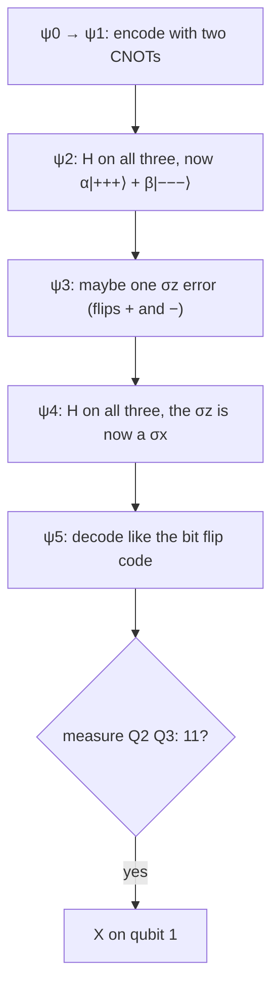

#quantum_error_correction #phase_flip_code #worked_example
the course's "Phase-Flip Code I: Recovering the State" exercise, worked through. the same as [[Bit flip code practice]] with a layer of Hadamards on each side of the error, so a $\sigma_z$ gets turned into a $\sigma_x$ before decoding. it uses the **textbook** version of the [[Phase flip code]] (no Hadamard on qubit 1 at the start), so the code words are $|{+}{+}{+}\rangle$ and $|{-}{-}{-}\rangle$
## the circuit
![[Phase_flip_practice_circuit.png]]

(again the "If" box is the answer: an $X$ on qubit 1 when the measurements read $11$)

## steps 1 to 3: encode  
$$
\begin{aligned}
|\psi_0\rangle&=|\psi\rangle|0\rangle|0\rangle=(\alpha|0\rangle+\beta|1\rangle)|0\rangle|0\rangle\\
\xrightarrow{\text{CNOTs}}\ |\psi_1\rangle&=\alpha|000\rangle+\beta|111\rangle\\
\xrightarrow{\text H^{\otimes3}}\ |\psi_2\rangle&=\alpha|{+}{+}{+}\rangle+\beta|{-}{-}{-}\rangle\qquad|\pm\rangle=\frac{|0\rangle\pm|1\rangle}{\sqrt2}
\end{aligned}
$$
## step 4: the error
a phase flip is a $Z$ gate. in the $|\pm\rangle$ basis it **swaps** them, exactly like $X$ swaps $|0\rangle$ and $|1\rangle$
$$
\sigma_z|+\rangle=\frac{|0\rangle-|1\rangle}{\sqrt2}=|-\rangle\qquad\sigma_z|-\rangle=\frac{|0\rangle+|1\rangle}{\sqrt2}=|+\rangle
$$
at most one qubit, so four cases
$$
\begin{aligned}
\text{(a) no error:}\quad|\psi_3^a\rangle&=\alpha|{+}{+}{+}\rangle+\beta|{-}{-}{-}\rangle\\
\text{(b) qubit 3:}\quad|\psi_3^b\rangle&=\alpha|{+}{+}{-}\rangle+\beta|{-}{-}{+}\rangle\\
\text{(c) qubit 2:}\quad|\psi_3^c\rangle&=\alpha|{+}{-}{+}\rangle+\beta|{-}{+}{-}\rangle\\
\text{(d) qubit 1:}\quad|\psi_3^d\rangle&=\alpha|{-}{+}{+}\rangle+\beta|{+}{-}{-}\rangle
\end{aligned}
$$
## step 5: undo the Hadamards
$\text H|+\rangle=|0\rangle$ and $\text H|-\rangle=|1\rangle$, so every $+$ becomes a 0 and every $-$ a 1
$$
\begin{aligned}
|\psi_4^a\rangle&=\alpha|000\rangle+\beta|111\rangle\\
|\psi_4^b\rangle&=\alpha|001\rangle+\beta|110\rangle\\
|\psi_4^c\rangle&=\alpha|010\rangle+\beta|101\rangle\\
|\psi_4^d\rangle&=\alpha|100\rangle+\beta|011\rangle
\end{aligned}
$$
==these are exactly the bit flip states from [[Bit flip code practice#step 3: the error]]: the $\sigma_z$ on qubit $k$ has become a $\sigma_x$ on qubit $k$==. that's because $\text HZ\text H=X$
## step 6: decode
the same two CNOTs as in the bit flip code, so the same answers
$$
\begin{aligned}
|\psi_5^a\rangle&=(\alpha|0\rangle+\beta|1\rangle)|0\rangle|0\rangle\\
|\psi_5^b\rangle&=(\alpha|0\rangle+\beta|1\rangle)|0\rangle|1\rangle\\
|\psi_5^c\rangle&=(\alpha|0\rangle+\beta|1\rangle)|1\rangle|0\rangle\\
|\psi_5^d\rangle&=(\alpha|1\rangle+\beta|0\rangle)|1\rangle|1\rangle
\end{aligned}
$$
## the question
> [!question] when should a $\sigma_x$ be applied to qubit 1 to recover $|\psi\rangle$?
> only when the ancillas are measured in $|1\rangle|1\rangle$ (case d, a phase error on qubit 1). same answer as for the bit flip code

note the fix is an $X$, not a $Z$: by the time we look, the Hadamards have already turned the phase error into a bit error

| case | error | $\vert\psi_4\rangle$ (after the Hadamards) | measure | fix |
|---|---|---|---|---|
| a | none | $\alpha\vert000\rangle+\beta\vert111\rangle$ | $00$ | nothing |
| b | $\sigma_z$ on qubit 3 | $\alpha\vert001\rangle+\beta\vert110\rangle$ | $01$ | nothing |
| c | $\sigma_z$ on qubit 2 | $\alpha\vert010\rangle+\beta\vert101\rangle$ | $10$ | nothing |
| d | $\sigma_z$ on qubit 1 | $\alpha\vert100\rangle+\beta\vert011\rangle$ | $11$ | $X$ on qubit 1 |

> [!exercise] try these
> ① check $\text HZ\text H=X$ by multiplying the matrices
> ② a $\sigma_x$ hits qubit 2 at the error spot instead ($X|+\rangle=|+\rangle$, $X|-\rangle=-|-\rangle$). what do you measure, and what comes out of qubit 1?
> ③ $\sigma_z$ on qubits 1 **and** 2. what do you measure, and what comes out?

> [!answer]-
> ① $\text HZ=\frac1{\sqrt2}\begin{bmatrix}1&-1\\1&1\end{bmatrix}$, then $\text HZ\text H=\frac12\begin{bmatrix}1&-1\\1&1\end{bmatrix}\begin{bmatrix}1&1\\1&-1\end{bmatrix}=\frac12\begin{bmatrix}0&2\\2&0\end{bmatrix}=X$
> ② $|\psi_3\rangle=\alpha|{+}{+}{+}\rangle-\beta|{-}{-}{-}\rangle$, so $|\psi_4\rangle=\alpha|000\rangle-\beta|111\rangle$ and $|\psi_5\rangle=(\alpha|0\rangle-\beta|1\rangle)|00\rangle$. you measure $00$ and get $Z|\psi\rangle$ out: a bit flip is invisible to this code ([[Phase flip code#bit errors are now worse]])
> ③ $|\psi_4\rangle=\alpha|110\rangle+\beta|001\rangle$. CNOT $1\to2$: $\alpha|100\rangle+\beta|001\rangle$. CNOT $1\to3$: $\alpha|101\rangle+\beta|001\rangle=(\alpha|1\rangle+\beta|0\rangle)|01\rangle$. you measure $01$, do nothing, and qubit 1 comes out as $X|\psi\rangle$: 2 errors beat it

see also [[Phase flip code]], [[Bit flip code practice]], [[Hadamard Gate]], [[Shor code]]

week hub: [[Detecting and correcting errors]]
