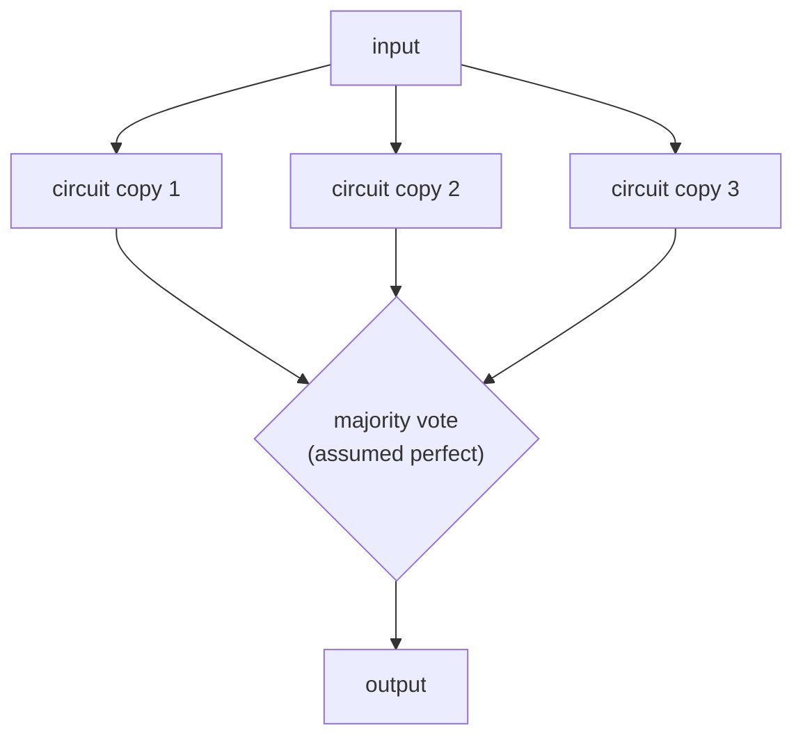

#fault_tolerance #threshold #classical_computing
## von Neumann's question
[[Computational capacity|Shannon]] asked about **communication**: a wire plus noise. in the 1950s **John von Neumann** asked the same kind of question about **computation**: what if we have **gates plus noise**?

his beautiful paper: *Probabilistic Logics and the Synthesis of Reliable Organisms from Unreliable Components* (1956)
- he was working with **vacuum tube** computers, and nobody yet knew if you could build a large scale classical computer at all
- so his model wasn't computers, it was **biology**: organisms like us are made of rather fallible pieces, and yet we walk, talk and communicate fairly reliably
- could we do whatever biology does to make reliability **emerge** out of unreliable parts, and do the same with unreliable vacuum tubes?

> [!quote]- von Neumann 1956: Probabilistic logics and the synthesis of reliable organisms from unreliable components
> lectures given at Caltech in January 1952 (notes by R. S. Pierce), published in *Automata Studies* (Princeton, 1956), pp. 43–98
> - every "organ" (gate) fails with some probability $\epsilon$, and the question is how small the final error can be made
> - majority organs and **multiplexing** (bundles of wires carrying one bit) are his versions of triple modular redundancy
> - he compares the setup to nerve cells throughout: the biology model from the lecture
>
> ![[von Neumann 1956 - Probabilistic logics and the synthesis of reliable organisms from unreliable components.pdf#height=500]]
## computational capacity
draw the same kind of graph as Shannon's, but now: the probability of error of the **circuit** against the probability of error of each **component**

the rules: **no** reliable components. every single gate (maybe even the wires, but at least the gates) only works with some failure probability. build a reliable system anyway
- with **no** strategy (no error correction), the circuit's error just grows as the components' error grows
- but if you construct the system appropriately, you get something like Shannon's capacity: a **computational capacity**, the capacity of a set of noisy gates to compute some function with essentially **no** noise

> [!important] the one idea
> ==a reliable computer can be built entirely from unreliable gates, as long as each gate is reliable enough==. it's Shannon's capacity idea moved from wires to gates, and it's essential for quantum computers, where noise in the gates is everywhere
## where this is used
- **not** in today's computers: our semiconductors are too reliable for it to be worth it (a transistor fails ~1 in $10^{20}$, [[Bit flip code#why we need error correction]]). we don't build a PC out of fallible PCs
- **but** at the largest scale of cloud computing we do: Amazon Web Services and Google Cloud Platform assume that **any** piece can fail, and make the system reliable anyway, out of unreliable networks of computers
- **biology** does it at a microscopic scale, and that's the scale von Neumann asked about
- **quantum computers** need it, because of how much noise there is in every gate ([[Fault-tolerant quantum computing]])
## triple modular redundancy
von Neumann's basic idea: take a circuit that fails with probability $p$, **repeat it three times**, and correct the output with a **majority voting** gate (for now, a perfect one that never fails)

the whole thing fails only if **2 or more** copies fail. there are $\binom32=3$ ways for 2 to fail, so it's the same counting as the bit flip code

![[Bit flip code#^logical-error]]

with $c=3$: a net win when $3p^2<p$, ie. $p<\frac13$. ==triple modular redundancy reduces the error as long as the circuit's error probability is below one third==

> [!eg] a circuit that fails 1% of the time
> three copies and a perfect vote: $3(0.01)^2-2(0.01)^3=2.98\times10^{-4}$, about 34× more reliable
## why it's not enough
it only shows **some** of the principles, because it's a **flawed** construction
### single point of failure
the majority voting gate is assumed **perfect**, but no component is allowed to be perfect. if the vote fails with probability $p_v$, the circuit fails at least that often, however many copies you use. a single point of failure like this can't be allowed
### no threshold
there's no single gate failure probability that lets the system **scale to any size**. the "$p<\frac13$" is about the error of the **whole** circuit being copied. a circuit of $N$ gates fails with
$$
p_{\text{circuit}}=1-(1-p)^N\approx Np
$$
so the condition $p_{\text{circuit}}<\frac13$ means
$$
p<\frac1{3N}
$$
^tmr-break-even

which **keeps changing** as the circuit gets bigger

![[TMR_no_threshold.png]]

> [!eg] the boundary moves
>
> | gates $N$ | TMR helps only if $p<$ |
> |---|---|
> | 1 | $0.33$ |
> | 30 | $0.011$ |
> | 1000 | $3.3\times10^{-4}$ |
> | $10^9$ | $3.3\times10^{-10}$ |
>
> for a big computation, the gates would have to be almost perfect already

so we ask for something **more**: a single error rate $p_{th}$ such that if every gate is below it, you can build a reliable circuit of **any** size. that's what we'll call a **threshold** ([[Threshold theorem]]). the fixes: vote after **every** small step instead of once at the end, make the voting itself redundant, and repeat the construction at many levels (like [[Bit flip code#more levels (recursion)]])

> [!exercise] try these
> ① a single circuit fails with $p=0.05$. what's its error with triple modular redundancy and a perfect vote?
> ② the majority gate fails with probability $10^{-3}$. what's the best TMR can do for the circuit in ①?
> ③ you want to protect a 10 000 gate circuit with one round of TMR. how good must each gate be?

> [!answer]-
> ① $3(0.05)^2-2(0.05)^3=0.0075-0.00025=0.00725$
> ② about $0.00725+0.001\approx0.0083$: the vote's own error adds straight on, and more copies can't remove it
> ③ $p<\frac1{3\times10^4}\approx3.3\times10^{-5}$, and even then it barely helps. you'd want much better gates, or a construction with a real threshold

see also [[Computational capacity]], [[Bit flip code]], [[Fault-tolerant quantum computing]]

week hub: [[Detecting and correcting errors]]
