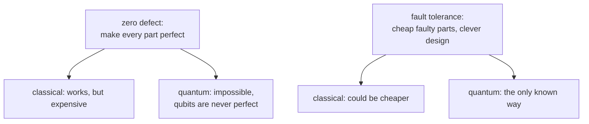

#fault_tolerance #threshold #classical_computing
## the last piece of the theorem
the [[Threshold theorem]] promises more than a threshold. it also says the cost is small: $O\big(N\,\text{polylog}(N/\epsilon)\big)$ noisy gates to simulate an error-free circuit of $N$ gates. the [[Recursive fault tolerance|recursive construction]] can prove that too: how many error-prone gates does it take to build a circuit that's (almost) error free?
## the circuit grows exponentially
each level of recursion replaces every gate with an encoded block of $d$ gates. one NAND becomes 3 NANDs, then 9, then 27, and so on (or 6, 36, 216 counting the majority gates as well, like [[Recursive fault tolerance#^recursion-table]]). with $k$ levels
$$
\text{size}=N\,d^k
$$
that's **exponential** in $k$, which looks worrying. so the question is how many levels $k$ we need
## how good each gate has to be
the goal: the whole $N$ gate circuit fails with probability at most $\epsilon$. share the error out: let each gate fail with probability at most $\frac\epsilon N$. failure probabilities at worst **add up** (the union bound), so
$$
N\cdot\frac\epsilon N=\epsilon
$$
## the central equation
with $c$ fault paths, the recursion gives $c\,p_{\text{fail}}=(cp)^{2^k}$. define $p_{th}=\frac1c$ and it becomes the neatest way to remember the threshold theorem
$$
\frac{p_{\text{fail}}}{p_{th}}=\left(\frac p{p_{th}}\right)^{2^k}
$$
^central-equation

> [!important] the one idea
> ==the circuit size grows **exponentially** in $k$, but the failure probability falls **doubly exponentially**==. the error drops much faster than the cost grows, so only a few levels are ever needed, and the cost ends up only polylogarithmic
## solving for the number of levels
we need $p_{\text{fail}}\leq\frac\epsilon N$. put that in and take logs
$$
\begin{aligned}
\left(\frac p{p_{th}}\right)^{2^k}&\leq\frac\epsilon{Np_{th}}\\
2^k\log\frac p{p_{th}}&\leq\log\frac\epsilon{Np_{th}}\\
2^k&\geq\frac{\log\big(Np_{th}/\epsilon\big)}{\log\big(p_{th}/p\big)}&&\text{(both logs were negative, so flip them and the inequality)}
\end{aligned}
$$
^levels-needed

everything is inside logarithms, so $k$ stays small
## the total size
$d^k=(2^k)^{\log_2d}$ (the same number, written in base 2), so
$$
\begin{aligned}
\text{size}=N\,d^k&=N\left(\frac{\log\big(Np_{th}/\epsilon\big)}{\log\big(p_{th}/p\big)}\right)^{\log_2d}\\
&=O\big(N\,\text{polylog}(N/\epsilon)\big)
\end{aligned}
$$
^fault-tolerance-size

the only part that grows with $N$ or $\epsilon$ is $\log\frac N\epsilon$ raised to a fixed power ($\log_2d$). everything else is a constant. that proves the theorem: ==a fault-tolerant circuit costs only a polylogarithmic factor more, as long as $p<p_{th}$==

![[Fault_tolerance_cost_vs_levels.png]]

> [!eg] $N=10^9$ gates, target $\epsilon=10^{-6}$, $c=15$
> $p_{th}=\frac1{15}=0.0667$, and each gate needs $p_{\text{fail}}\leq10^{-15}$. $\log_{10}\big(Np_{th}/\epsilon\big)=\log_{10}(6.67\times10^{13})=13.8$
> - $p=10^{-3}$: $\log_{10}(p_{th}/p)=\log_{10}66.7=1.82$, so $2^k\geq\frac{13.8}{1.82}=7.6$ → $k=3$. that's $6^3=216$ gates per gate, about $2\times10^{11}$ in all, and each gate fails with $\frac{(0.015)^8}{15}=1.7\times10^{-16}$ ✓
> - $p=0.05$ (close to the threshold): $\log_{10}(p_{th}/p)=\log_{10}1.33=0.125$, so $2^k\geq111$ → $k=7$: $6^7\approx2.8\times10^5$ gates per gate
>
> still finite, but ==being close to the threshold is very expensive==: the $\log(p_{th}/p)$ in the bottom goes to zero
## a different way to build computers
this suggests building **classical** computers differently too
- today: a **zero defect** philosophy, with perfect chips from billion dollar fabs
- instead: very cheap, error-prone chips (eg. silicon run deep below threshold voltage, from cheap fabs), and let them fail sometimes. design the system cleverly so it's fault tolerant anyway

for **quantum** computers this isn't just a nice idea, it's **necessary**: we don't know any other way to get the errors in quantum systems down to tolerable levels. that's where we go next ([[Fault-tolerant quantum computing]])

> [!exercise] try these
> ① with $p=10^{-3}$ and $c=15$, how many levels for $N=10^{12}$, $\epsilon=10^{-3}$?
> ② show $d^k=(2^k)^{\log_2d}$
> ③ with $d=6$, what power of the log is the overhead?
> ④ why does it go wrong if $p>p_{th}$? look at $\log(p_{th}/p)$

> [!answer]-
> ① each gate needs $10^{-15}$ again, so the same answer: $2^k\geq7.6$, $k=3$. only $N/\epsilon$ matters
> ② $d=2^{\log_2d}$, so $d^k=2^{k\log_2d}=(2^k)^{\log_2d}$
> ③ $\log_26=2.58$: the overhead grows like $\big(\log\frac N\epsilon\big)^{2.58}$
> ④ then $p_{th}/p<1$ and its log is negative, so no $k$ works: every level makes it worse ([[Recursive fault tolerance#^recursion-table]])

see also [[Threshold theorem]], [[Recursive fault tolerance]], [[Fault-tolerant procedure]]

week hub: [[Principles of fault tolerance]]
