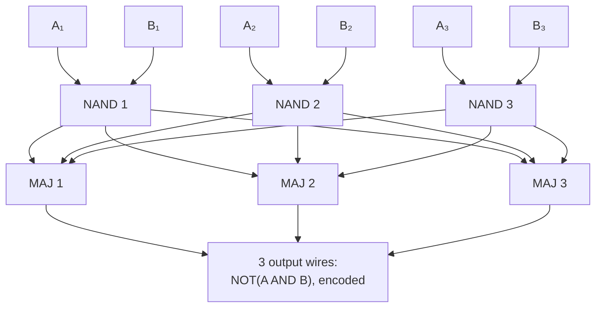

#fault_tolerance #threshold #classical_computing
## the building blocks
the first step of the [[Threshold theorem]] proof (a sketch, on classical circuits): ==compute on encoded data, and don't decode it as you go along==. [[Triple modular redundancy]] gave the idea, now formalise it with two gates
- **NAND** ($N$): output $\overline{x\wedge y}$, x and y inverted. NAND alone can build any classical circuit ([[Quantum gate#Universal gate sets]])
- **majority** ($M$): output the majority of its 3 inputs

each gate fails with probability $p$ (for simplicity they're all the same, but you can redo it with different probabilities)

| $x$ | $y$ | NAND |
|---|---|---|
| 0 | 0 | 1 |
| 0 | 1 | 1 |
| 1 | 0 | 1 |
| 1 | 1 | 0 |

^nand-truth

## the encoding
the triple redundancy code, the classical [[Bit flip code]]
$$
0_L=000\qquad1_L=111
$$
so there are **physical** states (the wires) and **logical** states (what they mean). a logical bit $A$ comes in on 3 wires $A_1,A_2,A_3$, and $B$ on $B_1,B_2,B_3$
## the encoded NAND
two parts
1. **the logical gate**: 3 NAND gates, the $i$th takes $A_i$ and $B_i$. its outputs may have an error, because the inputs might
2. **the error correction**: instead of the single majority vote of triple modular redundancy, **3** majority gates. copy each NAND output to all three (assume we can copy a bit from one wire to others)

> [!important] the one idea
> ==the output is still encoded, there's no single point of failure, and one error anywhere (a bad input wire or one failed gate) leaves at most one wrong output wire==, which the next gate's majority votes will remove. so the error never builds up

> [!eg] NAND 2 fails
> $A=1_L$, $B=1_L$, so the right answer is $0_L$. NAND 1 and NAND 3 output 0, but NAND 2 fails and outputs 1. every majority gate sees $0,1,0$ and outputs 0: the output $000$ is perfect
>
> if instead **MAJ 2** fails, the output is $010$: one wrong wire. still decodes to $0_L$, and the next encoded gate gets rid of it
## the probability of failure
the output is wrong only if **2 or more** of the 6 gates (3 NANDs, 3 majorities) fail. (leave out input errors for simplicity, they can be handled the same way.) the number of ways to pick 2 failed gates out of 6:
$$
\begin{aligned}
\binom62&=\frac{6\times5}2=15\\
p_{\text{fail}}&\leq15p^2
\end{aligned}
$$
^nand-fail

it's an upper bound: some pairs of failures don't actually spoil the output (eg. two failures that happen to give the same wrong bit on one wire), but many do

for this to beat a single unprotected gate we need $15p^2<p$:
$$
p_{th}=\frac1{15}\approx0.067
$$
^nand-threshold

==that's a real threshold even though every single gate, including the error correction, is allowed to fail==. it's lower than the bit flip code's $\frac13$ ([[Bit flip code#the threshold]]), but that one assumed the parity checks and the correction were perfect

> [!eg] $p=0.01$
> $15(0.01)^2=1.5\times10^{-3}$: about $7\times$ better than one gate. at $p=0.05$: $15(0.05)^2=0.0375$, still better, but only just
## what's left
this is a **level 1** encoding. one encoded gate is better than one plain gate, but we still have to show we can build an **arbitrary size** circuit with arbitrarily small error. that's done by recursion → [[Recursive fault tolerance]]

| | [[Triple modular redundancy]] | encoded NAND |
|---|---|---|
| output | decoded (one wire) | still **encoded** (3 wires) |
| voting | 1 perfect majority gate | 3 noisy majority gates |
| single point of failure | yes, the voter | none |
| threshold | moves with $N$ | $\frac1{15}$, and recursion makes it work for any $N$ |

> [!exercise] try these
> ① $A=0_L$, $B=1_L$, and the wire $A_3$ arrives flipped. trace the encoded NAND. what comes out?
> ② if the error correction used 5 majority gates instead of 3, what would the bound and the threshold be?
> ③ why do we need **3** majority gates, and not just 1?

> [!answer]-
> ① the right answer is $\overline{0\wedge1}=1$. NANDs 1, 2 get $(0,1)$ → 1. NAND 3 gets $(1,1)$ → 0. every majority gate sees $1,1,0$ → 1, so the output is $111$: the input error is gone
> ② $3+5=8$ gates, $\binom82=28$, so $p_{\text{fail}}\leq28p^2$ and the threshold drops to $\frac1{28}$: more gates means more ways to fail
> ③ with 1 majority gate, it's a single point of failure (its error goes straight to the output), and the output would be one wire, so it's decoded and the next gate has nothing to correct with

see also [[Triple modular redundancy]], [[Bit flip code]], [[Threshold theorem]], maths: [[Counting and the binomial distribution]]

week hub: [[Principles of fault tolerance]]
