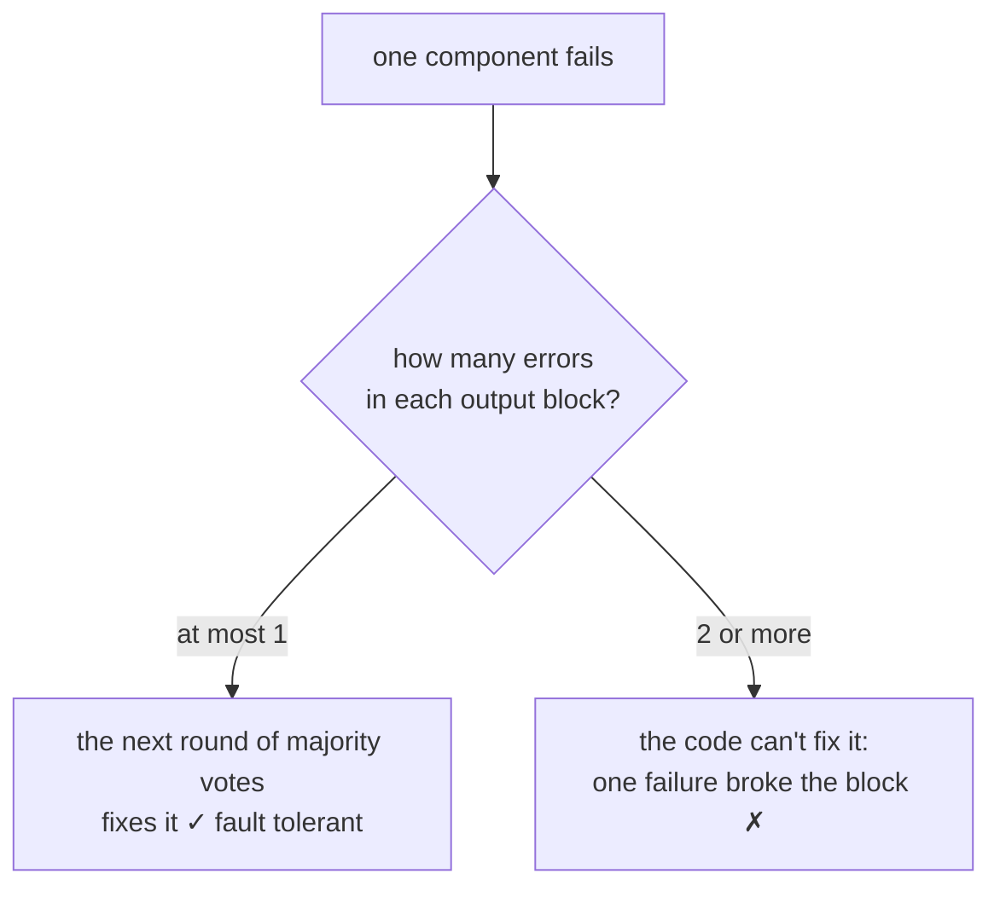
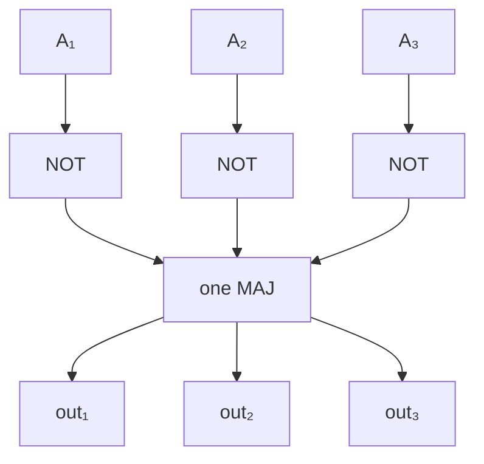
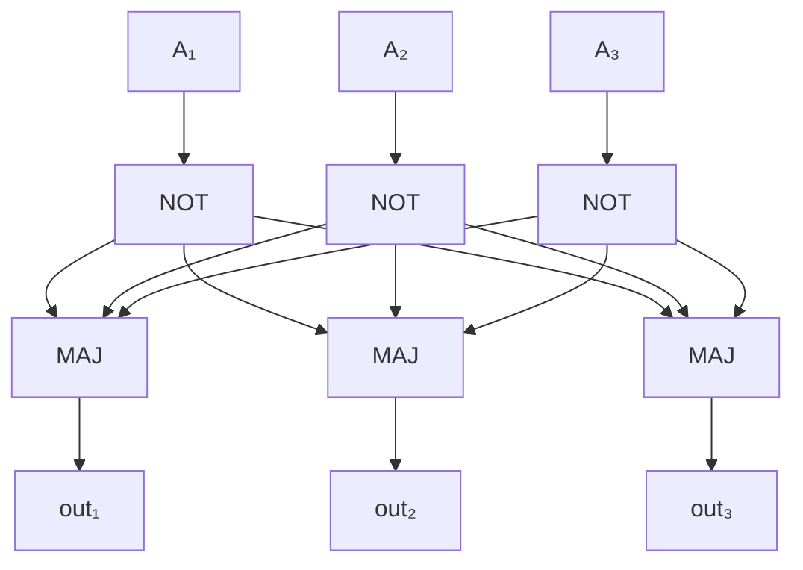

#fault_tolerance #threshold #classical_computing
## the principles behind the theorem
what made the [[Threshold theorem]] work? pull the ideas out of the classical construction ([[Fault-tolerant NAND gate]], [[Recursive fault tolerance]]) so we can try them on **quantum** circuits

the construction gave a threshold of 1 over the number of **fault paths** $c$: the number of ways failures can combine to make the circuit fail

![[Bit flip code#^threshold]]

two things have to be true for that number to mean anything
1. **a universal gate construction**: $c$ has to be counted for a gate (or family of gates) that can build **any** circuit
2. **a fault-tolerant procedure**: the construction has to control how errors **spread**, to keep the number of fault paths small

> [!important] the one idea
> ==a procedure is fault tolerant if a single component failure causes at most one error in each encoded block of bits in the output==. one failure must never cascade into more errors than the code can correct
## why universal
an inverter by itself can't build every circuit, so a threshold for inverters tells you nothing about computing in general. that's why the construction used **NAND**: any Boolean function can be built out of NAND gates composed the right way ([[Quantum gate#Universal gate sets]])

> [!eg] everything from NAND
> $$
> \begin{aligned}
> \text{NOT }a&=a\ \text{NAND}\ a\\
> a\text{ AND }b&=\text{NOT}(a\ \text{NAND}\ b)\\
> a\text{ OR }b&=(\text{NOT }a)\ \text{NAND}\ (\text{NOT }b)
> \end{aligned}
> $$
> so a threshold for an encoded NAND is a threshold for every circuit

(you don't need one gate: a **family** of universal gates works too, as long as every gate in it gets a fault-tolerant construction)
## the definition
a component is one gate: a NAND, an inverter, or one of the majority voting gates. a procedure is **fault tolerant** if
- **one** component failure
- causes **at most one error**
- in **each encoded block** of bits in the output

it's all about **error propagation**. two details in it
- **one error** because so far we only use codes that correct one error. with a code that corrects more, the definition (and the theorem) generalises
- **each block** because each data bit is its own code here (3 wires per logical bit). a construction with two output blocks is allowed one error in **each**. (you could also encode several data bits in one code, which changes the definition, but again it generalises easily)

## why it matters
if a single failure can put 2 errors in a block, then the block fails with the probability of **one** failure, not two
$$
\begin{aligned}
\text{fault tolerant:}\quad p_{\text{fail}}&\approx cp^2\\
\text{not fault tolerant:}\quad p_{\text{fail}}&\approx c_1p+c_2p^2\approx c_1p\quad\text{(small }p)
\end{aligned}
$$
^single-failure

with the $c_1p$ term, encoding never gets you below one gate's $p$ (and it's worse if $c_1>1$), recursion doesn't square anything, and there's **no threshold**. ==fault tolerance is what turns $p$ into $p^2$==
## examples: computing NOT
encode in the triple redundancy code, $A$ on 3 wires

**not fault tolerant**: 3 NOT gates, then a **single** majority vote, then copy its output 3 times

the voter is a **single point of failure**: if it fails, all 3 output wires are wrong, 3 errors in one block. that breaks the definition (it's the same flaw as [[Triple modular redundancy]])

**fault tolerant**: 3 NOTs, then **3** majority gates, each fed by all three NOT outputs (the same as the [[Fault-tolerant NAND gate]])

check every single failure
- one NOT fails → one wrong wire into each voter, each still sees 2 right out of 3 → **0** output errors
- one MAJ fails → only its own output is wrong → **1** output error

so it's fault tolerant. the same idea for gates between two blocks (like a CNOT) is a **transversal** gate: [[Transversal gates]]

> [!extra] 15 is an overcount
> the [[Fault-tolerant NAND gate]] bound counts all $\binom62=15$ pairs of failures. with perfect inputs only some pairs really break it: 2 NANDs (3 pairs) or 2 MAJs (3 pairs) give 2 wrong outputs, but a NAND plus a MAJ (9 pairs) gives at most 1. so 6 fault paths, not 15. the real count also has to include an error arriving on the inputs from the previous gate, which is why the simple bound $15p^2$ is the safe one to use

> [!exercise] try these
> ① in the fault-tolerant NOT, what if two NOT gates fail? two MAJ gates?
> ② "3 NOT gates and no voting at all" also gives at most one error per block from one failure. so why bother with the majority gates?
> ③ a construction has 10 components and one of them can, by failing alone, put 2 errors in a block. its gates fail with $p=10^{-3}$. roughly how often does the block fail?
> ④ build XOR from NAND gates (4 is enough)

> [!answer]-
> ① two NOTs: each voter sees 2 wrong out of 3, so all 3 outputs are wrong. two MAJs: 2 wrong outputs. both are 2 failures, so they're the $p^2$ terms the threshold counts
> ② errors coming **in** would pile up: with no voting, one wrong input wire stays wrong, and the next failure adds a second error to the same block. the majority gates are the error correction that resets each block to at most one error
> ③ that one component alone gives $p_{\text{fail}}\approx p=10^{-3}$, no better than an unencoded gate, plus the $cp^2$ terms. the encoding is wasted
> ④ $n=a\,\text{NAND}\,b$, then $a\oplus b=(a\,\text{NAND}\,n)\ \text{NAND}\ (b\,\text{NAND}\,n)$

see also [[Fault-tolerant NAND gate]], [[Recursive fault tolerance#so, the principles of classical fault tolerance]], [[Transversal gates]], [[Fault-tolerant quantum computing]]

week hub: [[Principles of fault tolerance]]
