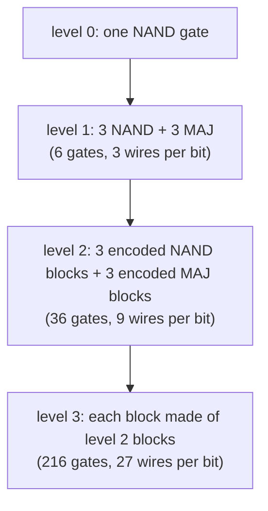

#fault_tolerance #threshold #concatenation #classical_computing
## recurse
the [[Fault-tolerant NAND gate]] is a **level 1** encoding: one encoded gate fails with

![[Fault-tolerant NAND gate#^nand-fail]]

now do the **same thing again**, recursively. this shows what happens when you scale to a large number of gates
- the encoding becomes $0\to000\,000\,000$ and $1\to$ nine 1s: three groups, each group is $000$ repeated, ie. **encode the encoded bits**
- every gate in the level 1 construction gets replaced by a whole level 1 block

the level 2 gate: $A$ and $B$ come in on 9 wires each. three big blocks, each the same 6 gate construction, each taking 6 wires in and giving 3 out (the encoded gate). then three blocks of majority gates (the error correction), with each output copied to the three blocks in the right way (simple to imagine, a little tedious to draw). out come 9 wires: $\overline{A\wedge B}$, encoded twice
## the probability of failure
the language is identical to level 1: the output is wrong only if **2 blocks** fail. there are $\binom62=15$ ways to pick them, and each block fails with $15p^2$:
$$
\begin{aligned}
p_{\text{fail}}^{(2)}&=15\big(15p^2\big)^2\\
&=\frac{(15p)^4}{15}
\end{aligned}
$$
^level-two

write $c$ for the number of **fault paths** (here $c=15$) and move it to the left:

| level | $c\,p_{\text{fail}}$ |
|---|---|
| 1 | $(cp)^2$ |
| 2 | $(cp)^{2^2}=(cp)^4$ |
| 3 | $(cp)^{2^3}=(cp)^8$ |
| $k$ | $(cp)^{2^k}$ |

^recursion-table

the powers go 2, 4, 8, 16, 32, 64, … it's the same formula as the recursion for the [[Bit flip code]] (there with $c=3$):

![[Bit flip code#^concatenation]]

> [!important] the one idea
> ==as long as $p<\frac1c$, $cp<1$, so $(cp)^{2^k}$ goes to zero **doubly exponentially** fast as you add levels==. that's why the threshold is $p_{th}=\frac1c$, independent of the size of the circuit and of the target error: it's the computational capacity ([[Computational capacity]])

> [!eg] $p=0.01$, $c=15$ ($cp=0.15$)
>
> | level $k$ | gates per logical gate $6^k$ | $p_{\text{fail}}=\frac{(cp)^{2^k}}c$ |
> |---|---|---|
> | 0 | 1 | $10^{-2}$ |
> | 1 | 6 | $1.5\times10^{-3}$ |
> | 2 | 36 | $3.4\times10^{-5}$ |
> | 3 | 216 | $1.7\times10^{-8}$ |
> | 4 | 1296 | $4.4\times10^{-15}$ |
> | 5 | 7776 | $2.9\times10^{-28}$ |
>
> each level costs $6\times$ more gates, but squares $cp$: the exponent of the error roughly **doubles** every level
## the threshold
draw $p_{\text{fail}}$ of the circuit against the gate error $p$. no error correction is a straight line, level 1 is the parabola $15p^2$, then a quartic, an 8th power, … each one **steeper** than the last, and they all cross at the same point, $p_{th}=\frac1c$

![[Recursive_fault_tolerance_threshold.png]]

- **below** $p_{th}$ every extra level makes it better, and fast
- **above** $p_{th}$ every extra level makes it worse
- the crossing point doesn't move with $N$ or $\epsilon$, exactly what the [[Threshold theorem]] asks for. ==a remarkable property to have==

> [!extra] where the polylog comes from
> each level costs $6\times$ more gates but squares the error, so you only need a few levels. working that out gives the $O\big(N\,\text{polylog}(N/\epsilon)\big)$ in the theorem: [[Cost of fault tolerance]]
## so, the principles of classical fault tolerance
1. **encode** the data (redundancy)
2. **compute on the encoded data**, never decode in between
3. **error correct** after every encoded gate, with error correction that is itself noisy but has no single point of failure
4. **recurse** to push the error down doubly exponentially

what makes step 3 work is a precise rule, a [[Fault-tolerant procedure]]: one failure gives at most one error per block, with gates between blocks done bitwise ([[Transversal gates]])

this is classical fault tolerance. the next step is to take these principles and apply them to **quantum** computation ([[Fault-tolerant quantum computing]])

> [!exercise] try these
> ① with $c=15$ and $p=0.05$, how many levels do you need to get below $10^{-6}$?
> ② what happens to $p_{\text{fail}}^{(k)}$ when $p=\frac1{15}$ exactly?
> ③ a gate with $p=10^{-3}$: how many levels (and gates per logical gate) to get below $10^{-15}$?

> [!answer]-
> ① $cp=0.75$: level 3 gives $\frac{0.75^8}{15}=6.7\times10^{-3}$, level 4 gives $6.7\times10^{-4}$, level 5 gives $6.7\times10^{-6}$, level 6 gives $\frac{0.75^{64}}{15}=6.7\times10^{-10}$. so **6 levels** ($6^6=46\,656$ gates per logical gate). close to the threshold, it's expensive
> ② $cp=1$, so $p_{\text{fail}}=\frac1{15}=p$ at every level: recursion neither helps nor hurts
> ③ $cp=0.015$: level 2 gives $3.4\times10^{-9}$, level 3 gives $\frac{0.015^8}{15}=1.7\times10^{-16}$. so **3 levels**, 216 gates per logical gate

see also [[Bit flip code#more levels (recursion)]], [[Shor code]] (concatenating two different codes), [[Threshold theorem]]

week hub: [[Principles of fault tolerance]]
