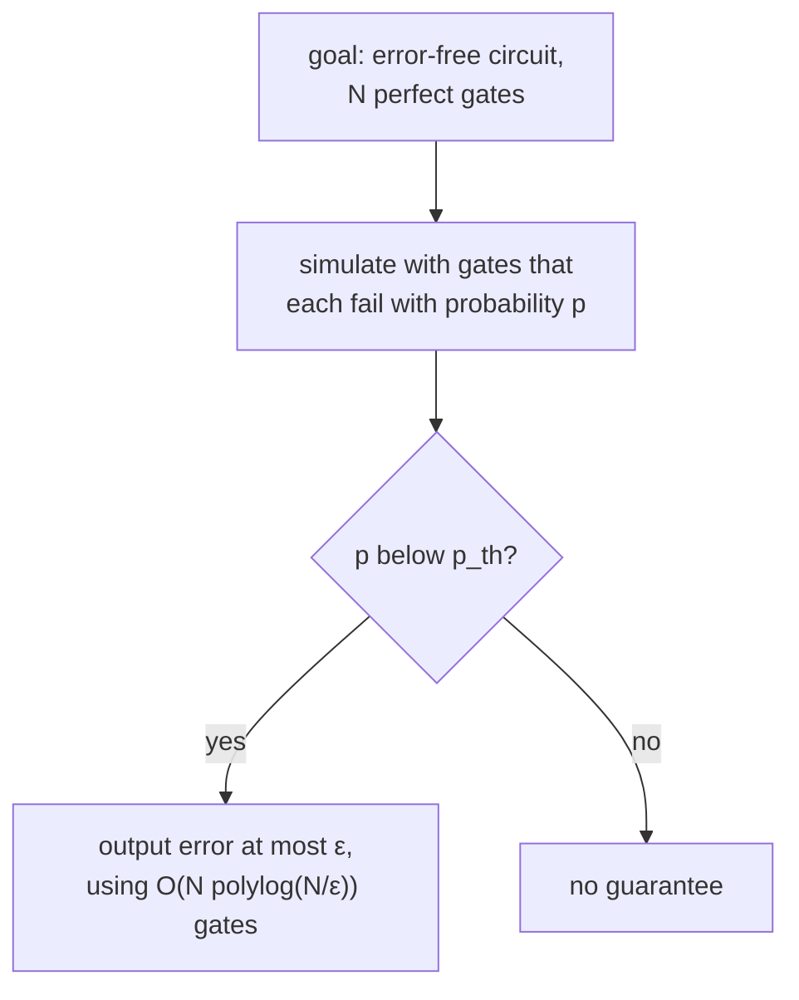

#threshold #fault_tolerance #classical_computing
## why we need a theorem
[[Triple modular redundancy]] showed one problem: its break-even point **moves** with the size of the circuit ([[Triple modular redundancy#no threshold]]). so first, say exactly what we **want** a threshold to do. this is a modern version of what von Neumann described
## the theorem
> [!important] the threshold theorem
> take a (uniform) family of circuits, and an **error-free** circuit of size $N$ (built any way you want) that you'd like to run. it can be **simulated** with probability of error at most $\epsilon$ using
> $$
> O\big(N\,\text{polylog}(N/\epsilon)\big)
> $$
> gates that each **fail** with probability $p$, as long as
> $$
> p<p_{th}
> $$
> where the threshold $p_{th}$ is ==independent of $N$ and $\epsilon$==

^threshold-theorem

taking it apart
- **the goal**: a circuit of size $N$ with perfect gates
- **the simulation**: a bigger circuit made of real gates, each failing with probability $p$, that gives the same output with error at most $\epsilon$
- **the cost**: the size grows only in proportion to $N$, times a factor that's only **logarithmic** in $\frac1\epsilon$. a very aggressive (good) scaling (proved in [[Cost of fault tolerance]])
- **the condition**: $p$ must be below $p_{th}$, and $p_{th}$ is a capacity that works for **any size** circuit (independent of $N$) and any **accuracy** (independent of $\epsilon$)

compare triple modular redundancy: its condition $p<\frac1{3N}$ ([[Triple modular redundancy#^tmr-break-even]]) **does** depend on $N$, so it's not a threshold in this sense

> [!eg] what "polylog" buys you
> say the overhead factor is $(\log_{10}\frac N\epsilon)^2$. for $N=10^9$ gates and $\epsilon=10^{-6}$: $(\log_{10}10^{15})^2=15^2=225$. so about $225N$ gates. asking for $\epsilon=10^{-12}$ instead only makes it $21^2=441$: a million times more accurate for twice the gates
## the proof idea
the proof (a sketch, for classical circuits) has two ingredients
1. ==compute on **encoded** data, and never decode it as you go along== → [[Fault-tolerant NAND gate]]
2. **recurse**: encode the encoded gates again, until the error is small enough → [[Recursive fault tolerance]]

recursion is just one way to prove it. there are many other techniques that could get to fault tolerance
## the classical thresholds
how big is $p_{th}$ for real constructions? (the plot in [[Recursive fault tolerance]] is for the simple $\frac1{15}$ construction)

| who | year | $p_{th}$ | gates | caveat |
|---|---|---|---|---|
| von Neumann | 1950s | $\geq0.073$ | 3 input | his assumptions weren't quite as strict, eg. not every gate had to be noisy |
| Hajek and Weller | 1991 | $0.167\approx\frac16$ | 3 input | |
| Evans and Pippenger | 1998 | $\approx0.089$ | 2 input (NAND) | worse than the 3 input numbers, but for gates that are [[Quantum gate#Universal gate sets\|universal]] on their own |
| upper bound (Evans and Schulman) | 2003 | $\leq\frac12-\frac1{2\sqrt k}$ | $k$ input | |

- the 3 input results assume **more** capability (a 3 input gate can do more), so it's no surprise they're higher. NAND gates are universal for classical computation, so their threshold is the one we'd really like to know
- you want $p_{th}$ as **high** as possible: the higher it is, the worse the gates you can compute with
- why the $\frac12$? a gate that fails with probability $\frac12$ outputs pure noise, so nothing can be computed with it. (and one failing 75% of the time is no good either, it's just a gate that's usually inverted)
- as $k$ gets large, the bound creeps up to $\frac12$: $0.211$ for $k=3$, $0.333$ for $k=9$, $0.450$ for $k=101$. so maybe gates failing 49.9% of the time could work, but nobody can show that it's realisable

> [!extra] the exact numbers
> the Evans and Pippenger 2 input NAND threshold is exactly $\frac{3-\sqrt7}4=0.0886$. these thresholds are for **formulas** (circuits where each output is used only once)

> [!exercise] try these
> ① a construction has $p_{th}=0.01$. your gates fail with $p=0.005$. can you run a circuit with $10^{15}$ gates reliably? what about $p=0.02$?
> ② what does the $k$ input bound give for $k=25$?
> ③ why isn't "$p<\frac13$" from triple modular redundancy a threshold in the sense of this theorem?
> ④ a circuit of $N$ perfect gates is simulated with error below $\epsilon$ using $O(\text{poly}(\log\frac N\epsilon)\,N)$ faulty gates, each failing with probability $p$. does $p_{th}$ depend on $N$, on $\epsilon$, or on $p$?

> [!answer]-
> ① with $p=0.005$, yes: the theorem says any size and any accuracy, just with more (polylog) overhead. with $p=0.02$ it gives no guarantee, however much overhead you add
> ② $\frac12-\frac1{2\times5}=0.5-0.1=0.4$
> ③ the $\frac13$ is for the error of the **whole** copied circuit, so per gate it's $p<\frac1{3N}$, which shrinks as $N$ grows. a threshold must be independent of $N$ (and the voter is assumed perfect, which isn't allowed)
> ④ none of them. $N$ and $\epsilon$ only change the **overhead** (how many levels), and $p$ is what you compare **against** $p_{th}$. the threshold is fixed by the construction itself (the code, the gate set, how many fault paths it has)

see also [[Computational capacity]] (Shannon's version for wires), [[Bit flip code#the threshold]], [[Fault-tolerant quantum computing]]

week hub: [[Principles of fault tolerance]]
