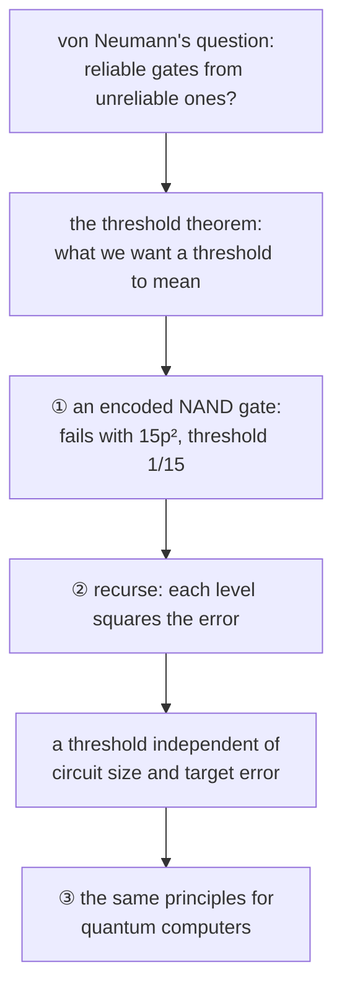

#fault_tolerance #threshold #quantum_error_correction
Course 4, Week 2: **the threshold theorem and the principles of fault tolerance**, first for classical computers, then for quantum ones
## the problem
- big computers (classical or quantum) have to run **reliably** for a long time, with noise everywhere
- in course 3, [[NISQ]] algorithms ran on uncorrected qubits, basically until too many qubits failed. their depth is limited by the qubits: coherence time, gate speed, and most of all **gate fidelity** ([[Gate fidelity]])
- big problems need algorithms that run **much longer** than any one physical qubit lives, so we need [[Quantum Error Correction|quantum error correction]]

in week 1 ([[Detecting and correcting errors]]) we saw that if the qubits are **good enough**, adding more of them (redundancy, overhead) lowers the overall error rate. that leaves two questions
1. how do we find the **threshold** for "good enough"?
2. how do we build a code that handles errors **whenever and wherever** they happen, even **during the error correction itself**?

> [!important] the one idea
> ==fault tolerance means computing on **encoded** data and never decoding it, so that a single failure anywhere, even in the error correction, can't spread into an uncorrectable error==. do that recursively and the error drops doubly exponentially, as long as every gate is below a threshold that doesn't depend on the size of the computation

## classical fault tolerance
- [[Threshold theorem]] → simulate any error-free circuit of size $N$ to error $\epsilon$ with $O(N\,\text{polylog}(N/\epsilon))$ noisy gates, as long as $p<p_{th}$, with $p_{th}$ **independent of $N$ and $\epsilon$**. and the known classical thresholds (von Neumann's 0.073 up to the $\frac12$ limit)
- [[Fault-tolerant NAND gate]] → encode a bit as 3, do 3 NANDs on the encoded wires, then 3 majority votes (no single point of failure). it fails only if 2 of the 6 gates fail: $15p^2$, so $p_{th}=\frac1{15}$
- [[Recursive fault tolerance]] → replace every gate by an encoded block, again and again: $cp_{\text{fail}}=(cp)^{2^k}$, doubly exponential, with only polylog overhead
## also this week
- [[Course 4 Week 2 formulas]] → every formula from this week on one page, with examples and exercises

coming up: [[Fault-tolerant quantum computing]], [[Logical qubit]]

see also [[Triple modular redundancy]] (the flawed first try), [[Computational capacity]], [[Bit flip code]]

previous week: [[Detecting and correcting errors]] · course overview: [[Requirements for large scale quantum computation]]
