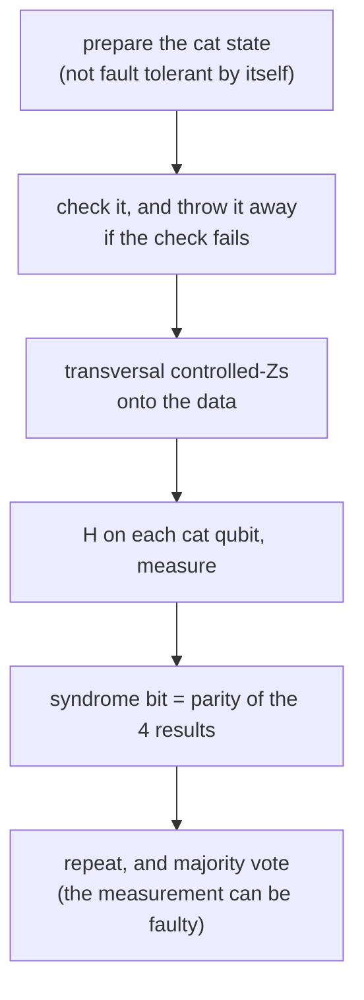

#fault_tolerance #syndrome #cat_state #stabilizer_codes
## the hardest part
probably the most complicated part of quantum fault tolerance, and the part that ends up **dominating** the cost and the threshold, is **measurement**. quantum error correction means measuring the stabilizer generators, then doing a recovery operation chosen (classically) from the results. but how do you measure a stabilizer without spreading errors? part of [[Fault-tolerant quantum computing]]
## the obvious way has a single point of failure
take a generator with four $Z$s, like $IIIZZZZ$ from the 7 qubit code ([[Transversal gates on stabilizer codes#^steane-generators]]). to measure it, start one ancilla in $|0\rangle$, do a Hadamard, a controlled-$Z$ onto each data qubit where the generator has a $Z$, another Hadamard, and measure (the same phase kickback idea as [[Parity measurement]])

![[Syndrome_measurement_one_ancilla.png]]

==the one ancilla touches four data qubits==. an $X$ error on it partway through turns each later controlled-$Z$ into a $Z$ on that data qubit: one failure, **up to 4 errors** in the same block. that's exactly what a [[Fault-tolerant procedure]] forbids (the same flaw as the classical CNOT shortcut in [[Transversal gates]])
## a story about Peter Shor
1. Shor invents the [[Shor's algorithm|quantum factoring algorithm]] (1994). critics: it'll never be realistic, it needs a perfect quantum computer
2. he writes a second paper that largely invents quantum error correction: the nine qubit code ([[Shor code]], 1995). critics: even with error correction, errors will spread too fast. error correction alone isn't enough, you need a code you can **compute** on
3. he comes up with a **fault-tolerant** construction for quantum computation (1996)

the trick below is from that third result
## Shor's trick: a cat state
instead of one ancilla, use four, prepared (very carefully) in a **cat state**
$$
|\text{cat}\rangle=\frac{|0000\rangle+|1111\rangle}{\sqrt2}
$$
^cat-state

then do the controlled-$Z$s **transversally**: ancilla $i$ only talks to data qubit $i$. finally a Hadamard on each ancilla and measure all four

![[Syndrome_measurement_cat_state.png]]

why it works
- the cat is either **all 0** or **all 1**, so the four controlled-$Z$s together do either nothing or the whole $Z^{\otimes4}$, just like the single ancilla did
- that kicks the generator's eigenvalue $s=\pm1$ back onto the cat as a phase
$$
\frac{|0000\rangle+|1111\rangle}{\sqrt2}\ \longrightarrow\ \frac{|0000\rangle+s\,|1111\rangle}{\sqrt2}
$$
^cat-kickback

- after $H^{\otimes4}$ that state only has **even** weight strings if $s=+1$, and only **odd** weight ones if $s=-1$. so ==the **parity** of the four measured bits is the syndrome bit==
- and each ancilla touches only **one** data qubit, so one failure can put at most one error into the data block

> [!important] the one idea
> ==spread the ancilla over a cat state so that every data qubit gets its own ancilla qubit==: the measurement becomes transversal, and an ancilla error can no longer copy itself onto several data qubits

## it's still not fault tolerant on its own
- the circuit that **makes** the cat state isn't fault tolerant: one failure in it can give several wrong cat qubits. so **check** the cat state first (eg. compare the parities of pairs of its qubits on an extra ancilla), and throw it away and start again if the check fails
- the measurement itself can be **wrong**, which would trigger the wrong recovery. so **repeat** it (three times in [[Quantum threshold estimate]]) and take a classical **majority vote**

that's the key idea behind fault tolerance: you can't make every piece perfect, so you check the pieces and repeat

> [!exercise] try these
> ① in the one ancilla circuit, an $X$ hits the ancilla right after the first controlled-$Z$. how many data errors?
> ② show that $H^{\otimes2}\frac{|00\rangle-|11\rangle}{\sqrt2}$ only has odd weight strings
> ③ in the cat circuit, an $X$ hits cat qubit 2 just before the controlled-$Z$s. how many data errors? does the syndrome come out right?

> [!answer]-
> ① the next three controlled-$Z$s each put a $Z$ on their data qubit: **3** errors in one block from one failure
> ② $H^{\otimes2}|00\rangle=\frac12(|00\rangle+|01\rangle+|10\rangle+|11\rangle)$ and $H^{\otimes2}|11\rangle=\frac12(|00\rangle-|01\rangle-|10\rangle+|11\rangle)$. subtract and divide by $\sqrt2$: $\frac1{\sqrt2}(|01\rangle+|10\rangle)$, only odd weight ✓
> ③ only qubit 2's controlled-$Z$ is affected, so at most **1** data error (a $Z$ on data qubit 2): fault tolerant. the syndrome can come out wrong, which is why the measurement is repeated and majority voted

see also [[Parity measurement]], [[Fault-tolerant procedure]], [[Shor code]], [[Bell states]]

week hub: [[Principles of fault tolerance]]
