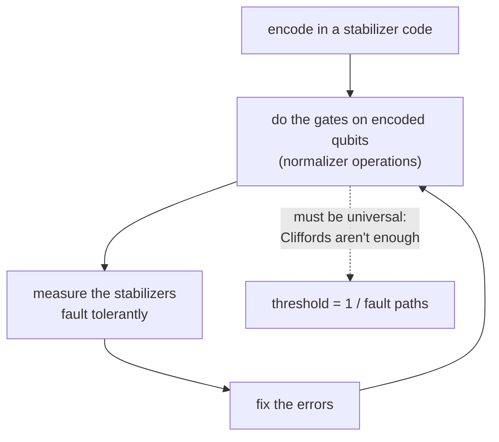

#fault_tolerance #threshold #quantum_error_correction #stabilizer_codes
## the question
what's the **largest** error we can have in our quantum gates and still build a quantum circuit of any size, with error as low as we like, out of those noisy gates? the principles of classical fault tolerance ([[Recursive fault tolerance#so, the principles of classical fault tolerance]]) carry over almost directly, but with some new challenges
## the same recipe, made quantum
we'd like a quantum threshold that's again 1 over the number of fault paths

![[Bit flip code#^threshold]]

and as in the classical case ([[Fault-tolerant procedure]]) that only means something if
1. $c$ is counted for a **universal** set of gates
2. the construction is a **fault-tolerant procedure**: compute on **encoded** data, which is now quantum, so that one failure gives at most one error per encoded block

> [!important] the one idea
> ==to compute fault tolerantly, the gates have to act on **encoded** qubits without ever decoding them, and they have to form a **universal** set==. for quantum codes that's much harder than for classical ones

## computing on encoded quantum data
the codes are **[[Stabilizer codes|stabilizer codes]]**: the code is the set of states left alone ($+1$ eigenstates) by every operator in a group of Pauli products, the **stabilizer** $S$. gates that act on encoded data have to map the code back to itself, so they must be in the **normalizer** of $S$
$$
N(S)=\{\,g\ :\ ghg^\dagger\in S\ \text{ for all }h\in S\,\}
$$
^normalizer

(conjugating any stabilizer by $g$ gives another stabilizer, so a state that every $h$ leaves alone gets mapped to one that every $h$ leaves alone). here $g$ is taken from the Paulis, but you can let $g$ be any unitary instead, and some codes have these **generalized** normalizers outside the Pauli group and outside the [[Clifford group]]
## why Cliffords aren't enough
the gates that map Pauli products to Pauli products are the **Clifford** gates, generated by $H$, $S$ and CNOT. but the [[Gottesman-Knill theorem]] says that circuits of Clifford gates on stabilizer states can be simulated **efficiently on a classical computer**

> [!warning] so Cliffords aren't universal
> ==anything a classical computer can simulate efficiently can't give a quantum speed up==. a fault-tolerant construction also needs at least one gate **outside** the Clifford group, eg. the $T$ gate ([[Phase shift]])

how hard that is depends on the code: [[Transversal gates on stabilizer codes]] shows the easy gates for the 5 and 7 qubit codes, and why **no** code gets a universal set the easy way
## the rest of the story
- [[Transversal gates on stabilizer codes]] → the 5 qubit code vs the 7 qubit (Steane) code, CSS codes and transversal CNOTs, and the Eastin-Knill theorem
- [[Steane code circuit]] → the 7 qubit code as a circuit: encoder, syndrome ancillas, lookup table
- [[Fault-tolerant measurement]] → measuring the stabilizers without spreading errors: Shor's cat state trick
- [[Quantum threshold estimate]] → putting it together for a CNOT on the 7 qubit code: 79 gates, so $p_{th}\approx\frac1{3081}\approx10^{-4}$

> [!exercise] try these
> ① why must a gate on encoded data be in the normalizer of the stabilizer?
> ② the 3 qubit bit flip code has stabilizer generators $Z_1Z_2$ and $Z_2Z_3$. is $X_1X_2X_3$ in the normalizer? what does it do?
> ③ a construction only uses $H$, $S$ and CNOT. why can't it be the whole story?

> [!answer]-
> ① if $|\psi\rangle$ is in the code, $h|\psi\rangle=|\psi\rangle$ for all $h\in S$. then $(ghg^\dagger)\,g|\psi\rangle=g|\psi\rangle$, so $g|\psi\rangle$ is left alone by every $ghg^\dagger$. that's the code again only if every $ghg^\dagger$ is in $S$
> ② it commutes with $Z_1Z_2$ and $Z_2Z_3$ (each overlaps it in 2 places), so conjugating leaves them unchanged: yes. it maps $|000\rangle\leftrightarrow|111\rangle$, the **logical** $X$ ([[Bit flip code]])
> ③ those generate only the Clifford group, which a classical computer can simulate efficiently (Gottesman-Knill). no speed up is possible without a non-Clifford gate

see also [[Fault-tolerant procedure]], [[Transversal gates]], [[Quantum Error Correction]], [[Threshold theorem]]

week hub: [[Principles of fault tolerance]]
