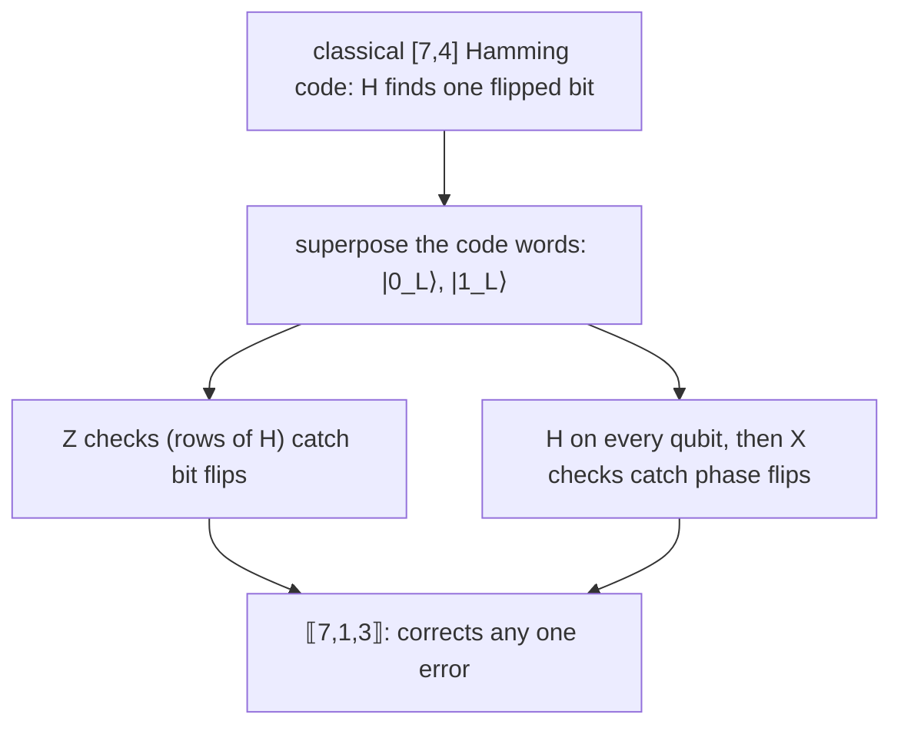

#steane_code #stabilizer_codes #syndrome #quantum_error_correction
the 7 qubit Steane code is easiest to understand starting from a classical code: Richard Hamming's $[7,4]$ code (1950, made to fix errors in punch card readers). Andrew Steane (Oxford, 1996) turned it into a quantum code
## the classical $[7,4]$ Hamming code
**7 bits** carry a **4 bit** message, and the 3 extra bits let you find and fix any single flipped bit. 4 bits of message need $2^4=16$ different code words of length 7. to encode, multiply the message (a column vector) by the **generator matrix** $G$, all mod 2 ([[Linear algebra mod 2]]):
$$
G=\begin{pmatrix}1&1&0&1\\1&0&1&1\\1&0&0&0\\0&1&1&1\\0&1&0&0\\0&0&1&0\\0&0&0&1\end{pmatrix}\qquad H=\begin{pmatrix}1&0&1&0&1&0&1\\0&1&1&0&0&1&1\\0&0&0&1&1&1&1\end{pmatrix}
$$
^hamming-g-h

to check a received word, multiply it by the **parity check matrix** $H$: the 3 bit answer is the **syndrome**. every code word gives $000$ ($HG=0$). ==column $j$ of $H$ is $j$ in binary== (top row = the 1s digit), so a flip on bit $j$ gives syndrome = column $j$, which names the bit. it's the same code as [[Classical linear codes#^hamming-7-4]], with the rows of $H$ listed in the opposite order

> [!eg] encode $0010$, then flip bit 1
> $$
> \begin{aligned}
> G\begin{pmatrix}0\\0\\1\\0\end{pmatrix}&=\text{column 3 of }G=\begin{pmatrix}0&1&0&1&0&1&0\end{pmatrix}^T\\
> H\,(0101010)^T&=\begin{pmatrix}0\\2\\2\end{pmatrix}\bmod2=\begin{pmatrix}0\\0\\0\end{pmatrix}\quad\text{a code word}\\
> H\,(1101010)^T&=\begin{pmatrix}1\\2\\2\end{pmatrix}\bmod2=\begin{pmatrix}1\\0\\0\end{pmatrix}=\text{column 1: bit 1 flipped}
> \end{aligned}
> $$

the syndrome tells you **which** bit flipped, never **what** its value is. that's the property that carries over to the quantum case
## the quantum version: $[\![7,1,3]\!]$
quantum errors include phase flips, so the Steane code spends 7 qubits on **one** qubit (not 4). the notation $[\![n,k,d]\!]$ (double brackets = quantum): $n=7$ physical qubits, $k=1$ logical qubit, and **distance** $d=3$, so it corrects any one error ([[Stabilizer codes#logical operators and distance]])

the code words are superpositions of Hamming code words:

![[CSS codes#^steane-codewords]]

every term is a Hamming code word, so a quantum circuit can compute $H$ on the whole superposition at once and find a bit flip. as stabilizer generators (the rows of $H$, once with $X$s and once with $Z$s):

![[Transversal gates on stabilizer codes#^steane-generators]]

(try a few: $IIIXXXX$ maps $|0000000\rangle\to|0001111\rangle$, another term of $|0_L\rangle$, so it leaves $|0_L\rangle$ alone)
## phase flips too
a phase flip takes $|+\rangle\to|-\rangle$: it's a **bit flip in the $\{|+\rangle,|-\rangle\}$ basis**. so rotate every qubit with $H$, and the same Hamming check finds phase flips. that's what the three $X$ generators do. the bit flip part and the phase flip part each give a 3 bit syndrome ($n$ and $m$ in the circuit), so the code corrects one $X$ error **and** one $Z$ error, even on the same qubit (a $Y$)
## an example with ancillas
encode $|\psi\rangle=a|0\rangle_L+b|1\rangle_L$ ($|a|^2+|b|^2=1$). a bit flip $E_{b1}$ hits the first qubit of every term: $|\psi'\rangle=E_{b1}|\psi\rangle$. add three ancillas in $|000\rangle$ and run the $Z$ checks onto them
$$
|\psi'\rangle|000\rangle\ \to\ |\psi'\rangle\,|S(\psi')\rangle\qquad S(\psi')=\begin{pmatrix}1\\0\\0\end{pmatrix}
$$
^steane-ancilla-syndrome

the same syndrome as the classical bit 1 flip, for **every** term of the superposition, so the ancillas aren't entangled with the data. measure them, flip qubit 1 back, and $|\psi\rangle$ is restored. ==the syndrome names the faulty qubit and reveals nothing about $a$ and $b$==, so this can sit inside a bigger computation

the full circuit (encoder, six ancillas, lookup table) is in [[Steane code circuit]]

> [!exercise] try these
> ① encode the message $1000$ with $G$
> ② the received word is $0101011$. which bit flipped?
> ③ why does $|0_L\rangle$ only contain Hamming code words with an even number of 1s?
> ④ a $Z$ error hits qubit 5. which generators notice it?

> [!answer]-
> ① column 1 of $G$: $1110000$. check: $H(1110000)^T=(1+1,\ 1+1,\ 0)=(0,0,0)$ ✓
> ② $H(0101011)^T$: row 1 (bits 1,3,5,7) $=0+0+0+1=1$, row 2 (bits 2,3,6,7) $=1+0+1+1=1$, row 3 (bits 4,5,6,7) $=1+0+1+1=1$. syndrome $(1,1,1)$ = binary 7: bit 7 flipped, the sent word was $0101010$
> ③ they're the code words of the smaller dual code (the rows of $H$ and their sums), all weight 0 or 4. the odd ones (weight 3 or 7) make up $|1_L\rangle=X^{\otimes7}|0_L\rangle$
> ④ the $X$ generators with an $X$ on qubit 5: $IIIXXXX$ and $XIXIXIX$ (5 = binary 101)

see also [[Classical linear codes]], [[CSS codes]], [[Transversal gates on stabilizer codes]], [[Stabilizer codes]]

week hub: [[Principles of fault tolerance]]
