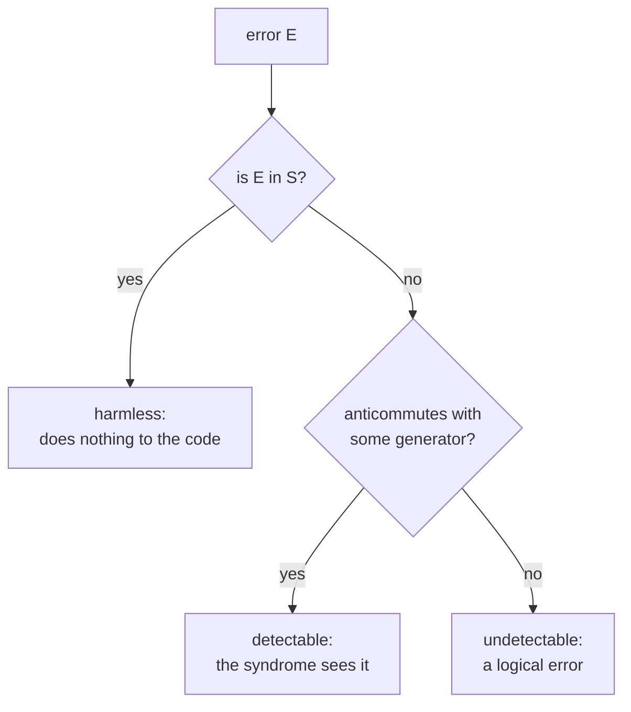

 ho#stabilizer_codes #quantum_error_correction #pauli
the language almost every quantum code is written in. instead of writing out the code words, list the Pauli operators that leave them alone. used all through [[Fault-tolerant quantum computing]]
## the idea
a **stabilizer** is a set of operators that leaves a particular group of states untouched. a state **outside** that group gets a "label" from them instead (a $-1$), which is how changes, ie. **errors**, to code words get detected

eg. the Bell state $|\Phi^+\rangle=\frac{|00\rangle+|11\rangle}{\sqrt2}$ (qubits 1 and 2 of the bit flip code)
$$
\begin{aligned}
X_1X_2|\Phi^+\rangle&=X_1X_2\frac{|00\rangle+|11\rangle}{\sqrt2}=\frac{|11\rangle+|00\rangle}{\sqrt2}=|\Phi^+\rangle\\
Z_1Z_2|\Phi^+\rangle&=Z_1Z_2\frac{|00\rangle+|11\rangle}{\sqrt2}=\frac{|00\rangle+(-1)^2|11\rangle}{\sqrt2}=|\Phi^+\rangle
\end{aligned}
$$
^bell-stabilized

so $X_1X_2$ and $Z_1Z_2$ **stabilize** $|\Phi^+\rangle$. likewise the bit flip code's code words $|000\rangle$ and $|111\rangle$ (and every superposition of them) are left alone by $Z_1Z_2$ and $Z_2Z_3$, and they're the **only** states with that property, so these two operators **define** the code

> [!important] the one idea
> ==a stabilizer code is the set of states that a group of commuting Pauli products all leave alone (eigenvalue $+1$)==. a few generators describe a code space that would take exponentially many numbers to write out
## the Pauli group and generators
everything is built from the **Pauli group** ([[Pauli matrices]]). for one qubit
$$
G_1\equiv\{\pm I,\pm iI,\pm X,\pm iX,\pm Y,\pm iY,\pm Z,\pm iZ\}
$$
and $G_n$ is all $n$-fold tensor products of these. for the Bell state, the group of everything that stabilizes it is
$$
S=\{I_1I_2,\ X_1X_2,\ Z_1Z_2,\ -Y_1Y_2\}
$$
(a subgroup of $G_2$; $-Y_1Y_2=(X_1X_2)(Z_1Z_2)$). it's enough to list its **generators**, the few elements that make all the others by multiplying ([[Groups]])
$$
S=\langle X_1X_2,\ Z_1Z_2\rangle\qquad I_1I_2=(X_1X_2)(X_1X_2)=(Z_1Z_2)(Z_1Z_2)
$$
the angle brackets mean "generated by". if a state is stabilized by every generator, it's stabilized by every element made from them
## two conditions
$S$ only stabilizes a non-trivial space (one with nonzero vectors in it) if
1. **$-I\notin S$**: $-I|\psi\rangle=|\psi\rangle$ only works for $|\psi\rangle=0$
2. **the elements of $S$ commute**: if $g_1g_2=-g_2g_1$, then $g_1g_2|\psi\rangle=-g_2g_1|\psi\rangle$ gives $|\psi\rangle=-|\psi\rangle$, so $|\psi\rangle=0$. the result of applying stabilizers should depend on the state, not on the order you apply them in
## errors flip the label
a bit flip on qubit 2, $I_1X_2$, takes $|\Phi^+\rangle$ to $\frac{|01\rangle+|10\rangle}{\sqrt2}$. it **commutes** with $X_1X_2$ but **anticommutes** with $Z_1Z_2$
$$
\begin{aligned}
(X_1X_2)(I_1X_2)\tfrac{|00\rangle+|11\rangle}{\sqrt2}&=\tfrac{|01\rangle+|10\rangle}{\sqrt2}=(I_1X_2)(X_1X_2)\tfrac{|00\rangle+|11\rangle}{\sqrt2}\\
(Z_1Z_2)(I_1X_2)\tfrac{|00\rangle+|11\rangle}{\sqrt2}&=-\tfrac{|01\rangle+|10\rangle}{\sqrt2}\quad\text{but}\quad(I_1X_2)(Z_1Z_2)\tfrac{|00\rangle+|11\rangle}{\sqrt2}=+\tfrac{|01\rangle+|10\rangle}{\sqrt2}
\end{aligned}
$$
so on the corrupted state $Z_1Z_2$ now gives $-1$: the error has been **labelled**. in general, if an error $E$ anticommutes with a generator $g$, then on a code state
$$
g\,(E|\psi\rangle)=-E\,g|\psi\rangle=-E|\psi\rangle
$$
and measuring $g$ gives $-1$ instead of $+1$. ==the **syndrome** is the list of which generators anticommute with the error==: one bit per generator, measured without touching the encoded state ([[Parity measurement]], done fault tolerantly in [[Fault-tolerant measurement]])
## how gates change the stabilizer
apply a unitary $U$ to a stabilized state: $U|\psi\rangle=Ug|\psi\rangle=UgU^\dagger\,U|\psi\rangle$, so the new state $U|\psi\rangle$ is stabilized by $UgU^\dagger$. ==to follow a state through a circuit, just follow its generators==

the gates that map Pauli products to Pauli products (the **normalizer** of $G_n$, the **normalizer gates**) form the [[Clifford group]], and every one of them can be built from three
$$
U_{\text{CNOT}}=\begin{bmatrix}1&0&0&0\\0&1&0&0\\0&0&0&1\\0&0&1&0\end{bmatrix}\qquad U_H=\frac1{\sqrt2}\begin{bmatrix}1&1\\1&-1\end{bmatrix}\qquad U_S=\begin{bmatrix}1&0\\0&i\end{bmatrix}
$$
eg. a CNOT on the Bell state changes the generator $X_1X_2$ into
$$
U_{\text{CNOT}}\,X_1X_2\,U_{\text{CNOT}}^\dagger=X_1I_2
$$
(multiply the $4\times4$ matrices, or use $X_1\to X_1X_2$ and $X_2\to X_2$ from [[Clifford group#^clifford-table]]). not every gate is a normalizer: the $T$ gate, added to the Cliffords to make a universal set, isn't
## Gottesman-Knill
a quantum circuit can be simulated **efficiently on a classical computer** if
1. the states are prepared in the computational basis (eg. $|0\rangle$)
2. the operations are Paulis, CNOT, Hadamard and phase gates
3. only Pauli observables are measured (eg. $Z$, with $\langle0|Z|0\rangle=1$ and $\langle1|Z|1\rangle=-1$)

each operation on an $n$ qubit state updates its $n$ generators in $n^2$ steps, so $m$ operations take $O(n^2m)$ classical steps ([[Gottesman-Knill theorem]]). the formalism can't describe universal gate sets, so it can't simulate universal quantum computers efficiently, but it does describe many error correcting codes and their normalizer gates
## the definition
on $n$ qubits, pick $n-k$ independent Pauli products $g_1,\dots,g_{n-k}$ that all **commute** with each other (and don't generate $-I$). the group they generate is the **stabilizer** $S=\langle g_1,\dots,g_{n-k}\rangle$, and the code space is
$$
C=V_S=\{\,|\psi\rangle\ :\ g\,|\psi\rangle=|\psi\rangle\ \text{ for all }g\in S\,\}\qquad\dim C=2^k
$$
^stabilizer-code

an $[n,k]$ **stabilizer code**: $n$ qubits and $n-k$ generators. each generator cuts the space in half (its $+1$ eigenspace), so $n-k$ of them leave $2^n/2^{n-k}=2^k$ dimensions: room for $k$ logical qubits

error detection starts by measuring all the generators $g_1,\dots,g_{n-k}$: the results are the **error syndrome**, which is then processed classically to decide whether an error happened and on which qubit
## three kinds of error
an error $E\in G_n$ on the code space is one of
1. **$E\in S$**: it maps the code to itself and does nothing to code states. not a real error, no recovery needed
2. **$E$ anticommutes with an element of $S$**: it moves the state into a subspace **orthogonal** to the code. **detectable**, and potentially correctable
3. **$E$ commutes with every element of $S$ but isn't in $S$**: it changes the encoded state without changing any syndrome. **undetectable**, so no recovery is possible. these are the logical operators below

> [!eg] the 5 qubit code
> generators $XZZXI,\ IXZZX,\ XIXZZ,\ ZXIXZ$ ([[Transversal gates on stabilizer codes#^five-qubit-generators]]). syndrome bit $j$ is 1 if the error anticommutes with generator $j$
>
> | qubit | $X$ | $Y$ | $Z$ |
> |---|---|---|---|
> | 1 | 0001 | 1011 | 1010 |
> | 2 | 1000 | 1101 | 0101 |
> | 3 | 1100 | 1110 | 0010 |
> | 4 | 0110 | 1111 | 1001 |
> | 5 | 0011 | 0111 | 0100 |
>
> all 15 single-qubit errors give **different** nonzero syndromes, and with "no error" (0000) that uses all $2^4=16$. so it corrects any one error, with nothing to spare: the "perfect" code from the [[Degenerate codes and the quantum Hamming bound|quantum Hamming bound]] (checked numerically)
## logical operators and distance
an operator that **commutes** with every generator but **isn't in** $S$ maps the code to itself without being the identity on it: it's a **logical** operator (it's in the normalizer, [[Fault-tolerant quantum computing#^normalizer]]). eg. $X_1X_2X_3$ for the bit flip code, or $X^{\otimes5}$ for the 5 qubit code

the **distance** $d$ is the weight (number of non-identity entries) of the smallest logical operator. an error that small is invisible to the syndrome **and** changes the logical state. a code with distance $d$ corrects any $t$ errors with $d\geq2t+1$, just like classical codes ([[Classical linear codes#^code-distance]]). written $[\![n,k,d]\!]$, with double brackets for quantum

| code | generators | $[\![n,k,d]\!]$ | note |
|---|---|---|---|
| [[Bit flip code]] | $Z_1Z_2,\ Z_2Z_3$ | $[\![3,1,1]\!]$ | $Z_1$ is a weight 1 logical: phase flips get through |
| [[Shor code]] | 6 $ZZ$ checks + 2 six-qubit $X$ checks | $[\![9,1,3]\!]$ | degenerate |
| 5 qubit code | 4 (above) | $[\![5,1,3]\!]$ | the smallest code for any one error |
| 7 qubit (Steane) code | 3 $X$ + 3 $Z$ checks | $[\![7,1,3]\!]$ | a [[CSS codes\|CSS code]], all Cliffords transversal |

^stabilizer-examples

> [!extra] why it's so useful
> stabilizer codes are the quantum version of classical **linear** codes: generators play the role of the parity check matrix ([[Linear algebra mod 2]])

> [!exercise] try these
> ① 4 independent generators on 6 qubits: how many logical qubits?
> ② find the syndrome of $X_2$ for the bit flip code (generators $Z_1Z_2$, $Z_2Z_3$)
> ③ why is the bit flip code's distance only 1?
> ④ the 7 qubit code has 6 generators. how many syndromes, and how many single-qubit Pauli errors?
> ⑤ which kind of error is $Z_1Z_2$ for the Bell state's stabilizer? and $Y_1Y_2$?

> [!answer]-
> ① $k=6-4=2$
> ② $X_2$ anticommutes with both (they each have a $Z$ on qubit 2): syndrome 11, matching [[Syndrome diagnosis and recovery#^z-syndrome-table]]
> ③ $Z_1$ commutes with both generators but isn't in $S$, so it's a logical operator of weight 1: a single phase flip changes the logical state without being detected
> ④ $2^6=64$ syndromes, for $1+21=22$ cases. lots to spare: an $X$ error is read by the 3 $Z$ checks and a $Z$ error by the 3 $X$ checks separately
> ⑤ $Z_1Z_2\in S$: harmless. $Y_1Y_2=-(-Y_1Y_2)$: it's $-1$ times an element of $S$, so it multiplies $|\Phi^+\rangle$ by $-1$, a global phase, also harmless here (with $k=0$ there's nothing logical to damage)

see also [[Transversal gates on stabilizer codes]], [[CSS codes]], [[Quantum error-correction conditions]], [[Parity measurement]], textbook: [[The stabilizer formalism]], [[Stabilizer code constructions]], maths: [[Pauli matrices]], [[Groups]]

week hub: [[Principles of fault tolerance]]
