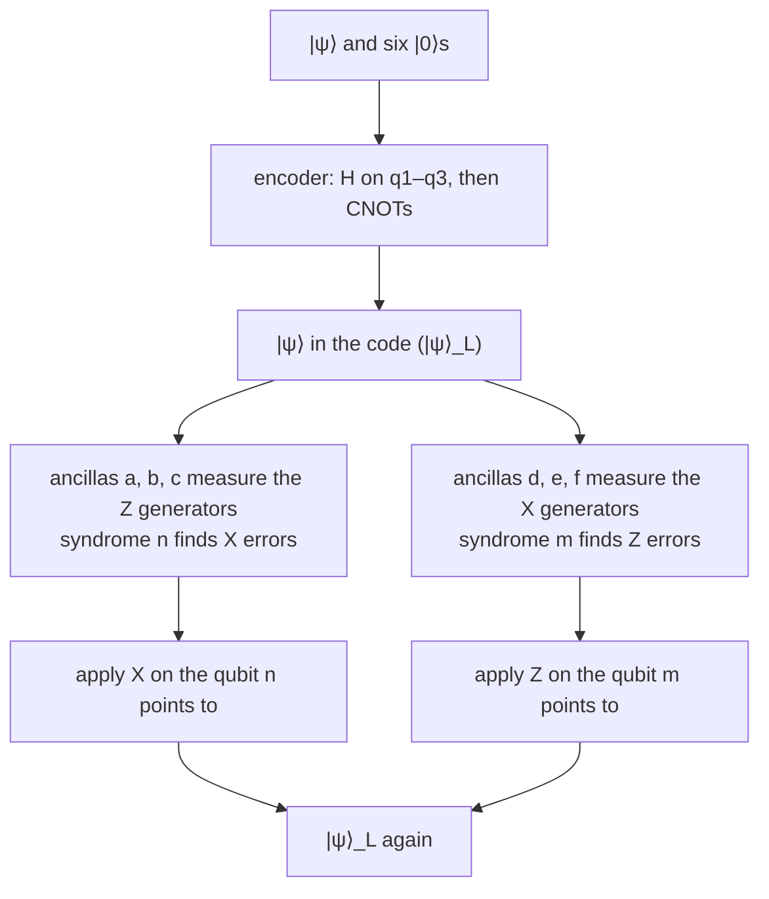

#steane_code #stabilizer_codes #syndrome #quantum_error_correction
## the whole thing in three steps
the 7 qubit Steane code as a circuit: **encode** one qubit into seven, **detect** errors by measuring the six stabilizer generators with six ancillas, then **correct** by flipping the qubit the syndrome points to. part of [[Fault-tolerant quantum computing]]

the generators used here are
$$
\begin{aligned}
&Z_1Z_5Z_6Z_7\qquad Z_2Z_4Z_6Z_7\qquad Z_3Z_4Z_5Z_7\\
&X_1X_5X_6X_7\qquad X_2X_4X_6X_7\qquad X_3X_4X_5X_7
\end{aligned}
$$
^steane-circuit-generators

this is the same code as [[Transversal gates on stabilizer codes#^steane-generators]] with the qubits numbered differently (the same $X$ and $Z$ patterns, so still CSS)
## encoding
start with $|\psi\rangle=\alpha|0\rangle+\beta|1\rangle$ on qubit 4 and $|0\rangle$ on the rest

![[Steane_encoder.png]]

- **the first two CNOTs** copy the logical value onto qubits 5 and 6: $|1\rangle$ becomes $|0001110\rangle$. that's $\bar X=X_4X_5X_6$ acting on the encoded $|0\rangle$
- **each Hadamard + CNOT fan** makes one $X$ generator: $H$ puts $q_1$ in $|+\rangle$ (stabilized by $X_1$), and the CNOTs spread that $X$ onto their targets, $X_1\to X_1X_5X_6X_7$. same for $q_2$ and $q_3$
- the $Z$ generators come for free: every qubit starts in $|0\rangle$, and after the CNOTs the parities $Z_1Z_5Z_6Z_7$ and so on are still $+1$

so the output is $\alpha|0_L\rangle+\beta|1_L\rangle$, with $|0_L\rangle$ an equal superposition of 8 code words (checked numerically: all six generators give $+1$, and $Z^{\otimes7}$ gives $+1$ for $|0\rangle$ and $-1$ for $|1\rangle$)
## error detection
each ancilla measures one generator: $H$, a controlled version of the generator, $H$, measure. the outcome is 0 for eigenvalue $+1$ and 1 for $-1$ (the [[Phase kickback]] trick)

![[Steane_error_detection.png]]

- **a, b, c** use controlled-$Z$s: they measure the $Z$ generators, which anticommute with **$X$ errors**
- **d, e, f** use CNOTs (controlled-$X$): they measure the $X$ generators, which anticommute with **$Z$ errors**
- ==the ancillas only learn the **parities**, never the data itself, so the encoded superposition survives==

> [!extra] H, controlled-Z, H is a CNOT
> controlled-$Z$ is symmetric, and $H$ on the target turns it into a CNOT. so $H$–$CZ$–$H$ on the ancilla is just a CNOT **from** the data qubit **onto** the ancilla: the ancilla adds up the data qubits mod 2, like a classical parity check
## error correction
read the syndromes as binary numbers
$$
n=a+2b+4c\qquad m=d+2e+4f
$$
^steane-circuit-syndrome

$n$ says which qubit had an $X$ error, and $m$ which had a $Z$ error. the ancilla $a$ checks qubits 1, 5, 6, 7, so which of $a$, $b$, $c$ fire depends on where the qubit appears in the generators

| qubit with the error | 1 | 2 | 3 | 4 | 5 | 6 | 7 |
|---|---|---|---|---|---|---|---|
| ancillas that fire | $a$ | $b$ | $c$ | $b,c$ | $a,c$ | $a,b$ | $a,b,c$ |
| syndrome $n$ (or $m$) | 1 | 2 | 4 | 6 | 5 | 3 | 7 |

^steane-circuit-lookup

$n=0$ means no $X$ error. every qubit has a **different** nonzero syndrome, so ==any single $X$ error and any single $Z$ error can be found and undone==, and a $Y=iXZ$ error shows up in both $n$ and $m$ on the same qubit. (renumber the qubits by their syndrome, $3\to4$, $4\to6$, $6\to3$, and $n$ is the qubit number itself: that's the binary pattern of [[Transversal gates on stabilizer codes#^steane-generators]])

> [!important] not fault tolerant yet
> one ancilla touches four data qubits. an $X$ error on ancilla $d$ halfway through spreads through its remaining CNOTs onto **several** data qubits, more than the code can fix. that's why [[Fault-tolerant measurement]] replaces each ancilla with a checked cat state

> [!exercise] try these
> ① an $X$ error hits qubit 4. which ancillas fire, and what is $n$?
> ② a $Y$ error hits qubit 6. what are $n$ and $m$, and what do you apply?
> ③ why not just measure qubits 1, 5, 6, 7 in the $Z$ basis to get the parity $Z_1Z_5Z_6Z_7$?
> ④ check that $\bar X=X_4X_5X_6$ commutes with all three $Z$ generators

> [!answer]-
> ① qubit 4 is in $Z_2Z_4Z_6Z_7$ and $Z_3Z_4Z_5Z_7$, so $b$ and $c$ fire: $n=2+4=6$, which the table maps back to qubit 4
> ② $Y_6$ anticommutes with both kinds of generator through qubit 6: $a,b$ fire and $d,e$ fire, so $n=m=3$ → qubit 6. apply $X_6$ and $Z_6$ (a $Y$ up to phase)
> ③ that measures each qubit separately and collapses the superposition of code words, destroying $|\psi\rangle_L$. the ancilla only learns the parity
> ④ overlaps with $\{1,5,6,7\}$, $\{2,4,6,7\}$, $\{3,4,5,7\}$ are $\{5,6\}$, $\{4,6\}$, $\{4,5\}$: two each, so two sign flips cancel ✓

see also [[Stabilizer codes]], [[Transversal gates on stabilizer codes]], [[Fault-tolerant measurement]], [[Calderbank-Shor-Steane codes]], [[Standard form and stabilizer circuits]], maths: [[Linear algebra mod 2]]

week hub: [[Principles of fault tolerance]]
