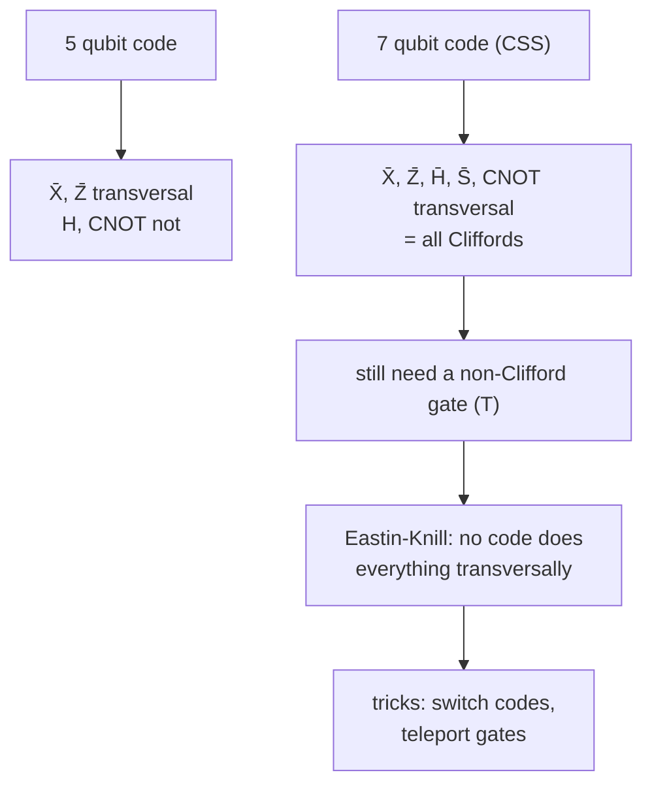

#fault_tolerance #transversal #stabilizer_codes #steane_code
## which gates are easy?
the easiest way to do a gate on encoded data is **transversally**: the same gate on every qubit (or between matching qubits of two blocks), exactly like the classical [[Transversal gates]]. one failure then only touches one qubit per block. so which gates can each code do this way? part of [[Fault-tolerant quantum computing]]
## the 5 qubit code
its stabilizer is generated by
$$
XZZXI\qquad IXZZX\qquad XIXZZ\qquad ZXIXZ
$$
^five-qubit-generators

(memorize the first, then shift it cyclically one place at a time to get the others)
- **logical $X$**: $\bar X=XXXXX$. each generator has two $Z$s, and $X$ anticommutes with $Z$, so two sign flips cancel: it commutes with every generator, so it's in the [[Fault-tolerant quantum computing#^normalizer|normalizer]]
- **logical $Z$**: $\bar Z=ZZZZZ$, for the same reason
- **Hadamard: not transversal**. $H^{\otimes5}$ swaps $X\leftrightarrow Z$, which turns $XZZXI$ into $ZXXZI$. that **anticommutes** with $IXZZX$ (they clash only in place 3), so it isn't in the stabilizer and $H^{\otimes5}$ doesn't map the code to itself
- the CNOT doesn't work bitwise either

so ==the 5 qubit code has no simple way to do the gates needed for universal computation on its encoded data==
## the 7 qubit code
the stabilizer generators are easiest to remember by writing the numbers 1 to 7 in binary down the columns (an $X$ for each 1)
$$
\begin{aligned}
&IIIXXXX\qquad IXXIIXX\qquad XIXIXIX\\
&IIIZZZZ\qquad\,IZZIIZZ\qquad\,ZIZIZIZ
\end{aligned}
$$
^steane-generators

the same pattern as the parity check matrix of the classical $[7,4]$ Hamming code ([[Classical linear codes#^hamming-7-4]]), once with $X$s and once with $Z$s. that makes it a **CSS code** (Calderbank-Shor-Steane, [[CSS codes]]), and it has beautiful properties

| gate | transversal? | why |
|---|---|---|
| $\bar X$ | $X^{\otimes7}$ ✓ | 7 $X$s meet each $Z$ generator in 4 places: commutes |
| $\bar Z$ | $Z^{\otimes7}$ ✓ | the same with $X$ and $Z$ swapped |
| $\bar H$ | $H^{\otimes7}$ ✓ | swaps the $X$ generators with the $Z$ generators, which is still the same stabilizer |
| CNOT | 7 bitwise CNOTs ✓ | between two code blocks, qubit $i$ to qubit $i$ |
| $\bar S$ | $(S^\dagger)^{\otimes7}$ ✓ | exercise ② |

> [!important] the one idea
> ==every CSS code has a transversal CNOT, and every stabilizer code with a transversal CNOT is a CSS code==. a lovely fact to try proving yourself
## but not universal
$H$, $S$ and CNOT generate only the [[Clifford group]], and that isn't universal ([[Fault-tolerant quantum computing#why Cliffords aren't enough]]). so even the 7 qubit code is missing a gate. could some other code do everything transversally? no:

> [!warning] the Eastin-Knill theorem (2009)
> ==no quantum error-correcting code, stabilizer or not, has a universal set of transversal gates==. you can't get universal quantum computation by staying inside one code and only using transversal gates

stabilizer codes are the most useful codes to work with, because they're the quantum analog of classical linear codes, with big families and nice properties. so this is a real blow, and the next lectures are a series of tricks to get around it
- **switching codes**: complicated codes that have several families together, moving the data between codes that each do different gates transversally
- **teleporting gates**: prepare a special state, then use a teleportation-like circuit ([[Teleportation]]) to apply the missing gate

for the first threshold estimate ([[Quantum threshold estimate]]) we just assume the CNOT is the gate to count. a strong caveat to keep in mind

> [!exercise] try these
> ① check that $ZZZZZ$ commutes with all four 5 qubit code generators
> ② what does $S^{\otimes7}$ do to the 7 qubit code? (use $SXS^\dagger=Y=iXZ$, and that the $X$ generators have 4 $X$s)
> ③ why does $H^{\otimes7}$ work for the 7 qubit code but $H^{\otimes5}$ fail for the 5 qubit code?

> [!answer]-
> ① each generator has two $X$s, so $ZZZZZ$ anticommutes in two places: two sign flips cancel ✓
> ② an $X$ generator $X^{\otimes4}$ goes to $Y^{\otimes4}=i^4X^{\otimes4}Z^{\otimes4}$, the product of an $X$ generator and the $Z$ generator on the same qubits: still in the stabilizer ✓. $\bar X=X^{\otimes7}$ goes to $Y^{\otimes7}=i^7X^{\otimes7}Z^{\otimes7}=-i\bar X\bar Z=-\bar Y$, which is what $\bar S^\dagger$ does. so $S^{\otimes7}=\bar S^\dagger$, and $(S^\dagger)^{\otimes7}=\bar S$
> ③ the 7 qubit code's $X$ and $Z$ generators have the **same pattern**, so swapping $X\leftrightarrow Z$ just swaps the two sets. the 5 qubit code's generators mix $X$s and $Z$s, and the swapped versions aren't in its stabilizer

see also [[Transversal gates]], [[Classical linear codes]], [[Shor code]]

week hub: [[Principles of fault tolerance]]
