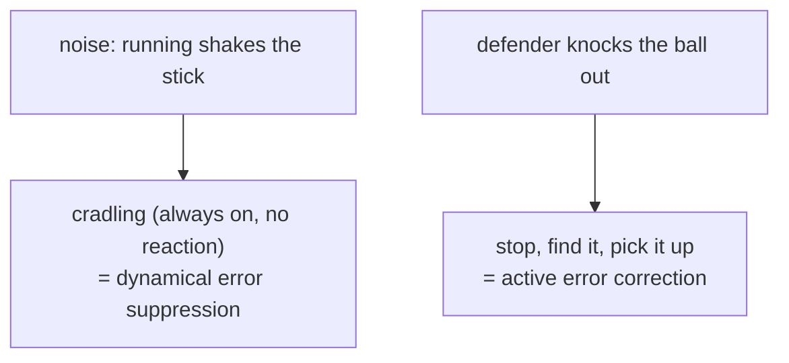

#noise #decoherence #power_spectral_density #filter_function
## recap: two kinds of noise
in course 3 ([[Noise Processes]]) noise came in two kinds, [[Systematic noise]] and [[Stochastic noise]]. this part of the week is about suppressing **stochastic** noise: random fluctuations of some parameter coupled to the qubit, which cause decoherence. part of [[Quantum error mitigation]]
## relaxation and dephasing
- **relaxation**: a qubit in $|1\rangle$ loses its energy to the environment and drops to $|0\rangle$, at the rate $\Gamma_1=1/T_1$ ([[Amplitude damping channel]]). assume it's rarely kicked back **up** by the environment
- **decoherence on the equator**: a Bloch vector on the equator loses its phase at the rate $\Gamma_2=1/T_2$. two things can go wrong there
  1. it **relaxes** to the north pole ($T_1$). after that there's no way to tell which way it was pointing, so this breaks the phase too
  2. it **diffuses around the equator**: this is **dephasing**, with time $T_\phi$

![[Relaxation_vs_dephasing.png]]

$T_2$ combines both:

![[Phase damping channel#^t2-relation]]

with no dephasing at all ($T_\phi\to\infty$), $T_2=2T_1$: the best you can do, limited only by relaxation

> [!important] the one idea
> ==relaxation is irreversible, but dephasing can be **coherent**, and then it can be undone==. that's what dynamical decoupling does: a kind of **passive** error suppression, built from pulses
## the lacrosse picture
a lacrosse player runs down the field with the ball in the net at the end of their stick. running shakes the stick (the **noise**)
- hold the stick still in front of you → the ball soon falls out
- **cradle** the stick, back and forth, the whole time → the ball stays in. players do it out of habit, not in response to anything in particular: it **decouples** the ball from the running noise. that's **dynamical error suppression**
- but cradling can't stop a defender from knocking the ball to the ground. then you have to stop, find the ball and pick it up: that's **active error correction**

## example: a flux qubit
a superconducting **flux qubit**: a superconducting loop interrupted by 4 Josephson junctions. the magnetic flux $\Phi$ through the loop sets the qubit energy $E_{01}$. local magnetic field fluctuations make $\Phi$, and so $E_{01}$, wobble: that's what dephases the qubit

![[Flux_qubit_noise.png]]

start in $\alpha|0\rangle+\beta|1\rangle$. $|1\rangle$ has more energy, so it gathers phase faster:
$$
\alpha|0\rangle+\beta e^{-i\varphi(t)}|1\rangle,\qquad\varphi(t)=\frac{E_{01}}\hbar\,t
$$
^free-evolution

this is **free evolution**: the phase changes only because of the energy gap, with no driving
- **no noise**: $E_{01}$ is fixed, the phase is deterministic, you can say exactly what it'll be at any time
- **with noise** (eg. slow flux noise): $E_{01}=\bar E_{01}+\tilde E_{01}(t)$, an average plus a fluctuating part, so $\varphi=\bar\varphi+\tilde\varphi(t)$. the random $\tilde\varphi$ is the dephasing

> [!eg] numbers
> a qubit at $E_{01}/h=5$ GHz gathers $2\pi\times5\times10^9$ radians of phase per second. if noise shifts it by just $0.01\%$ (500 kHz), then after $1\,\mu$s the phase is off by $2\pi\times500\times10^3\times10^{-6}=\pi$ rad: completely scrambled
## how much it dephases
average over the ensemble. the phase is the time integral of the energy fluctuation, $\tilde\varphi(t)=\frac1\hbar\int_0^t\tilde E_{01}(t')\,dt'$, and if the noise is **Gaussian** (many weakly coupled magnetic noise sources), the average of $e^{-i\tilde\varphi}$ is
$$
\big\langle e^{-i\tilde\varphi(t)}\big\rangle=\exp\left[-\frac{t^2}{2\hbar^2}\left(\frac{\partial E_{01}}{\partial\Phi}\right)^2\frac1{2\pi}\int_{-\infty}^{\infty}S_\Phi(\omega)\,g(\omega,t)\,d\omega\right]
$$
^dephasing-decay

three pieces
- $\left(\frac{\partial E_{01}}{\partial\Phi}\right)^2$: how **sensitive** the qubit energy is to flux. (that's why qubits are often run at a "sweet spot" where this derivative is zero)
- $S_\Phi(\omega)$: the **power spectral density** of the flux noise ([[Noise power spectral density]]), units $\Phi^2/$Hz. on its own, $\frac1{2\pi}\int S\,d\omega$ is just the variance of the noise
- $g(\omega,t)$: the **filter function**. it depends on the **pulses** you apply, and it windows (filters) the noise spectrum

> [!important] pulses shape the noise
> ==the qubit doesn't see the whole noise spectrum, only the part let through by the filter function, and you choose the filter function by choosing the pulse sequence==

the filter function is the Fourier transform of the sign pattern $y(t')=\pm1$ (flipped by every $\pi$ pulse, see [[Dynamical decoupling]])
$$
g(\omega,t)=\left|\frac1t\int_0^ty(t')\,e^{i\omega t'}\,dt'\right|^2
$$
^filter-function

with no pulses, $y=1$ throughout and $g=\text{sinc}^2(\omega t/2)$

> [!extra] where the formula comes from
> for a Gaussian variable, $\langle e^{-i\tilde\varphi}\rangle=e^{-\langle\tilde\varphi^2\rangle/2}$. squaring the time integral gives a double integral of the autocorrelation $\langle\tilde E(t_1)\tilde E(t_2)\rangle$, and [[Noise power spectral density#Wiener–Khinchin theorem|Wiener–Khinchin]] turns that into $\frac1{2\pi}\int S(\omega)\left|\int_0^ty\,e^{i\omega t'}dt'\right|^2d\omega$

> [!exercise] try these
> ① $T_1=50\,\mu$s and $T_\phi=100\,\mu$s. what's $T_2$?
> ② a qubit is at a sweet spot, $\partial E_{01}/\partial\Phi=0$. how much does flux noise dephase it (to this order)?
> ③ why can't dynamical decoupling help with $T_1$?

> [!answer]-
> ① $\frac1{T_2}=\frac1{100}+\frac1{100}=\frac1{50}$, so $T_2=50\,\mu$s
> ② not at all: the exponent is proportional to $(\partial E_{01}/\partial\Phi)^2=0$. (higher order terms still dephase it a little)
> ③ relaxation gives energy away to the environment, which is irreversible. pulses can only refocus coherent phase errors

next: [[Dynamical decoupling]] (actual pulse sequences and their filter functions)

see also [[Noise spectra]], [[Rabi oscillation]], [[Phase damping channel]]

week hub: [[Quantum error mitigation]]
