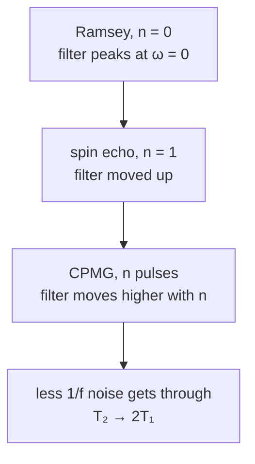
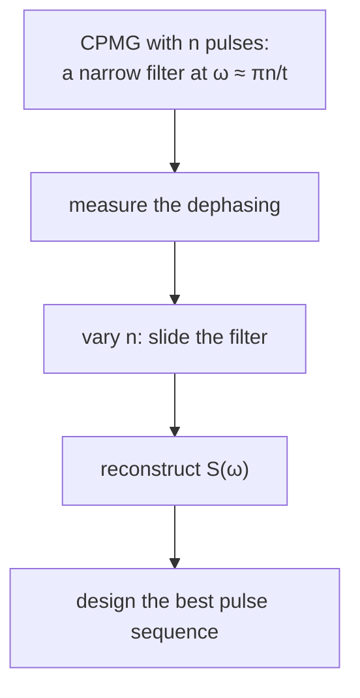

#dynamical_decoupling #noise #filter_function #spin_echo
## the setup
a flux qubit with magnetic flux noise ([[Dephasing and the filter function]]). the dephasing depends on the noise spectrum **seen through a filter function**, and the filter function comes from the pulses we apply. so which pulses help? three examples, from worst to best. part of [[Quantum error mitigation]]

the noise here is **1/f noise** ([[Noise spectra]]): big at low frequencies, falling as $1/f$. take it to be **quasi-static**: fixed during any one run, different from run to run (some probability distribution). work in the **rotating frame**, where with no noise the Bloch vector would just sit still along $x$

all the sequences on one page (the rotary echo is in [[Rotary echo]]):

![[Pulse_sequences.png]]
## Ramsey: do nothing (n = 0)
1. a $\frac\pi2$ pulse around $y$ brings the Bloch vector down to the equator, pointing along $x$
2. wait a time $\tau$ (free evolution)
3. a second $\frac\pi2$ pulse rotates it back to the $z$ axis. with no noise it ends exactly at $|1\rangle$ (south pole)

with noise, each run's Bloch vector drifts clockwise or anticlockwise around the equator, at a different speed depending on that run's noise offset. by the second pulse they're spread all over, so the ensemble ends up **largely depolarized**

follow **one** run. red is the qubit, its path stays drawn, and the grey dashed arrow is where it would be with no noise. nothing undoes the drift, so it misses $|1\rangle$:

![[Ramsey_animation.png]]

why, in frequency: during the wait, the energy offset of one run is constant, a **rectangle** in time. the Fourier transform of a rectangle is a **sinc**, centred at zero frequency. so ==with no pulses the filter function passes low frequencies, exactly where 1/f noise is strongest: the worst possible choice==. (in lacrosse terms: running without cradling)
## spin echo (n = 1)
put a $\pi$ pulse in the **middle** of the free evolution. it flips the Bloch vector over, so the runs that were drifting **away** from $x$ now drift **back towards** it, at the same speed. they all **refocus** right when the second $\frac\pi2$ pulse comes, and the vector lands on $|1\rangle$ again

![[Spin_echo_phases.png]]

the same run as in the Ramsey animation, with the same noise, now with the 180° pulse in the middle. watch the red path: it drifts 60° one way, gets flipped to the mirror side, and the **same** drift carries it straight back:

![[Spin_echo_animation.png]]

the evolution is now two half periods: a rectangle with sign $+$, then one with sign $-$ (the $\pi$ pulse inverted the system). their filter function

![[Dephasing and the filter function#^filter-function]]

with $y=+1$ then $-1$ is
$$
g_{\text{echo}}(\omega,t)=\frac{\sin^4(\omega t/4)}{(\omega t/4)^2}
$$
^echo-filter

which is **zero** at $\omega=0$ and peaks at a higher frequency. 1/f noise is weaker up there, so less noise gets through and the dephasing drops. this is **dynamical decoupling** of the qubit from its flux noise: cradling while running
## CPMG: more pulses (n = 2, 3, ...)
two $\pi$ pulses split the free evolution into three periods and push the passband even higher. **equally spaced** $\pi$ pulses, at times $\frac{j-1/2}n\,t$ for $j=1,\dots,n$, are the **CPMG** sequence (Carr, Purcell, Meiboom and Gill)

![[Filter_functions_CPMG.png]]

as $n$ grows, the filter moves to higher and higher frequencies, and the dephasing rate keeps dropping

the same run with two 180° pulses. it never drifts more than 30° before being flipped back:

![[CPMG_animation.png]]

![[Dephasing_more_pulses.png]]
(coherence under 1/f noise, worked out from [[Dephasing and the filter function#^dephasing-decay]])

> [!important] the one idea
> ==each $\pi$ pulse flips the sign of the phase the qubit is collecting, so slow noise cancels itself out; more pulses cancel faster noise too, and $T_2$ climbs towards its limit $2T_1$==


## what if the π pulses overshoot?
real pulses are never exactly $\pi$: the amplitude or length is a bit off, so every pulse rotates a bit too far. with one pulse that's a small error. with CPMG's dozens of pulses, could the errors **pile up**? it depends on **which axis** the $\pi$ pulses turn around
- **CPMG**: the $\pi$ pulses turn around $x$, the **same axis the state points along** (the first $\frac\pi2$ pulse put it on $x$). turning a vector around its own axis does nothing to it, so turning too far does nothing either. the small leftover errors from the noise drift also flip sign from pulse to pulse and cancel
- **CP** (Carr and Purcell, the older version): the $\pi$ pulses turn around $y$, **across** the state. each pulse that's 5% too long leaves the vector $9°$ off, and these $9°$s **add up**: after 10 pulses it's $90°$ off, pointing nowhere near where it should

![[Overshoot_CP_vs_CPMG.png]]

what a bad pulse does to one spin echo: every pulse is 25% too long (so "90°" is really 112° and "180°" is really 225°). the flip no longer lands on the mirror side, so the drift can't bring it home, and it ends up with only an 88% chance of $|1\rangle$:

![[Spin_echo_overshoot_animation.png]]

that's why CPMG has the "MG" (Meiboom and Gill): they made it robust to pulse errors by turning the $\pi$ pulses $90°$, from $y$ to $x$. (the CP curve swings back up because the extra rotation keeps going round: after about 20 pulses it's $180°$ off, pointing along $-x$, and the plot only measures how far along the $x$ axis it is, either way)

> [!extra]- the sequences as code
> the whole family in [Qiskit](https://www.qiskit.org/): $n=0$ is Ramsey, $n=1$ the spin echo, $n>1$ CPMG with the $\pi$ pulses at $\frac{j-1/2}n\,T$
> ```python
> from math import pi
> from qiskit import QuantumCircuit
>
> def cpmg(n, T=800, overshoot=0.0):
>     """n = 0: Ramsey, n = 1: spin echo, n > 1: CPMG. total wait T ns."""
>     f = 1 + overshoot                    # 0.05 = every pulse 5% too long
>     qc = QuantumCircuit(1)
>     qc.ry(f * pi / 2, 0)                 # π/2: onto the equator, along x
>     if n == 0:
>         qc.delay(T, 0, unit="ns")        # just wait
>     else:
>         qc.delay(T // (2 * n), 0, unit="ns")
>         for j in range(n):
>             qc.rx(f * pi, 0)             # π pulse around x (along the state)
>             qc.delay(T // n if j < n - 1 else T // (2 * n), 0, unit="ns")
>     qc.ry(f * pi / 2, 0)                 # π/2: read out, ideally |1⟩
>     qc.measure_all()
>     return qc
>
> print(cpmg(4).draw())
> ```
> `cpmg(4)` is π/2, then 100 ns, π, 200 ns, π, 200 ns, π, 200 ns, π, 100 ns, then π/2. with `overshoot=0.05` the noise free circuit still lands on $|1\rangle$ more than 99% of the time. change `qc.rx` to `qc.ry` to get CP and watch the error grow with `n`. on real hardware the `delay`s are where the noise acts
## noise spectroscopy
CPMG with many pulses has a **narrow** passband, centred near $\omega\approx\pi n/t$. change $n$ (or $t$) and the narrow filter slides around in frequency. measure how much the qubit dephases each time, and you can **reconstruct the noise spectrum** $S(\omega)$ the qubit sees: the qubit plus pulses becomes a **noise spectrometer**

![[Noise_spectroscopy.png]]

and once you know $S(\omega)$, you can design a pulse sequence whose filter function is **optimal** for that noise (within whatever constraints you have)



> [!eg] where the CPMG passband sits
> $n=10$ pulses over $t=20\,\mu$s: the pulses are $2\,\mu$s apart, so the sign flips every $2\,\mu$s, a square wave of period $4\,\mu$s. the filter peaks near $1/(4\,\mu\text{s})=250$ kHz. for 1/f noise that's far weaker than the noise near 0 Hz that Ramsey lets through

> [!exercise] try these
> ① in a spin echo with total time $t$, when exactly is the $\pi$ pulse, and why does it have to be there?
> ② why does the spin echo refocus quasi-static noise **perfectly**, but CPMG still helps for real 1/f noise?
> ③ CPMG with $n=4$ pulses over $t=8\,\mu$s: when are the pulses?
> ④ every $\pi$ pulse is 2% too long. with CP pulses (around $y$), about how far off is the state after 25 pulses? and with CPMG?

> [!answer]-
> ① at $t/2$: the phase gathered in the first half ($+\delta\omega\,t/2$) is cancelled by the second half ($-\delta\omega\,t/2$) only if the halves are equally long
> ② quasi-static noise is constant during a run, so any equal $+$ and $-$ periods cancel it exactly. real 1/f noise also changes during the run; the echo only cancels the part slower than $t$, and more pulses (shorter periods) also cancel the faster parts
> ③ at $\frac{j-1/2}4\times8=1,3,5,7\,\mu$s
> ④ 2% of $180°$ is $3.6°$ per pulse, and with CP these add up: $25\times3.6°=90°$ off. with CPMG the pulses turn around the axis the state points along, so it stays (almost) where it should

see also [[Rotary echo]] (the same trick during a drive), [[Noise power spectral density]], [[Bloch sphere]]

week hub: [[Quantum error mitigation]]
