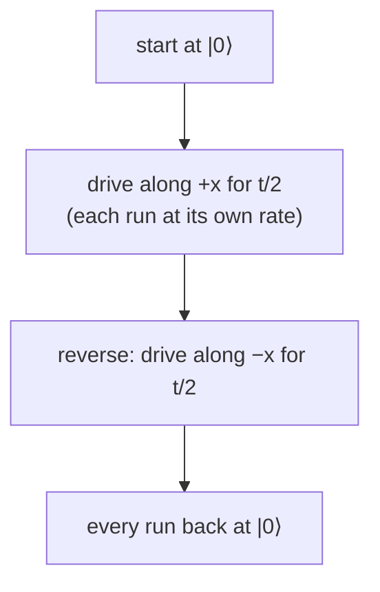
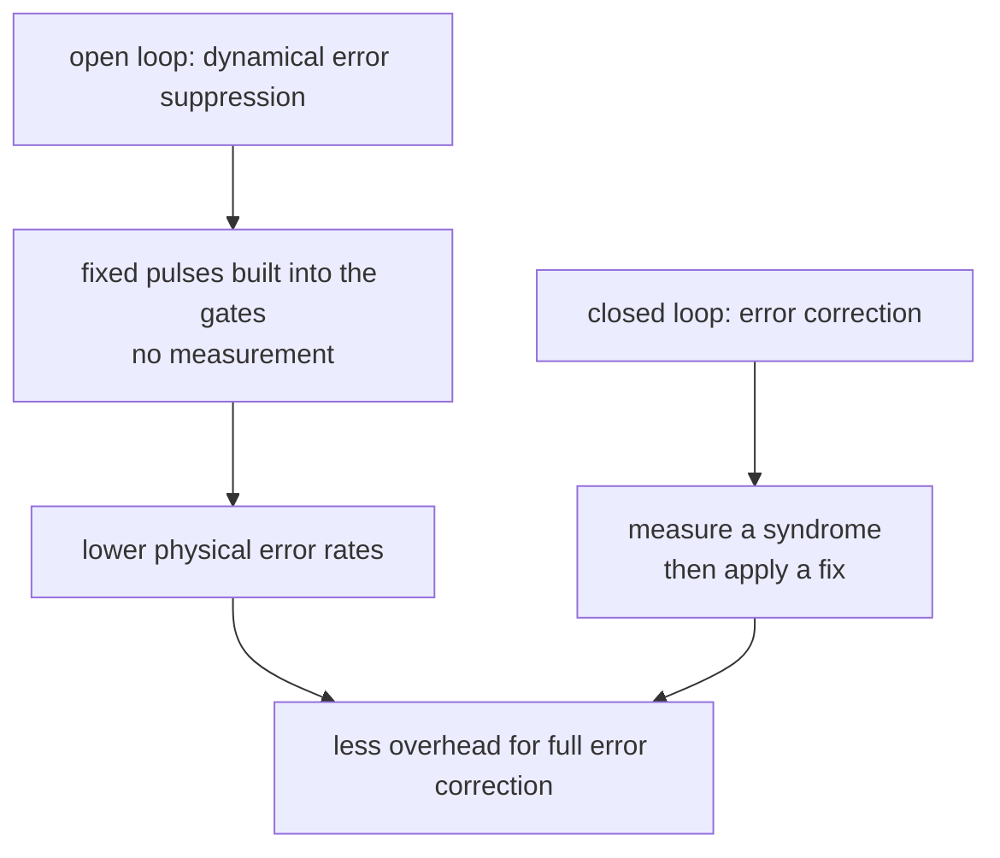

#dynamical_decoupling #rabi_oscillation #noise #filter_function
## from free to driven evolution
[[Dynamical decoupling]] protected a qubit while it sat still (free evolution). but noise also hits a qubit while it's being **driven**, ie. during gates. the **rotary echo** is the driven version of the spin echo. part of [[Quantum error mitigation]]
## the problem: a noisy Rabi oscillation
start in $|0\rangle$ and drive continuously along $x$ ([[Rabi oscillation]]). ideally the Bloch vector swings north pole → south pole → north pole around the drive axis, at the Rabi frequency, which is proportional to the drive amplitude

if the drive **amplitude** is noisy (quasi-static: fixed in each run, different between runs), each run rotates at a slightly different rate. the ensemble spreads out and the oscillation **decays** (Gaussian, as in [[Rabi oscillation#with noise]])
## the fix: reverse the drive halfway
in a **rotary echo**, the drive is **reversed** ($+x\to-x$) halfway through. whatever rate a run had, it now rotates back at the **same** rate, so the over- or under-rotation from the first half is exactly undone. at the end every run is back at the north pole: a **revival**

![[Rotary_echo.png]]

$$
R_{-x}(\Omega t/2)\,R_x(\Omega t/2)=I\qquad\text{for any }\Omega
$$
^rotary-echo

"for any $\Omega$" includes a drive that's simply **too strong**: an overshoot. read the animation like a table:
- **rows**: the drive is just right (top) or 25% too strong (bottom)
- **columns**: the drive is left on the whole time (left, grey) or reversed halfway, the rotary echo (right, purple)

the green ring is the target, $|0\rangle$, and the bar at the bottom shows when the drive gets reversed:

![[Rotary_echo_animation.png]]

- **just right**: both get back to $|0\rangle$ (a full $2\pi$ turn either way)
- **25% too strong**: without the reversal the qubit turns $2.5\pi$ and ends up on the equator, so a measurement gives $|0\rangle$ only half the time. with the reversal it retraces its path exactly and is back at $|0\rangle$

where it sits next to the other sequences:

![[Pulse_sequences.png]]

> [!important] the one idea
> ==reversing the drive undoes any amplitude error, whatever its size, just as a $\pi$ pulse undoes any phase drift in a spin echo==


> [!extra]- the rotary echo as code
> in [Qiskit](https://www.qiskit.org/), a continuous drive for a time is just a rotation by the angle it turns through
> ```python
> from math import pi
> from qiskit import QuantumCircuit
>
> def rotary_echo(theta, overshoot=0.0):
>     f = 1 + overshoot            # 0.25 = drive 25% too strong
>     qc = QuantumCircuit(1)
>     qc.rx(f * theta, 0)          # drive along +x
>     qc.rx(-f * theta, 0)         # drive reversed: along −x
>     qc.measure_all()             # always |0⟩, whatever the overshoot
>     return qc
> ```
> try `rotary_echo(pi, overshoot=0.25)`: it measures $|0\rangle$ every time. delete the second `rx` and add its angle to the first (`qc.rx(2 * f * theta, 0)`) to get the unreversed drive, which misses
## more reversals
just like spin echo → CPMG, for noise that falls off with frequency one reversal can become **many**. each extra reversal pushes the filter function to higher frequencies. here the filter shapes the noise spectrum of the **drive amplitude** fluctuations, not of the qubit frequency

| | free evolution | driven evolution |
|---|---|---|
| noise | qubit frequency (eg. flux noise) | drive amplitude |
| one flip | spin echo ($\pi$ pulse) | rotary echo (drive reversed) |
| many flips | CPMG | multiple reversals |
| filter function | moves up with more pulses | moves up with more reversals |

## open loop vs closed loop
dynamical decoupling and rotary echoes are **open loop** error suppression: nothing is measured, and no pulse depends on a measurement result (unlike error correction, which feeds measurement results forward). the pulses are just added to, or built into, the gates



==it uses the same pulses we already use for logic ($\pi$ pulses), and lowers the error rates from coherent, reversible errors==. lower physical error rates mean less overhead for full error correction ([[Threshold theorem]]: the further below threshold, the fewer levels of coding you need)

> [!exercise] try these
> ① a rotary echo is meant to rotate by $\pi$ around $+x$, then $\pi$ around $-x$. a run's drive is 5% too strong. what does it do in each half, and where does it end up?
> ② does a rotary echo help with noise in the qubit **frequency** during the drive?
> ③ is dynamical decoupling error correction? why or why not?

> [!answer]-
> ① the first half does $1.05\pi$ instead of $\pi$ (it overshoots $|1\rangle$). the second half does $-1.05\pi$. the total is $0$: back at $|0\rangle$ exactly
> ② not directly: it's built to cancel **amplitude** errors. frequency noise during free evolution is what the spin echo and CPMG handle
> ③ no: it's open loop suppression. it never measures anything, so it can't catch errors it isn't built for (the "defender knocking the ball out" errors, see [[Dephasing and the filter function#the lacrosse picture]])

see also [[Stochastic noise]], [[Composite pulses]], [[Fault-tolerant quantum computing]]

week hub: [[Quantum error mitigation]]
