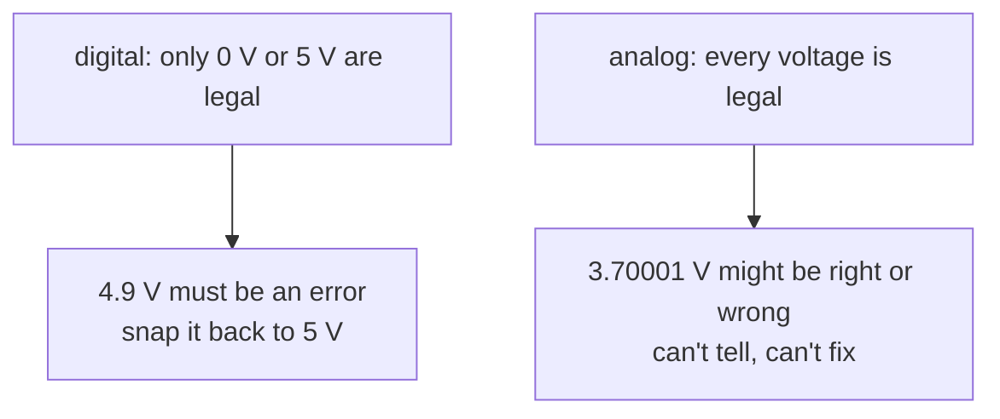

#quantum_error_correction #noise #pauli
## the old argument against quantum computers
right after [[Shor's algorithm]] came out, people argued online (on Usenet, a kind of early Twitter) that quantum computers could **never** be built, because of noise. the argument went like this:
- quantum computers look very powerful, but so do **analog computers** in theory
- the amplitudes of a quantum state are just real (complex) numbers, like the voltages in an analog computer
- and analog computers can't be built to high precision, because they **can't be error corrected**

part of [[Quantum error mitigation]]
## why analog computers can't be corrected
- **digital**: a bit is either 0 V or 5 V, everything else is **illegal**. if the computer sees 4.9 V it knows it should be 5 V, and bumps it back up
- **analog**: if 3.7 V is a legal value, so is 3.70001 V. if the voltage drifts a little, the computer has no way to tell whether that drift was supposed to happen or is an error

so ==analog computing is fundamentally not error correctable==. fine for a stereo (slightly wrong sound is still sound), not fine for a long maths calculation

## the quantum version of the problem
from now on $X=\sigma_x$, $Y=\sigma_y$, $Z=\sigma_z$ ([[Pauli matrices]]). take a small unwanted rotation
$$
e^{i\theta Z}
$$
$\theta$ varies **continuously** and can be tiny. there are infinitely many of these errors, impossible to tell apart, so how could you correct them all? before quantum codes existed this was a convincing argument, and the Usenet debate was part of what pushed Peter Shor and others to invent quantum error correcting codes
## the answer: errors are linear
$$
e^{i\theta Z}=\cos\theta\,I+i\sin\theta\,Z
$$
^rotation-as-paulis

a continuous rotation is just a **linear combination** of $I$ (no error) and $Z$ (a phase flip). so if a code corrects $I$ and $Z$, it corrects $e^{i\theta Z}$ for **every** $\theta$, at no extra cost

> [!important] the one idea
> ==the errors a quantum code corrects form a **linear subspace**: correct a few basis errors and you correct every linear combination of them==. that's what makes quantum error correction possible, and it's exactly what analog computers lack

the syndrome measurement does the work: it collapses $\cos\theta\,|\psi\rangle+i\sin\theta\,Z|\psi\rangle$ onto either "no error" or "one $Z$ error", and the second one gets fixed. the general version (any single qubit error is a sum of $I$, $X$, $Y$, $Z$):

![[Shor code#^pauli-expansion]]

> [!eg] a small rotation on the phase flip code
> $\theta=0.1$ on one qubit of the [[Phase flip code]]: the state becomes $\cos(0.1)|\psi_L\rangle+i\sin(0.1)Z_1|\psi_L\rangle$. the syndrome measurement gives "no error" with probability $\cos^2(0.1)\approx0.990$ (state is now perfect) and "$Z$ on qubit 1" with probability $\sin^2(0.1)\approx0.010$ (apply $Z_1$, state is now perfect). either way, no leftover $\theta$

> [!exercise] try these
> ① write $e^{i\theta X}$ as a combination of Paulis. which code corrects it?
> ② after the syndrome measurement in the example, is there any trace of $\theta$ left in the state?
> ③ why doesn't the same trick work for an analog voltage?

> [!answer]-
> ① $e^{i\theta X}=\cos\theta\,I+i\sin\theta\,X$: any code that corrects single bit flips, eg. the [[Bit flip code]]
> ② no: $\theta$ only set the **probabilities** of the two outcomes. after the measurement (and the fix) the state is exactly $|\psi_L\rangle$
> ③ the voltage is a single number with no redundancy and no "legal" set to project onto. the quantum code spreads the qubit over several qubits, and the syndrome measurement projects onto a small set of discrete outcomes

see also [[Discretization of the errors]] (the textbook proof), [[Shor code]], [[Detecting and correcting errors]], maths: [[Pauli matrices]]

week hub: [[Quantum error mitigation]]
