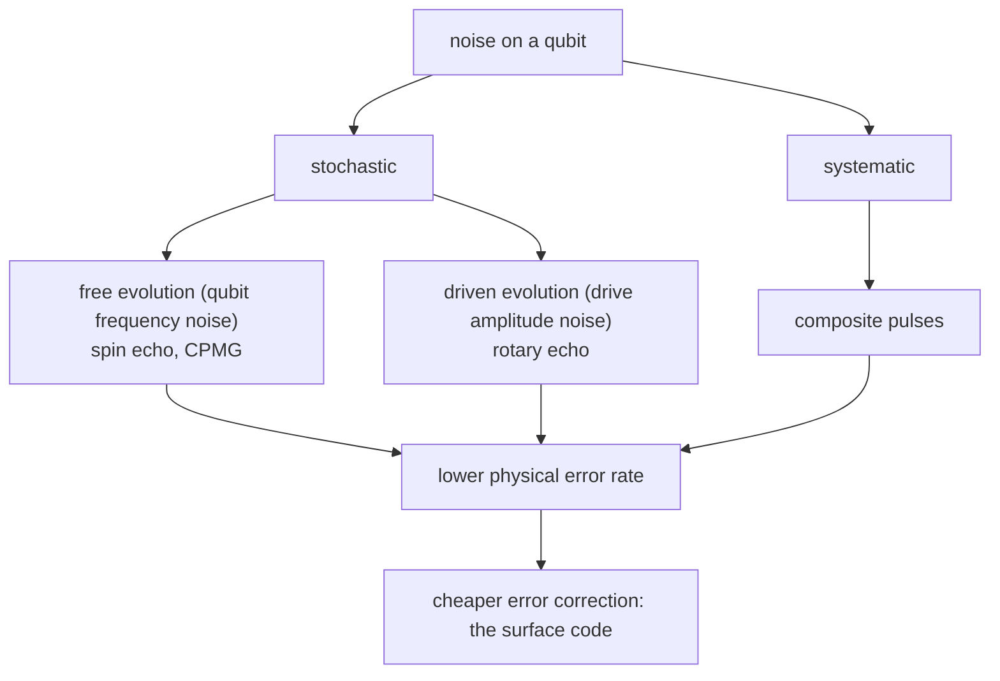

#error_mitigation #noise #dynamical_decoupling #quantum_error_correction
Course 4, Week 3: **quantum error mitigation**. before (and alongside) full error correction, lower the physical error rates with smart pulses
## why
[[Threshold theorem|the threshold theorem]] says error correction works once the physical error rate is below threshold, and the further below, the cheaper it gets ([[Cost of fault tolerance]]). so anything that lowers the physical error rate for free is worth having. this week: tricks that use the pulses we already apply for gates, with **no measurements**
- **systematic** errors (the same every time) → [[Composite pulses]]
- **stochastic** errors (random, but slow and coherent) → **dynamical error suppression**: echoes and dynamical decoupling

> [!important] the one idea
> ==dynamical error suppression is open loop: fixed pulse sequences that make slow noise cancel itself out, lowering the physical error rate before any error correction is applied==

## this week's notes
### error correction
- [[Correcting continuous errors]] → analog computers can't be corrected, but a continuous error $e^{i\theta Z}=\cos\theta\,I+i\sin\theta\,Z$ is a linear combination, so a code that fixes $Z$ fixes it too
### dynamical error suppression
- [[Dephasing and the filter function]] → $T_1$, $T_\phi$, $T_2$, the lacrosse picture, a flux qubit's random phase, and the dephasing formula where the pulses act as a **filter function** on the noise spectrum
- [[Dynamical decoupling]] → Ramsey (filter at 0 Hz, the worst for 1/f noise), spin echo, CPMG (filter moves up with more pulses), noise spectroscopy
- [[Rotary echo]] → the same trick during a drive: reverse the drive halfway to undo amplitude errors; open loop vs closed loop
### the surface code
once the physical errors are low enough, correct the rest:
- [[Surface code]] → detection events, the 2D grid of parity checks, why it tolerates ~1% error with only nearest neighbour gates
- [[Surface code logical operations]] → logical qubits are chains across the grid, measuring big parities (lattice surgery), a CNOT made of measurements
- [[Magic state distillation]] → $T$ gates use up $T$ states: injection, 15 to 1 distillation ($35p^3$), factories, a millisecond per AND gate
- [[Decoding the surface code]] → $10^{12}$ bits a second, minimum weight perfect matching, thousands of CPUs, under 10 µs latency
## also this week
- [[Course 4 Week 3 formulas]] → every formula from this week on one page, with examples and exercises

coming up: [[Composite pulses]]

see also [[Noise Processes]], [[Noise power spectral density]], [[Rabi oscillation]]

previous week: [[Principles of fault tolerance]] · course overview: [[Requirements for large scale quantum computation]]
