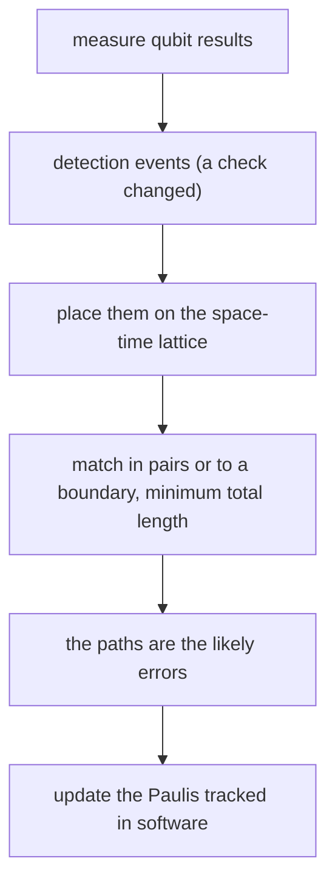

#surface_code #quantum_error_correction #decoding
the [[Surface code]] only produces **detection events**. something classical has to turn them into "which errors happened": the **decoder**. for a big machine that's a serious computer of its own

(the hard part on the quantum side is still the physical gate error: no real scale up can happen until gates are good enough for the surface code, and stay that good as the system grows)
## how much data
- one round of error detection on a superconducting chip: about **1 µs**
- about **half** the qubits (the measure qubits) are measured every round, each giving 1 bit
- a machine big enough for classically intractable chemistry: **100,000 to 1,000,000** physical qubits

so of order $10^{11}$ to $10^{12}$ bits **per second**. at a physical error rate of $\sim0.1\%$, roughly **1 in 20** bits is a detection event
## minimum weight perfect matching
model errors as chains that can only run along certain directions in **space and time** (a measure qubit giving a wrong result is a chain in the time direction). the allowed directions form a 3D lattice: the 2D chip horizontally, one layer per round, time going up. this lattice is worked out in advance

each error chain leaves a detection event at **each end** (or one end, if the other is on a boundary):

![[Surface_code_matching.png]]

so: pair up the detection events, or connect one to the nearest boundary, with paths whose **total length is as small as possible**. short chains are much more likely than long ones, so ==the most likely explanation is the matching with the fewest errors==. that's **minimum weight perfect matching**

**how to find the pairs**: picture the lattice edges as water pipes, fatter for more likely errors so water flows faster along them. pour water into every detection event, each one grows an exploring region. when two regions touch **only each other**, match those two
- this simple case is easy to build into **FPGAs** (fast, reconfigurable chips)
- messier cases, with several regions colliding, go to **CPUs**
## how big the classical computer is
- one CPU core keeps up with about **100 physical qubits**
- so 1,000 to 10,000 cores just for error correction
- a normal operating system can pause a core for milliseconds, so it needs a **custom real-time OS**, and probably custom hardware for core-to-core communication
## why it has to be fast
in [[Magic state distillation]], whether each later step is done depends on corrected earlier measurement results. ==the decoder's latency should be under about 10 µs==. if it's slower, the quantum computer has to wait, adding extra rounds of error detection while it waits, which costs time and qubits

> [!important] the one idea
> ==a surface code computer needs thousands of CPUs and FPGAs, connected in a custom way, decoding $10^{12}$ bits a second with under 10 µs of latency==

> [!exercise] try these
> ① a chip with 200,000 physical qubits does a round every 1 µs. how many bits per second come out, and about how many are detection events (1 in 20)?
> ② how many CPU cores does that need?
> ③ two detection events are 2 steps apart, and each is 4 steps from the boundary. what does matching choose, and why?
> ④ why is it fine for the decoder to be wrong about exactly *which* path the errors took, as long as the ends are right?

> [!answer]-
> ① half are measured: $10^5$ bits per µs $=10^{11}$ bits/s, about $5\times10^9$ detection events per second
> ② $200{,}000/100=2000$ cores
> ③ pair them with each other: total length 2, against 8 for sending both to the boundary. 2 errors are far more likely than 8
> ④ two paths with the same ends differ by a closed loop, and a closed loop of errors is a product of checks (a stabilizer), which does nothing to the logical qubit. only a mistake that adds up to a chain right across the grid is a logical error

see also [[Surface code logical operations]], [[Parity measurement]], [[Threshold theorem]]

part of [[Surface code]] · week hub: [[Quantum error mitigation]]
