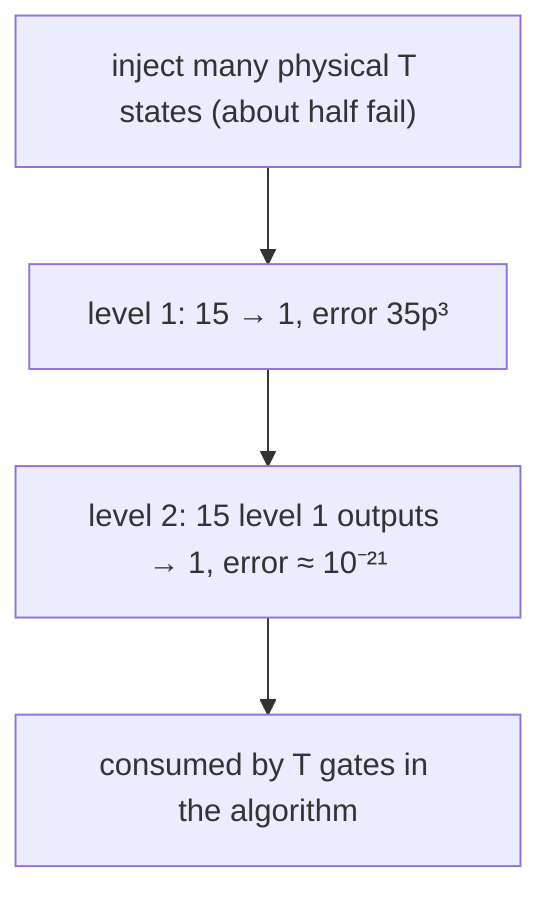

#surface_code #magic_state #T_gate #fault_tolerance
the [[Surface code logical operations|measurement tricks]] give the Clifford gates, but those aren't enough ([[Fault-tolerant quantum computing#why Cliffords aren't enough]]). the missing piece is the $T$ gate ([[Phase shift]]), and on the surface code it's by far the most expensive part
## T gates eat T states
you can't do $T$ directly on a logical qubit, but you can **teleport** it in ([[Transversal gates on stabilizer codes#but not universal]]) using a special ancilla, the **$T$ state** (or **magic state**)
$$
|T\rangle=T|+\rangle=\frac{|0\rangle+e^{i\pi/4}|1\rangle}{\sqrt2}
$$
^t-state

![[T_gate_from_T_state.png]]

a CNOT from the data onto $|T\rangle$, measure the $|T\rangle$ qubit: outcome 0 leaves $T|\psi\rangle$, outcome 1 leaves $T^\dagger|\psi\rangle$, fixed with an $S$ (a Clifford, so easy). each $T$ gate **uses up** one $T$ state. so the real question is: ==how do you make good $T$ states?==
## step 1: injection
start with **one physical qubit** in the $T$ state, then switch on error detection around it in a particular way so it grows into a logical qubit (a method by Ying Li)
- if errors are detected early on, the injection has **failed** and must be repeated. at gate errors $\sim10^{-3}$ that's about **half** the time
- so to be nearly sure of a $T$ state at a given place and time, leave room for many attempts (eg. 20 attempts: all fail with probability $0.5^{20}\approx10^{-6}$)
- when one succeeds, grow that logical qubit to the full patch size for safer storage

even when it works, the injected $T$ state's error is about that of **one two-qubit gate**, $\sim p$. that's far too high for a long fault-tolerant computation
## step 2: distillation
**15 to 1 distillation**: take **15** noisy injected $T$ states and run a circuit that outputs **1** better one (it's built on a code, so errors in the inputs get detected and that run is thrown away). the output error is
$$
p_{out}\approx35\,p^3
$$
^distill-error

with $p$ the two-qubit physical gate error. at $p=10^{-3}$: $35\times10^{-9}=3.5\times10^{-8}$

for many algorithms one level isn't enough, so feed the outputs of the first level into a second level: $35\,(3.5\times10^{-8})^3\approx10^{-21}$

**the distillation circuit as measurements**: on paper the circuit is mostly CNOTs with one control and many targets, and those are cheap ([[Surface code logical operations#a CNOT made of measurements]]). better still: **prepare $|+\rangle$ then a multi-target CNOT** is the same as **prepare $|0\rangle$ then measure a multi-qubit $\bar X$**. so the whole thing is just **five 8-body logical $X$ measurements** on 16 logical qubits, plus the final $T$ gates. drawn in 3D (2D chip + time going up), with qubits only switched on when they're needed, it looks like a little engine: "3D quantum assembly code"
## how big and how slow
for a two-level factory with $p=10^{-3}$ and 1 µs per round of error detection:
- about **150,000 physical qubits**
- one output $T$ state about every **200 µs**
- the quantum version of an AND gate (a [[Toffoli gate]]) needs **4** $T$ states, so ==nearly a millisecond for one AND==

so a quantum computer is **slow** per operation, millions of times slower than a classical one. it still wins on problems with an **exponential** speed up, which beat any constant factor

with $p=10^{-4}$: under **15,000 qubits**, and twice the output rate. and with many qubits you can run many factories in parallel to go as fast as you like

> [!important] the one idea
> ==T gates are paid for with T states, and making good ones (inject, then distill 15 into 1) is the slowest, biggest part of a surface code computer==

## a whole computer
a big square chip split up into
- **patches**: the protected logical qubits
- a large rectangle: a **$T$ state factory**
- **open lanes**: room to move logical qubits around and make them interact (lattice surgery)

the factory is large but not the main cost. not long ago, 90% or more of the chip had to make $T$ states for reasonable run times. it's much less now thanks to better distillation and to quantum chemistry algorithms that need far fewer $T$ gates

> [!exercise] try these
> ① your injected $T$ states have error $p=2\times10^{-3}$. what's the error after one level of 15 to 1?
> ② an injection succeeds half the time. with room for 10 attempts, how often do you end up with no $T$ state?
> ③ an algorithm needs $10^8$ $T$ gates and must fail less than 1% of the time. is one level of distillation at $p=10^{-3}$ enough?
> ④ why not just apply $T$ transversally to every data qubit?

> [!answer]-
> ① $35\times(2\times10^{-3})^3=35\times8\times10^{-9}=2.8\times10^{-7}$
> ② $0.5^{10}\approx10^{-3}$, about 1 time in 1000
> ③ $10^8\times3.5\times10^{-8}=3.5$ expected errors, way more than 0.01: no, you need a second level ($10^8\times10^{-21}$ is tiny)
> ④ on the surface code that's not a valid logical gate, and by the Eastin-Knill theorem no code has a universal transversal set, so some gate always has to be done another way

see also [[Clifford group]], [[Gottesman-Knill theorem]], [[Teleportation]], [[Cost of fault tolerance]]

part of [[Surface code]] · week hub: [[Quantum error mitigation]]
