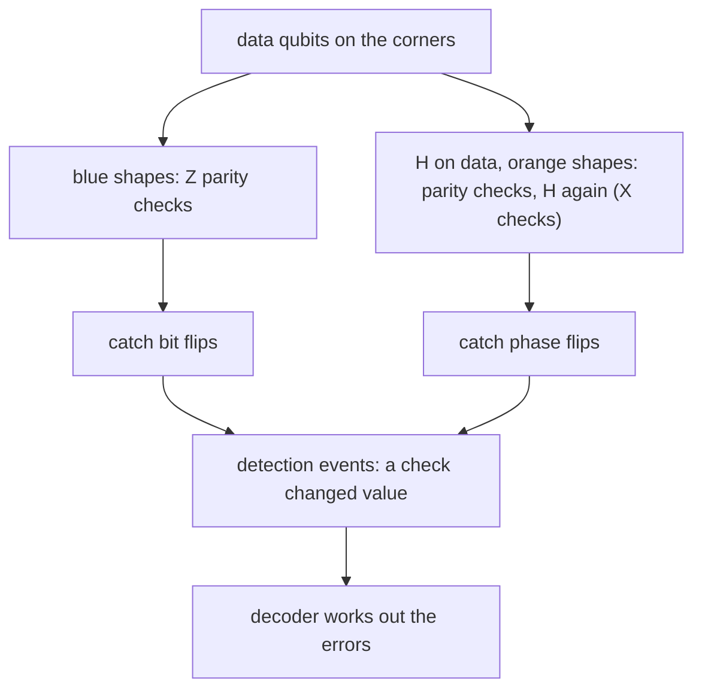

#surface_code #quantum_error_correction #stabilizer_codes #fault_tolerance
the error correcting code most likely to be used in a real large quantum computer. it's the [[Parity measurement]] idea from the [[Bit flip code]] spread out over a 2D grid
## detection events
the basic move: measure the **parity** of a few qubits, again and again, and watch for the value to **change**. a change is a **detection event**, and ==a detection event means there's an error somewhere nearby==

(watching for *changes* rather than the value itself means a check that starts at $-1$ for no reason is fine, it only matters when it flips)
## the layout
![[Surface_code_layout.png]]

- the **corners** (grey dots) are the **data qubits**, the ones holding the information
- each **square** and each **half circle** on the edge is a **measure qubit** sitting in the middle, doing a parity check on the data qubits it touches: 4 in the bulk ([[Parity measurement|weight four]]), 2 on the edges
- every data qubit is touched by at least one blue shape and one orange shape

**bit flips**: parity checks on the blue shapes ($Z$ checks, eg. $Z_1Z_2Z_3Z_4$) catch every single bit flip ($X$ error), because a flipped data qubit changes the parity of every blue shape it touches

**phase flips**: a Hadamard turns a phase flip into a bit flip ($HZH=X$, [[Hadamard Gate]]). so put $H$ on the data qubits, do the parity checks on the orange shapes, then $H$ again. that's an $X$ check, eg. $X_1X_2X_3X_4$

repeat both, forever: that's the surface code. all the checks commute (a blue and an orange shape always share 0 or 2 qubits), so it's a [[Stabilizer codes|stabilizer code]] with these checks as its generators

to first order this catches every error, since any error is a mix of $X$, $Z$ and both ([[Correcting continuous errors]]). some things it **can't** handle, and they need their own fixes
- **leakage** (the qubit leaves $\{|0\rangle,|1\rangle\}$): periodic resetting
- slow **drift of the gate calibration**: continuous recalibration
- **power cuts**: batteries and backup generators
## why the surface code
1. **only nearest neighbours**: each measure qubit only talks to the data qubits next to it. good for solid state chips (eg. superconducting qubits), where qubits can only couple to their neighbours
2. **each check is cheap**: about **half a dozen gates** (4 CNOTs plus a reset and a measurement) give one bit of information about local errors. so few gates per bit means each bit is very likely to be right
3. so a **high threshold**: a physical error rate around **1%** is tolerable in principle. no other code with only nearest neighbour gates tolerates as much

compare the [[Quantum threshold estimate]] for the 7 qubit code: $\sim10^{-4}$. the surface code is about 100 times more forgiving

> [!important] the one idea
> ==the surface code only needs nearest neighbour gates and about 6 gates per check, so it has the highest threshold (~1%) of any nearest neighbour code==

in practice, the lower the error rate the better: at a gate error around $10^{-3}$, making the code bigger **rapidly** suppresses the logical error. that's not yet been done in a scalable system, but it's within reach and several groups are racing for it

> [!extra] how fast "rapidly" is
> the size is the **code distance** $d$: the length of the shortest undetectable chain of errors (the grid above has $d=5$). roughly
> $$
> p_L\approx0.1\left(\frac p{p_{th}}\right)^{(d+1)/2}
> $$
> with $p_{th}\approx1\%$. at $p=10^{-3}$, every step $d\to d+2$ makes the logical error 10 times smaller. a distance $d$ patch uses $d^2$ data qubits and $d^2-1$ measure qubits

## more on the surface code
- [[Surface code logical operations]] → logical qubits are long chains, measuring big parities, a CNOT made of measurements
- [[Magic state distillation]] → the $T$ gate: inject, distill 15 into 1, factories and how slow it all is
- [[Decoding the surface code]] → the classical side: a trillion bits a second, minimum weight matching, sub 10 µs latency

> [!exercise] try these
> ① a single bit flip on a data qubit in the middle of the grid. how many detection events does it cause, and on which shapes?
> ② why do the orange checks need the $H$ gates before and after?
> ③ a blue square and an orange square share an edge. do their checks commute?
> ④ why does using fewer gates per check give a higher threshold?

> [!answer]-
> ① 2: the two blue shapes touching it (each data qubit in the bulk touches 2 blue and 2 orange shapes). the orange ones don't notice a bit flip
> ② a parity check in the computational basis only sees bit flips. $H$ swaps $X$ and $Z$, so between the two $H$ layers a phase flip looks like a bit flip
> ③ yes: they share 2 qubits, and $Z\otimes Z$ commutes with $X\otimes X$ (two minus signs cancel)
> ④ each gate can fail. with fewer gates in a check, there are fewer ways for the check itself to go wrong, so the information about errors is more reliable and more physical error can be tolerated

see also [[Parity measurement]], [[Stabilizer codes]], [[Threshold theorem]], [[Cost of fault tolerance]], [[Fault-tolerant quantum computing]]

week hub: [[Quantum error mitigation]]
