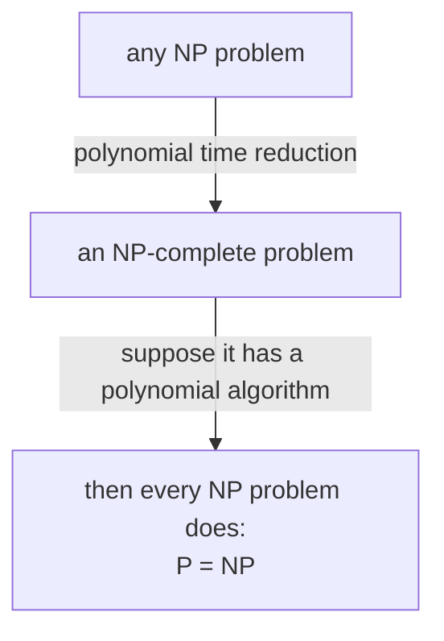

#complexity #complexity_class #NP
the **hardest** problems in [[NP]]: solve any one of them fast and you've solved all of NP fast. part of [[Complexity classes]]

## the definition
a problem is **NP-complete** if
- it's **in NP**: a yes answer has a short certificate you can check in polynomial time
- it's **NP-hard**: **every** NP problem can be turned into it by a polynomial time reduction

this is the same idea as BQP-complete in [[Quantum circuit evaluation#why it's BQP-complete]], just for NP

> [!important] all or nothing
> ==if a single NP-complete problem is in P, then P = NP==. decades of searching have turned up no such algorithm, which is the main reason people believe P ≠ NP

## examples

| problem | question | certificate |
|---|---|---|
| circuit SAT | does some input make this circuit output 1? | that input |
| travelling salesman | is there a round trip through all the cities, each once, shorter than $k$ miles? | the route |
| $n\times n$ Sudoku | can this grid be filled in? | the filled grid |
| map colouring | can the map be coloured with 3 colours so neighbours always differ? | the colouring |
| box packing | do these boxes fit into $k$ bins? | which bin each box goes in |

circuit SAT is the original one: it's exactly the OR over certificates in [[NP#^np-or]], with the verifier written as a circuit. lots of planning and scheduling problems turn out to be NP-complete, which is why NP gets so much attention

## why brute force is hopeless
for travelling salesman with $n$ cities, fix the start city and ignore the direction: there are $\frac{(n-1)!}2$ round trips to try

| cities | round trips |
|---|---|
| 10 | 181 440 |
| 20 | $6\times10^{16}$ |
| 30 | $4\times10^{30}$ |

$n!$ grows even faster than $2^n$: by Stirling's formula $n!\approx\sqrt{2\pi n}\left(\frac ne\right)^n$. smarter algorithms exist (dynamic programming takes about $n^22^n$ steps), but every known one is still exponential

## not everything in NP is NP-complete
if P ≠ NP, some problems sit **in between**: in NP, not in P, but not NP-complete either. the two famous candidates:
- **factoring**: in NP (the factors are the certificate), no fast classical algorithm known, but not believed to be NP-complete
- **graph isomorphism**: are two networks the same up to relabelling the nodes?

this matters for quantum computers: [[Shor's algorithm]] factors fast, but since factoring isn't NP-complete, that doesn't hand them the rest of NP ([[Quantum vs classical complexity]])

![[Complexity_hierarchy.png]]

> [!extra]- can a quantum computer solve NP-complete problems?
> nobody knows a way. [[Grover's algorithm]] speeds up brute force search from $2^n$ to about $2^{n/2}$ tries, but that's still exponential. the big quantum speed ups use a hidden structure in the problem (like the period in factoring), and NP-complete problems don't seem to have one. so people believe NP-complete problems are **not** in BQP

> [!exercise] try these
> ① you find a polynomial algorithm for 3-colouring maps. what happens to travelling salesman?
> ② how many round trips are there for 12 cities?
> ③ circuit SAT with 100 input bits: about how many tries does brute force need? and Grover?
> ④ factoring is in NP, and Shor's algorithm puts it in BQP. why doesn't that show NP ⊆ BQP?

> [!answer]-
> ① it becomes polynomial too: reduce travelling salesman to 3-colouring (polynomial time), then run your algorithm. in fact all of NP would be in P, so P = NP
> ② $\frac{11!}2=19\,958\,400$
> ③ brute force: up to $2^{100}\approx1.3\times10^{30}$. Grover: about $2^{50}\approx10^{15}$, much better but still far too many
> ④ factoring isn't known to be NP-complete, so other NP problems can't be reduced to it. only an NP-complete problem in BQP would pull all of NP in

previous: [[NP]] · next: [[Quantum circuit evaluation]]

see also [[Nondeterminism]], [[Big O notation]]

week hub: [[Computational complexity]]
