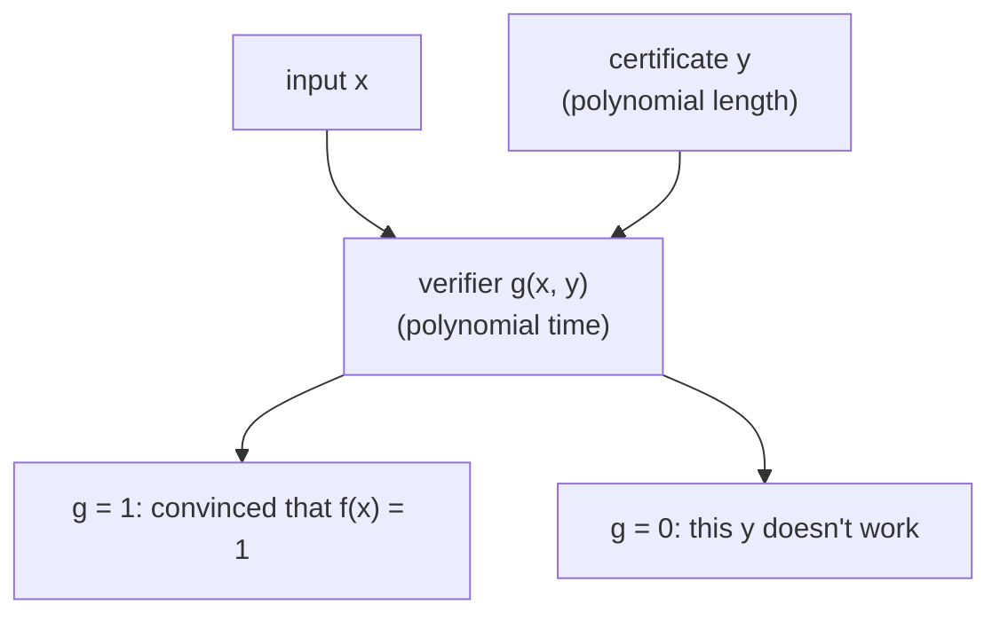

#complexity #complexity_class #NP
the problems where a **yes** answer has a **short proof** that you can **check quickly**. part of [[Complexity classes]]

## verify, don't solve
NP = the problems you can **verify** in polynomial time, but only when the answer is **yes**
- if the answer is yes, there's a short **certificate** (proof) of it. it might be hard to **find**, but it's easy to **check**
- if the answer is no, there doesn't have to be any short way to prove it

> [!eg] travelling salesman
> can I visit all these cities, each exactly once, with a total route under 1000 miles?
>
> ![[TSP_certificate.png]]
>
> - **yes**: the certificate is just the list of cities in order. check that each city appears once and add up the miles: fast
> - **no**: "there's no route under 1000 miles" might have **no** short proof. you'd seemingly have to rule out every route

## the definition: one giant OR
$f$ is in NP if it can be written as
$$
f(x)=\bigvee_{y\in\{0,1\}^{|x|^c}}g(x,y)
$$
^np-or

- $y$ is the **certificate**: a bit string of **polynomial** length, $|x|^c$ for some constant $c$
- $g$ is the **verifier**: computable in **polynomial time** (it's in P)
- $\bigvee$ = OR over **all** possible $y$, and there are exponentially many of them

==polynomial time checking, but an OR over exponentially many certificates==

- **if $f(x)=1$**: there's some $y$ with $g(x,y)=1$. hand it over, the checker computes $g(x,y)$ quickly and is convinced
- **if $f(x)=0$**: there's no such proof. whatever $y$ a cheater offers, $g(x,y)=0$, so they can't fool the checker

## two ways to see it
- **nondeterminism**: a nondeterministic computer could check **all** certificates at once and take the OR, exactly the model in [[Nondeterminism]] (the choices along an accepting branch are the certificate)
- **proofs**: complexity theory asks what we can compute quickly, but also **what can be proven**. NP is a statement about **proof complexity**: which statements have short proofs

> [!extra]- NP-complete
> some NP problems are the **hardest** in NP: every NP problem can be turned into them with a polynomial time reduction, so a fast algorithm for one gives a fast algorithm for all. these are [[NP-complete]], eg. travelling salesman, and the original one, **circuit SAT**: given a classical circuit, is there an input that makes it output 1? (that's the OR above, with $g$ = the circuit). many planning and optimization problems are naturally NP-complete, which is why NP gets so much attention. the quantum version is [[Quantum circuit evaluation]]

> [!exercise] try these
> ① for "does this number $N$ have a factor between 2 and $\sqrt N$?", what's a certificate for yes, and how do you check it?
> ② for a route of 30 cities, how many certificates $y$ are there to OR over (ignoring the start city)? how long does checking one take?
> ③ is "this travelling salesman instance has **no** route under 1000 miles" obviously in NP? why?
> ④ why does the certificate have to be **polynomial** length?

> [!answer]-
> ① the factor $d$ itself. check: divide $N$ by $d$ and see the remainder is 0, fast (polynomial in the number of digits)
> ② $29!\approx9\times10^{30}$ orderings, but checking one is just 30 additions
> ③ no: a yes for this question means "no route works", and there's no known short proof of that. (it's in co-NP, the "no-side" version)
> ④ the checker only has polynomial time, so it can only read a polynomial number of bits. an exponentially long certificate couldn't even be read

previous: [[Complexity classes]] · next: [[Quantum circuit evaluation]]

see also [[Nondeterminism]], [[Grover's algorithm]]

week hub: [[Computational complexity]]
