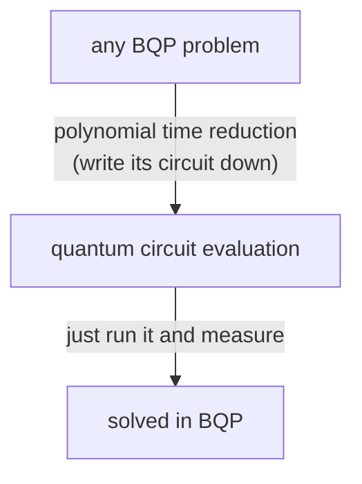

#complexity #complexity_class #BQP #promise_problem
the natural **BQP-complete** problem: "run this quantum circuit, is the output probably 0 or probably 1?". the quantum version of circuit SAT for [[NP]]. part of [[Complexity classes]]

## the problem
- **input**: a quantum circuit $U$ on $n$ qubits: start in $|0\dots0\rangle$, apply $n^2$ gates (the input says which), measure the **first qubit**
- **promise**: the probability of getting 1 is either **above $\frac23$** or **below $\frac13$**
- **question**: which one?

$$
\text{QCE}(U)=\begin{cases}1&P(\text{first qubit}=1)>\frac23\\0&P(\text{first qubit}=1)<\frac13\end{cases}
$$
^qce

the promise matches BQP's rule: right with probability at least $\frac23$. a "yes" circuit gives 1 more than $\frac23$ of the time, a "no" circuit less than $\frac13$, never anything in the middle

> [!important] a promise problem
> it's a [[Promise, sampling and relation problems|promise problem]]: only defined on circuits that satisfy the promise. ==checking the promise might itself be hard, but promises don't have to be easy to check==: we just only care about solving the problem on those inputs

![[Promise_problem.png]]

## why it's BQP-complete
**complete** = it's in the class, **and** it's as hard as anything in the class

### ① it's in BQP
just **run the circuit** and measure the first qubit. by the promise, the output is right with probability at least $\frac23$. and if running it adds some extra errors, **repeat** a few times and take the majority to push the error back below $\frac13$

### ② every BQP problem reduces to it
a problem in BQP practically **is** "there's a uniform quantum circuit that gets it right with probability $\frac23$" ([[Randomized and quantum computation#uniform circuit families]]). so to reduce it: write that circuit down, and hand it to quantum circuit evaluation

### the $n^2$ worry
BQP allows any polynomial number of gates, say $n^{17}$, but this problem only allows $n^2$. is that a problem? no:
- the size limit is in terms of **its own input**, and the reduction can make the input **bigger**
- the original problem on $n$ bits needs, say, $n^{10}$ gates. write it as a circuit description of length $n'=n^{20}$ (pad it with idle qubits if needed). now the budget is $n'^2=n^{40}$ gates, more than enough

==a polynomial time reduction can quietly smuggle in polynomial overheads==: the input can get polynomially longer. that's why complexity classes can't tell $n^2$ from $n^{17}$, only polynomial from exponential ([[Complexity classes#why only "polynomial"?]])

## the payoff
because it's BQP-complete:
$$
\text{quantum circuit evaluation}\in\text{BPP}\iff\text{BPP}=\text{BQP}
$$
^qce-bpp

so if (as people believe) BPP ≠ BQP, there's **no efficient classical algorithm** for simulating quantum circuits, even just to guess one output bit. (you could write P instead of BPP: P ⊆ BPP, but randomized is closer in spirit to quantum)

![[Complexity_class_map.png]]

> [!extra]- why it's the analogue of circuit SAT
> both problems take a **circuit** as input and ask about its output
> - **circuit SAT** (NP-complete): a classical circuit $g$. is there **any** input $y$ that makes it output 1? that's the OR over all $y$ in [[NP#^np-or]]
> - **quantum circuit evaluation** (BQP-complete): a quantum circuit. is its output **mostly** 1 or **mostly** 0?
>
> in both, the circuit is the "universal" problem of the class: a problem is in the class exactly when its answer can be read off some such circuit, so writing that circuit down is the reduction

> [!exercise] try these
> ① a circuit gives 1 with probability 0.5. what does quantum circuit evaluation say about it?
> ② one run is right with probability $\frac23$. you run it 3 times and take the majority. what's the chance the majority is right?
> ③ a BQP problem needs $n^{6}$ gates on $n$ qubits. how long should the padded input $n'$ be so the $n'^2$ budget covers it?
> ④ why does BQP-completeness of this problem mean simulating quantum circuits classically is probably hard?

> [!answer]-
> ① nothing: 0.5 breaks the promise, so the circuit isn't a valid input and any answer is allowed
> ② at least 2 of 3 right: $3\left(\tfrac23\right)^2\tfrac13+\left(\tfrac23\right)^3=\tfrac{12}{27}+\tfrac8{27}=\tfrac{20}{27}\approx0.74$, already better than $\frac23$
> ③ for the budget alone, $n'^2\ge n^6$ means $n'\ge n^3$. but just listing $n^6$ gates already makes the description about $n^6$ long, and then the budget is $n'^2\approx n^{12}$: way more than needed, so it's automatically fine
> ④ a fast classical simulator would put this problem in BPP, and then (since every BQP problem reduces to it) all of BQP would be in BPP: BPP = BQP, which people believe is false

previous: [[NP]]

see also [[Promise, sampling and relation problems]], [[Quantum volume]], [[Quantum supremacy]]

week hub: [[Computational complexity]]
