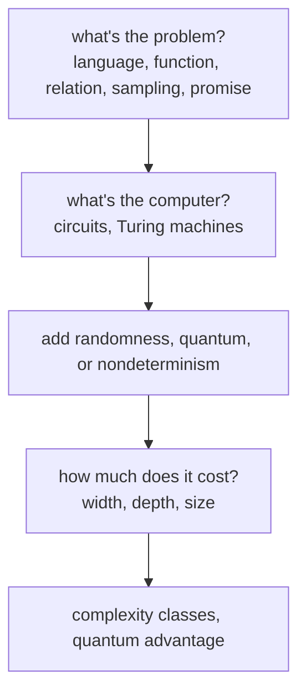

#complexity
Course 4, Week 4: **computational complexity**. to say a quantum computer is really better at something ([[Quantum advantage|quantum advantage]]), first pin down what a "problem" is and what counts as a "computer", then how to measure the cost
## why
complexity theory asks **how hard** a problem is, not just whether it can be solved. the answers depend on conventions: which kind of problem, which model of computing, which cost. the literature mostly uses one set of conventions, so it's worth knowing them

> [!important] the one idea
> ==problems are (mostly) languages, yes/no questions on bit strings; the computer is a uniform family of circuits; the cost is the width, depth and size of those circuits==

## this week's notes
### problems
- [[Languages]] → functions on $\{0,1\}^*$, languages $L=f^{-1}(1)$ (accept or reject), why one output bit is enough
- [[Promise, sampling and relation problems]] → only inputs in $P$ count; output a random sample from $D_x$; any one of several right answers
### models of computation
- [[Circuit model]] → classical vs quantum circuits, fan-in and fan-out, ancillas, **width, depth, size**, and the flaw: one circuit per input size (the halting trick), no loops
- [[Randomized and quantum computation]] → random gates or random input bits, a classical Turing machine writing a quantum circuit for each $n$, probabilities average but amplitudes cancel
- [[Nondeterminism]] → accept if **any** of $2^n$ branches accepts: physically unreasonable, but where [[NP]] comes from
### complexity classes
- [[Complexity classes]] → DTIME, time vs memory (PSPACE), efficient isn't fast, **P ⊆ BPP ⊆ BQP ⊆ PSPACE** and P ⊆ NP, the believed map, why P = BPP is suspected, why only polynomial vs exponential matters
- [[NP]] → yes answers have short proofs you can check: $f(x)=\bigvee_yg(x,y)$, travelling salesman, factoring, P ⊆ NP
- [[NP-complete]] → the hardest NP problems: one in P means P = NP; Sudoku, map colouring, circuit SAT; $(n-1)!/2$ routes; factoring isn't one
- [[Quantum circuit evaluation]] → the BQP-complete problem: is the output mostly 1 or mostly 0? (a promise problem); in BPP only if BPP = BQP
- [[Quantum vs classical complexity]] → where BQP sits: factoring yes, NP-complete probably not, BQP ⊆ PSPACE; exponential vs Grover's quadratic speed ups; nothing proven

![[Complexity_hierarchy.png]]

coming up: [[Turing machine]], [[Quantum supremacy]]

see also [[Big O notation]], [[Quantum volume]]

previous week: [[Quantum error mitigation]] · course overview: [[Requirements for large scale quantum computation]]
