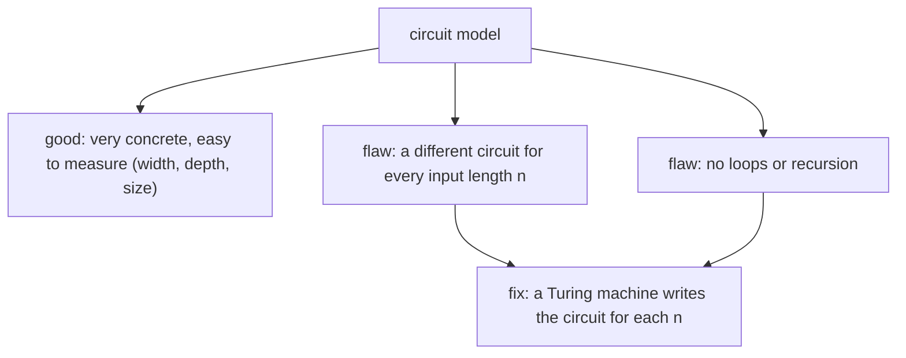

#complexity #circuit_model
the first model of computing: the circuit. the models in this week aren't separate boxes, they're **attributes** that can be combined (a circuit can be random, quantum, ...). part of [[Computational complexity]]
## classical vs quantum circuits
**classical**: bits $x_1,\dots,x_n$ combined by gates like AND, OR and NOT
- gates can have **unbounded fan-in and fan-out**. **fan-in** = how many wires go in (eg. the AND of 100 bits), **fan-out** = how many wires come out (feed that AND into 100 other gates)
- you can restrict to **bounded** fan-in and fan-out, or to **reversible** circuits (a special case), but you don't have to
- no ancillas needed: the internal wires **are** new bits, created as you go

**quantum**: every gate is **unitary**, so it has the same number of inputs and outputs. a [[CNOT gate]] takes 2 qubits to 2, a [[Toffoli gate]] 3 to 3. gates can't create extra data, so every qubit you'll ever need goes in at the start: the input plus a bunch of **ancillas** in $|0\rangle$
## how big is a circuit?
**computability** asks: can this be computed at all, yes or no? **complexity** asks: given that it can, **how hard** is it? how much time, how much effort? for a circuit, three measures:

![[Circuit_width_depth_size.png]]

- **width**: the number of bits (qubits), ie. the **memory**
- **depth**: the number of **layers**. gates on separate bits can run at the same time, in one layer, so depth is the **time**
- **size**: the total number of **gates**, the total **effort**

the measurement at the end isn't counted here (some people do count it)

> [!eg] the AND of $n$ bits
> - unbounded fan-in: **one** gate. size 1, depth 1
> - only 2-input AND gates: pair the bits up, then pair up the results, and so on, a tree. size $n-1$, depth $\lceil\log_2n\rceil$. for $n=8$: $4+2+1=7$ gates in 3 layers
>
> same problem, different counts: ==the cost depends on which gates you allow==

## the big flaw, one circuit per input size
a function takes inputs of **any** length: "matrix multiplication" covers $2\times2$, $7\times7$ and rectangular matrices all at once. but a circuit (soldered wires, or a fixed list of laser pulses for a quantum one) has a **fixed** number of inputs. so a full recipe needs a **circuit for every** $n=|x|$ (the length of the input $x$)

if the circuit for each $n$ may be **anything** (only its width, depth and size bounded by some function of $n$), information can be smuggled in through $n$:

> [!eg] smuggling in the halting problem
> "does the $n$-th [[Turing machine]] halt when started on a blank input?" no algorithm can answer this for every $n$. but a circuit family can: for each $n$, let the circuit **ignore its input** and output the right answer (0 or 1) straight away. every circuit is tiny, and the family "solves" an unsolvable problem, because the hard part went into **choosing** the circuits

so letting the circuit depend on $n$ arbitrarily gives **too much** power. ==a circuit family is only realistic if the circuits themselves are easy to produce==; the fix is in [[Randomized and quantum computation#uniform circuit families]]
## no loops
a circuit is a program with **no loops** (and no recursion)
- con: nobody writes long programs without loops, they're a key part of programming
- pro: no infinite loops, a circuit always finishes after a known number of steps

> [!important] the one idea
> ==circuits measure cost cleanly (width = memory, depth = time, size = effort), but a circuit only handles one input length==, so a whole problem needs a family of them

> [!exercise] try these
> ① a circuit on 5 qubits has gates on (1,2), (3,4), (2,3), (4,5), (1,2). gates in a layer can't share a qubit, and a gate must come after the earlier gates it shares qubits with. what are the width, size and smallest depth?
> ② why does a quantum circuit need ancillas when a classical one doesn't?
> ③ making an $n$ qubit GHZ state with a chain of CNOTs (1→2, 2→3, ...): what are the size and depth? can you do better on depth?
> ④ why isn't a circuit family enough, by itself, to describe an algorithm?

> [!answer]-
> ① width 5, size 5, depth **3**. layer 1: (1,2) and (3,4). layer 2: (2,3), which waits for both, and (4,5), which only waits for (3,4) and shares nothing with (2,3). layer 3: the last (1,2), which waits for (2,3)
> ② unitary gates have as many outputs as inputs, so they can't make new wires; all the workspace has to be there from the start, as $|0\rangle$ ancillas
> ③ size $n-1$, depth $n-1$ (each CNOT waits for the previous one). yes: once qubits 1 and 2 are entangled, both can be controls in the next layer, so the number of entangled qubits doubles each layer: depth $\lceil\log_2n\rceil$, same size
> ④ it's one circuit per $n$, chosen with no rules, so it could hide uncomputable information (the halting example). an algorithm needs one finite recipe for all $n$

next: [[Randomized and quantum computation]]

see also [[Quantum volume]] (depth vs width in practice), [[Toffoli gate]], [[Big O notation]]

week hub: [[Computational complexity]]
