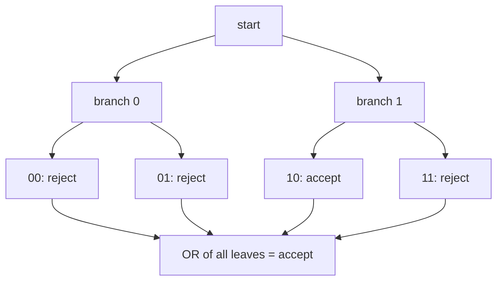

#complexity #nondeterminism
one last model: **nondeterminism**, where the class [[NP]] comes from. it's **physically unreasonable**, but useful for thinking about proofs. part of [[Computational complexity]]
## the OR of all branches
the computer can split into **two branches**, and each branch can split again. after $n$ steps there can be $2^n$ branches. at the end
- if **any** branch accepts, the whole computer **accepts**
- if **every** branch rejects, it **rejects**

that's taking the **OR** of the branches (accept = 1, so one 1 anywhere makes the OR 1)

## compared with random and quantum
all three models branch; they differ in how the branches are **combined** at the end

| model | branches carry | combined by | real? |
|---|---|---|---|
| randomized | probabilities | **averaging**: the accept probability | yes |
| quantum | amplitudes | **adding** amplitudes (they can cancel), then $\vert\cdot\vert^2$ | yes |
| nondeterministic | nothing | **OR**: accept if any branch accepts | no |

^branch-models

==one accepting branch out of $2^n$ is enough for nondeterminism, but a random computer would find it with probability only $2^{-n}$==. that's why it doesn't match anything we can build

> [!eg] finding a satisfying input
> is there an $n$ bit string $y$ that makes some formula $\phi(y)$ true?
> - **nondeterministic**: branch on each bit of $y$, check $\phi$ in every leaf: $n$ steps. accept if any leaf works
> - **randomized**: guess one $y$; if only one string works, the chance of success is $2^{-n}$
> - **quantum**: [[Grover's algorithm]] finds it in about $\sqrt{2^n}$ steps: much better than trying all $2^n$, but nowhere near nondeterminism's $n$

> [!important] the one idea
> ==nondeterminism accepts if **any** of exponentially many branches accepts==: an imaginary model, but the right one for "is there a solution?" questions

> [!extra] nondeterminism as proofs
> the choices made along an accepting branch are a **certificate**: hand them to an ordinary computer and it can follow that one branch and check it quickly. so "a nondeterministic machine accepts $x$ in polynomial time" means the same as "there's a short proof that $x$ is a yes instance, which can be checked fast". that's the usual definition of [[NP]]

> [!exercise] try these
> ① a nondeterministic computer branches in two at each of 20 steps. how many branches are there at the end?
> ② 1 of those branches accepts. what does the nondeterministic computer output? what's the chance a randomized one taking random branches accepts?
> ③ what does the nondeterministic computer output if no branch accepts?
> ④ why can't a quantum computer just do nondeterminism by putting all branches in superposition?

> [!answer]-
> ① $2^{20}\approx10^6$
> ② it accepts. a random one: $2^{-20}\approx10^{-6}$
> ③ reject: the OR of all zeros is 0
> ④ measuring the superposition gives one random branch, just like the randomized case. to boost the accepting branch you need interference, and the best known speed up for search (Grover) is only a square root

see also [[Randomized and quantum computation]], [[Circuit model]], [[Grover's algorithm]]

week hub: [[Computational complexity]]
