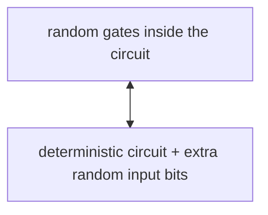
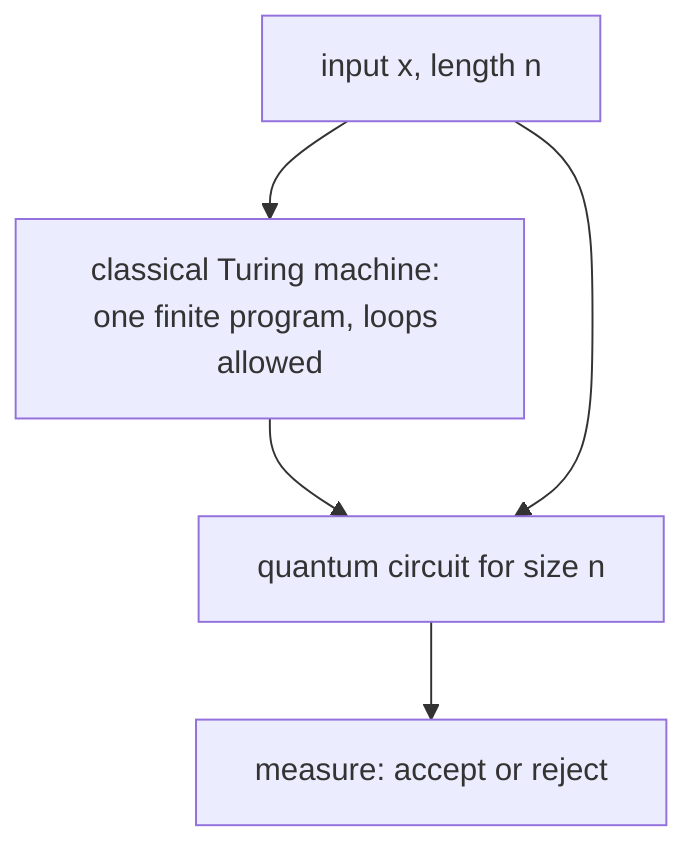

#complexity #circuit_model #randomness
the basic models, circuits and [[Turing machine|Turing machines]], describe **deterministic** computation. building up to quantum, add randomness first. part of [[Computational complexity]]
## randomized computation
two ways to put randomness in, and they're basically equivalent
1. **random steps**: add a "random gate" that outputs 0 or 1 at random each time it's used (or a Turing machine rule like "if the current symbol is 0, do this with probability $\frac12$ and that with probability $\frac12$")
2. **random input**: keep every step deterministic, and push all the randomness to the start: an extra input $r_1,\dots,r_m$ of random bits that the gates (or the Turing machine) can read

(going from 1 to 2: give every random gate its own fresh input bit $r_j$ to read instead)
## quantum circuits
already familiar: unitary gates, ancillas in $|0\rangle$, a width, a depth and a size ([[Circuit model]]). the one drawback is the same as for classical circuits: an **uncontrolled dependence on the input size** $n$
## uniform circuit families
two ways around it
- **quantum Turing machines**: defined in the 1990s, but almost nobody uses them
- the preferred model: ==a **classical Turing machine** outputs the **quantum circuit** for each input length $n$==, then you run that circuit

for classical circuits this compromise doesn't make much sense: if a Turing machine can write the circuit, it could just compute the answer itself. but here the split is useful. the classical Turing machine brings loops, recursion and **one finite program for all input sizes**, and the quantum circuit brings the quantum part. this is what (almost) everyone means when they say a quantum circuit "can compute" something

because the Turing machine has to actually write the circuit, it can't hide uncomputable information in it, which fixes the halting trick in [[Circuit model#the big flaw, one circuit per input size]]
## branches: random vs quantum
a random choice splits the computation into two **branches**; many choices give many branches, and their **probabilities add up** to the chance of accepting or rejecting. a [[Hadamard Gate]] also puts weight on two branches, but the weights are **amplitudes**, which can be negative and **cancel**

> [!eg] two coin flips vs two Hadamards
> start in 0 and apply "flip a fair coin" twice: after the first, 0 or 1 with probability $\frac12$ each; after the second, still $\frac12,\frac12$. randomness never un-mixes
> $$
> \begin{aligned}
> H|0\rangle&=\tfrac1{\sqrt2}\big(|0\rangle+|1\rangle\big)\\
> H\,H|0\rangle&=\tfrac12\big(|0\rangle+|1\rangle\big)+\tfrac12\big(|0\rangle-|1\rangle\big)=|0\rangle
> \end{aligned}
> $$
> the two branches that lead to $|1\rangle$ have amplitudes $+\frac12$ and $-\frac12$ and **cancel**. that **interference** is what a random computer can't do

> [!important] the one idea
> ==randomness averages probabilities over branches; quantum adds amplitudes, which can cancel==. and the standard quantum model is a classical program that writes a quantum circuit for each input size

> [!extra] why randomness helps at all
> a random algorithm only has to be right with high probability, say $\frac23$. repeating it $k$ times and taking the majority makes the error shrink exponentially in $k$, the same counting as [[Bit flip code|repetition codes]]. the class of problems solved this way in polynomial time is BPP, and its quantum version is BQP ([[Complexity classes]])

> [!exercise] try these
> ① a randomized circuit uses 5 random gates. how many extra input bits does the "random input" version need?
> ② why don't people bother having a Turing machine output a **classical** circuit?
> ③ apply $H$ three times to $|0\rangle$. what's the result?
> ④ a random walk on 0/1 flips its bit with probability $\frac12$ at each step. after 10 steps, what's the probability of being at 0?

> [!answer]-
> ① 5, one per random gate
> ② the Turing machine could just compute the answer directly instead of writing a circuit and running it a moment later
> ③ $HH=I$, so $HHH|0\rangle=H|0\rangle=\frac1{\sqrt2}(|0\rangle+|1\rangle)$
> ④ $\frac12$: after the very first step it's already $\frac12,\frac12$, and a fair flip keeps it there

next: [[Nondeterminism]]

see also [[Circuit model]], [[Hadamard Gate]], [[Quantum random number generators]]

week hub: [[Computational complexity]]
