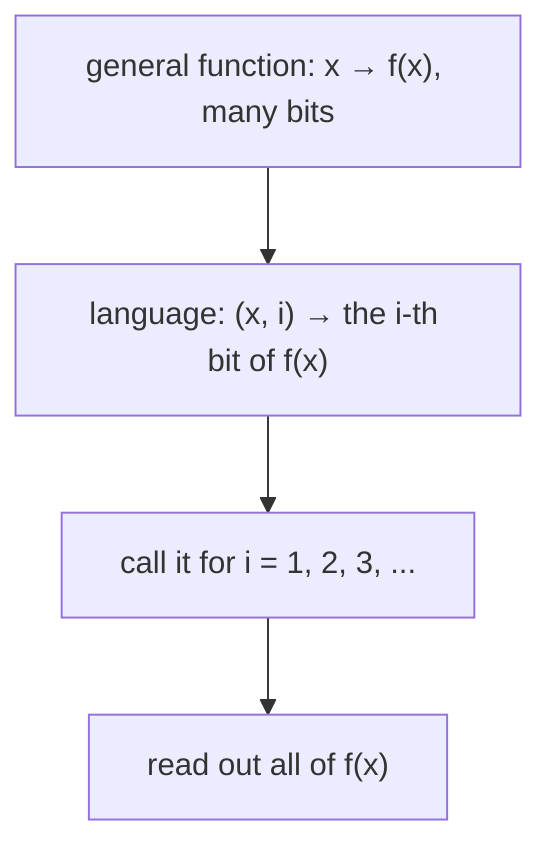

#complexity #languages
before asking how **hard** a problem is, pin down what a problem **is**. part of [[Computational complexity]]
## problems are functions on bit strings
computing something usually means computing a **function** $f$: a bit string goes in, a bit string comes out. the input can be any length, so the inputs are all strings of every length:
$$
\{0,1\}^*=\bigcup_{n\geq0}\{0,1\}^n
$$
^all-strings

and $f:\{0,1\}^*\to\{0,1\}^*$. anything can be written in bits, so this covers
- **matrix multiplication** (integers or fractions in binary, real numbers approximated in bits)
- **shortest path** in a graph
- **integer factorization**
- the **halting problem**: given some code and an input, does the code ever stop?

some of these are much, much harder than others (the halting problem can't be solved at all)
## languages: one bit out
the usual convention is to only look at functions with a **1 bit** output. these are called **languages**

a 1 bit function is completely described by the set of inputs that give 1:
$$
L=f^{-1}(1)=\{x\in\{0,1\}^*:f(x)=1\}\subseteq\{0,1\}^*
$$
^language

**deciding** $L$ means: **accept** (output 1) every $x\in L$, **reject** (output 0) every $x\notin L$. so computing a 1 bit function and testing **membership in a set** are the same maths with different words: ==any problem can be phrased as a yes/no question==

> [!eg] PARITY
> $L_{\text{PARITY}}=\{x:x\text{ has an odd number of 1s}\}$. so $0111\in L$ (accept), $0110\notin L$ (reject). the same as the 1 bit function $f(x)=x_1\oplus x_2\oplus\cdots\oplus x_n$ ([[Parity measurement]])
## why one bit is enough
it's **nearly** as powerful as a general function: add an extra input $i$ that asks for the $i$-th bit of the answer, then call the 1 bit function once per bit

> [!eg] factoring as a language
> factoring takes $N$ and outputs its prime factors, which looks like many bits of output. instead ask: input $(N,i)$, output the $i$-th bit of the factorization. for $N=15=3\times5$, write the factors as $0011\ 0101$ (4 bits each): 8 calls with $i=1,\dots,8$ read it all out

there's a little overhead (one call per output bit, so a few times more work for a polynomial size output), but not a big one. so complexity theory is mostly written in terms of languages

> [!important] the one idea
> ==a language is the set of inputs whose answer is yes==; deciding it means accept the members and reject the rest, and every function reduces to that with little overhead

> [!extra] another way to make factoring yes/no
> ask "does $N$ have a factor $d$ with $1<d\leq k$?". **binary search** on $k$ finds the smallest factor in about $\log_2N$ questions: halve the range each time. that's the standard yes/no version of factoring, and the one that's used to place it among the [[Complexity classes|complexity classes]]

> [!exercise] try these
> ① how many strings in $\{0,1\}^*$ have length at most 3?
> ② $L=\{x:x\text{ starts with }1\}$. accept or reject: $1010$, $0111$, the empty string?
> ③ a function outputs 64 bits. how many calls to its language version do you need to read the whole answer?
> ④ write the halting problem as a language

> [!answer]-
> ① $1+2+4+8=15$ (the empty string, 2 of length 1, 4 of length 2, 8 of length 3)
> ② accept $1010$; reject $0111$; reject the empty string (it doesn't start with anything)
> ③ 64, one per bit
> ④ $L_{\text{HALT}}=\{(\text{code},x):\text{the code stops when run on }x\}$, with the pair written as one bit string

next: [[Promise, sampling and relation problems]]

see also [[Big O notation]], [[Circuit model]]

week hub: [[Computational complexity]]
