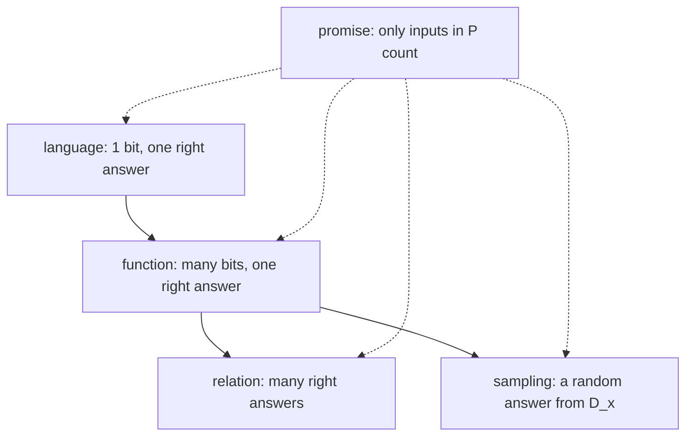

#complexity #languages
[[Languages]] and functions are the basic problems. a few more types come up often. part of [[Computational complexity]]
## promise problems
the input doesn't have to be **any** string. you only need the right answer when $x$ is in some set $P\subseteq\{0,1\}^*$: the input is **promised** to be in $P$. outside $P$ there's no guarantee at all on what the program does

![[Promise_problem.png]]

> [!eg] Simon's problem
> in [[Simon's algorithm]], $f$ is **promised** to be 2 to 1 with a hidden string $s$, or 1 to 1. an algorithm only has to work on functions that keep the promise. hand it some other function and whatever it outputs is fine

a promise can be added to **any** of the other types: a promise language, a promise function, a promise sampling problem
## sampling problems
a generalization of functions. each input $x$ comes with a probability distribution $D_x$, and the job is: given $x$, output a **sample** from $D_x$ (perhaps only approximately). the output isn't one fixed string any more, it's random

> [!eg] sampling
> - $x=n$, $D_x$ = uniform over $\{0,1\}^n$: output $n$ fair random bits ([[Quantum random number generators]])
> - $x$ = a description of a quantum circuit, $D_x$ = the distribution of its measurement results. a quantum computer samples this just by running the circuit. that's the kind of task used to show [[Quantum supremacy]]

(you could go further, eg. the output is a **quantum state**. but languages, functions and sampling are a good first map)
## relations
a **relation** allows **several right answers**. $R\subseteq\{0,1\}^*\times\{0,1\}^*$, and given $x$ the job is to output **any** $y$ with $(x,y)\in R$

> [!eg] factoring as a relation
> given $N$, output **any** prime factor. for $N=15$, both $3$ and $5$ are right

## all the types

| type | given $x$, output | example |
|---|---|---|
| language | 1 bit: is $x\in L$? | PARITY |
| function | the one string $f(x)$ | the full prime factorization |
| relation | any $y$ with $(x,y)\in R$ | any one prime factor |
| sampling | a random sample from $D_x$ | a quantum circuit's measurement results |
| + promise | any of the above, only for $x\in P$ | Simon's problem |

==most things can be said with languages, but sometimes the other types are the natural fit==: quantum advantage experiments are sampling problems, and quantum algorithms often come with a promise

> [!important] the one idea
> ==a promise shrinks the inputs that count, a relation allows many right answers, a sampling problem asks for a random output with the right distribution==

> [!exercise] try these
> ① an algorithm crashes on an input outside the promise. is it still a correct algorithm for the promise problem?
> ② "given a graph, output a shortest path between two nodes". function or relation?
> ③ is every function also a relation?
> ④ why can't a sampling problem be checked by looking at a single output?

> [!answer]-
> ① yes: outside $P$ there's no requirement at all
> ② a relation: there can be several shortest paths, and any one of them is right
> ③ yes: $R=\{(x,f(x))\}$, a relation with exactly one right answer for each $x$
> ④ every possible output may be allowed; what matters is how **often** each one comes up, which you only see from many samples

next: [[Circuit model]]

see also [[Languages]], [[Simon's algorithm]]

week hub: [[Computational complexity]]
