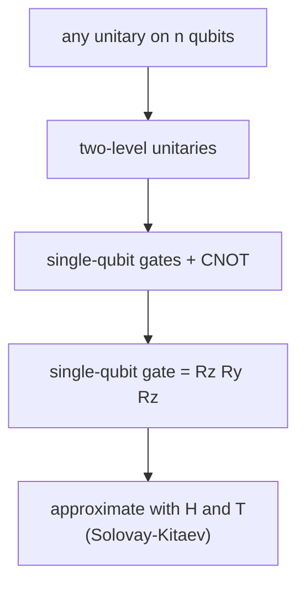

#extra #universal_gates #quantum_gates #gate_synthesis
**extra** (not in the course as its own topic): which small set of gates is enough to build **every** quantum computation. classically one gate (NAND) does it. quantum is a bit subtler because there are infinitely many gates
## what "universal" means here
gates are continuous (any angle of a [[Rotation gates|rotation]]), so no finite set can hit every unitary **exactly**. instead:
- **exactly universal**: an infinite set that builds any unitary exactly
- **approximately universal**: a finite set that gets within any error $\varepsilon$ you ask for

> [!important] the one idea
> ==$H$, $T$ and CNOT are enough to approximate any quantum computation as closely as you like==, and the [[Solovay-Kitaev theorem]] says it only costs a small (polylog) number of extra gates

## the standard sets

| set | universal? | why / why not |
|---|---|---|
| all single-qubit gates + CNOT | exactly | any unitary splits into two-level pieces, each built from these |
| $H$, $T$, CNOT ("Clifford + T") | approximately | $H$ and $T$ together make rotations by angles that are irrational multiples of $\pi$, so they fill the sphere |
| $H$, $S$, CNOT (the [[Clifford group]]) | **no** | only 24 single-qubit gates, and classically easy ([[Gottesman-Knill theorem]]) |
| $H$, [[Toffoli gate]] | yes, for real amplitudes (enough for computing) | Toffoli alone is classical, $H$ adds the quantum part |
| CNOT alone, or single-qubit gates alone | no | no superposition / no entanglement |

adding **any** non-Clifford gate (like $T$) to the Cliffords makes them universal. that's why fault-tolerant machines care so much about making $T$ gates ([[Magic state distillation]])

## what the hardware actually has
each machine has a **native** gate set and the compiler translates everything into it, eg. on superconducting chips: $R_z(\theta)$ (free, done in software), $\sqrt X$, $X$ and one entangling two-qubit gate ([[Superconducting qubits]]). on ion traps the entangler is an $XX$ rotation between two ions

## universal isn't the same as fast
almost every unitary on $n$ qubits needs **exponentially many** gates in $n$ (there are just too many of them to all have short circuits). universality says you **can** build anything; good algorithms are the rare unitaries with short circuits ([[Complexity classes]], [[Circuit model]])

> [!exercise] try these
> **1** why can't $H$ and $S$ alone make $T$?
> **2** write $Z$ using only $H$ and $X$
> **3** about how many $H$/$T$ gates does Solovay–Kitaev need for $\varepsilon=10^{-10}$, if the cost is $\sim\log^{2}(1/\varepsilon)$?

> [!answer]-
> **1** $H$ and $S$ are Cliffords; products of Cliffords stay Cliffords, and $T$ isn't one
> **2** $Z=HXH$
> **3** $\log_2(10^{10})\approx33$, so ~$33^2\approx1000$

see also [[Quantum gate]], [[Rotation gates]], [[Solovay-Kitaev theorem]], [[Clifford group]], [[Transversal gates]]
