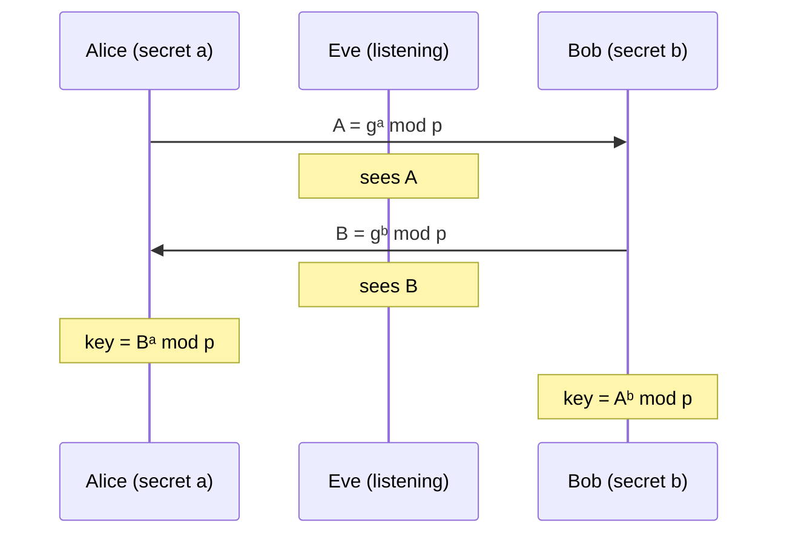

#extra #cryptography #public_key #modular_arithmetic
**extra** (not in the course as its own topic): how two people who've never met agree on a **secret key** over a channel everyone can hear. the other big public-key system next to [[RSA]], and also broken by [[Shor's algorithm]]
## the exchange
everyone knows a big prime $p$ and a number $g$. Alice picks a secret $a$, Bob a secret $b$

both get the same key, because
$$
B^a=(g^b)^a=g^{ab}=(g^a)^b=A^b\pmod p
$$
^dh-key

> [!important] the one idea
> ==mixing in your secret is easy ($g^a\bmod p$ by [[Modular Exponentiation|fast exponentiation]]), but un-mixing it, finding $a$ from $g^a\bmod p$, is the **discrete logarithm** problem, which is believed hard classically==. Eve sees $g^a$ and $g^b$ but can't get $g^{ab}$

> [!eg] tiny numbers
> $p=23$, $g=5$, Alice's $a=6$, Bob's $b=15$
> $$
> \begin{aligned}
> A&=5^6\bmod23=8\\
> B&=5^{15}\bmod23=19\\
> \text{Alice: }19^6\bmod23&=2\\
> \text{Bob: }8^{15}\bmod23&=2
> \end{aligned}
> $$
> shared key: **2**. Eve knows 23, 5, 8, 19, and would need to solve $5^a\equiv8\pmod{23}$ (easy here, impossible for a 2048-bit $p$)

## why it falls to quantum computers
the discrete log hides a **period**: the function $f(x,y)=g^xA^{-y}\bmod p$ repeats whenever $(x,y)$ shifts by $(a,1)$. finding hidden periods is exactly what [[Shor's algorithm]] does (with the [[Quantum Fourier Transform]], like [[Order finding algorithm|order finding]]). the elliptic-curve version (ECDH, used in most of today's web traffic) breaks the same way, and with **fewer** qubits than RSA

that's why [[Post-quantum cryptography]] replaces it (eg. with lattice-based key exchange), and [[QKD]] is the physics alternative

## a weakness even without quantum
plain Diffie–Hellman doesn't check **who** you're talking to: Eve can sit in the middle and run one exchange with Alice and another with Bob. real protocols add signatures (authentication) on top

> [!exercise] try these
> **1** with $p=23$, $g=5$, $a=3$, $b=4$: find $A$, $B$ and the key
> **2** why can't Eve just multiply $A\times B$?
> **3** what does Shor's algorithm need to find, to break this?

> [!answer]-
> **1** $A=5^3\bmod23=10$, $B=5^4\bmod23=4$, key $=4^3\bmod23=64\bmod23=18$ (check: $10^4\bmod23=18$ ✓)
> **2** $A\times B=g^{a+b}$, not $g^{ab}$
> **3** the secret exponent $a$ (the discrete log), found as a hidden period

see also [[Modern cryptography]], [[RSA]], [[Modular arithmetic]], [[Cryptography and Shor's algorithm]], [[Post-quantum cryptography]]
