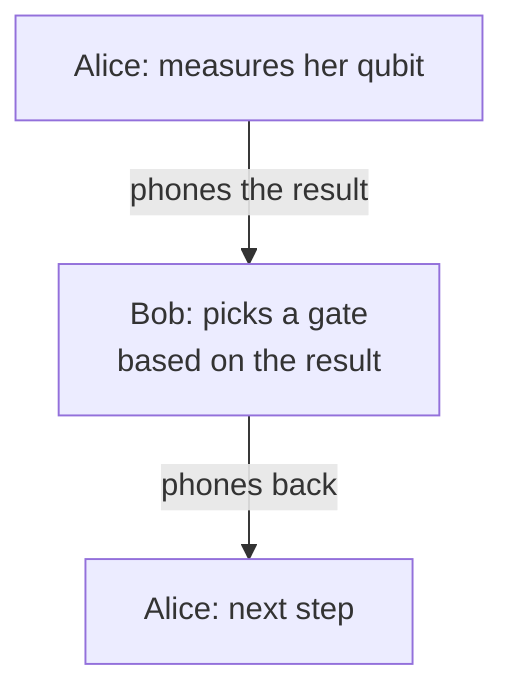

#extra #entanglement #resource_theory #schmidt_decomposition
**extra** (not in the course as its own topic): **l**ocal **o**perations and **c**lassical **c**ommunication. the rules of the game in [[Entanglement as a resource]]: Alice and Bob are far apart, can do anything to their **own** qubits, and can phone each other, but can't send qubits
## the rules
- **local operations**: any gate, measurement or extra qubits, but only on your own side
- **classical communication**: send ordinary bits, as many as you like, back and forth
- **not allowed**: sending qubits, or doing a joint gate on Alice's and Bob's qubits together

> [!important] the one idea
> ==LOCC can't create entanglement, and on average it can't increase it==. so entanglement is exactly the thing LOCC can't make: the definition of a resource, like money you can spend but not print

## what LOCC can do
- make any **separable** state (classical correlations): eg. flip a coin, phone the result, both prepare $|00\rangle$ or $|11\rangle$
- **spend** entanglement: [[Teleportation]] (one ebit + 2 bits moves a qubit), [[Superdense coding]]
- **concentrate** it: many weakly entangled pairs → fewer strong ones ([[Entanglement purification]], [[Entanglement fungibility]])
- turn a more entangled state into a less entangled one, exactly

## Nielsen's rule
for pure states of two parties, write each state in its [[Schmidt decomposition]] with Schmidt coefficients squared $\lambda=(\lambda_1,\lambda_2,\dots)$. then
$$
|\psi\rangle\xrightarrow{\text{LOCC}}|\phi\rangle\quad\Longleftrightarrow\quad\lambda_\psi\prec\lambda_\phi
$$
^nielsen-locc

$\prec$ is [[Majorization]]: $\lambda_\phi$ is **more spread out at the top** (less entangled). so you can always go downhill in entanglement, never uphill

> [!eg] two qubits
> - a Bell state has $\lambda=(\frac12,\frac12)$, majorized by everything: **a Bell pair can become any 2-qubit pure state**
> - $|00\rangle$ has $\lambda=(1,0)$, majorizes everything: anything can become a product state (just throw the entanglement away)
> - $\sqrt{0.8}|00\rangle+\sqrt{0.2}|11\rangle\to\sqrt{0.6}|00\rangle+\sqrt{0.4}|11\rangle$? needs $(0.8,0.2)\prec(0.6,0.4)$, ie. $0.8\le0.6$. no: that would **increase** entanglement

## the Bell pair → any state recipe
target $\cos\theta|00\rangle+\sin\theta|11\rangle$ from $\frac1{\sqrt2}(|00\rangle+|11\rangle)$
**1** Alice measures with two outcomes
$$
M_0=\cos\theta|0\rangle\langle0|+\sin\theta|1\rangle\langle1|,\qquad M_1=\sin\theta|0\rangle\langle0|+\cos\theta|1\rangle\langle1|
$$
($M_0^\dagger M_0+M_1^\dagger M_1=I$ ✓)
**2** outcome 0: the state is already $\cos\theta|00\rangle+\sin\theta|11\rangle$
**3** outcome 1: it's $\sin\theta|00\rangle+\cos\theta|11\rangle$. she phones Bob, and they **both** apply $X$: $\sin\theta|11\rangle+\cos\theta|00\rangle$ ✓

works every time, using one round of classical communication

## mixed states
for mixed states it's much harder: no simple rule like Nielsen's, and some entangled states ("bound entangled") can't be purified at all by LOCC. the [[Partial transpose|PPT test]] helps decide what's entangled

> [!exercise] try these
> **1** can LOCC turn $|00\rangle$ into a Bell state?
> **2** can $\sqrt{0.6}|00\rangle+\sqrt{0.4}|11\rangle$ become $\sqrt{0.9}|00\rangle+\sqrt{0.1}|11\rangle$?
> **3** why doesn't teleportation break the "no sending qubits" rule?

> [!answer]-
> **1** no: $(1,0)\prec(\frac12,\frac12)$ is false, that would create entanglement
> **2** yes: $0.6\le0.9$, so $(0.6,0.4)\prec(0.9,0.1)$
> **3** it uses up a shared Bell pair made earlier; only classical bits travel

see also [[Entanglement as a resource]], [[Schmidt decomposition]], [[Entanglement entropy]], [[Majorization]]
