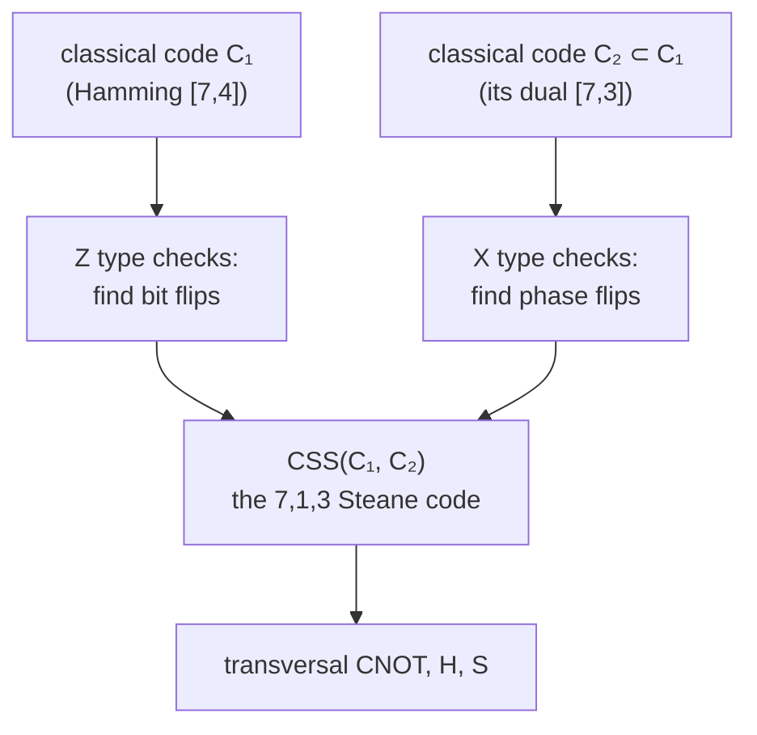

#extra #css_codes #stabilizer_codes #steane_code
**extra** (not in the course yet): Calderbank-Shor-Steane codes, a quantum code built from **two classical linear codes**, one fixing bit flips and one fixing phase flips. the 7 qubit code in [[Transversal gates on stabilizer codes]] is one, and it's why its CNOT is transversal
## the idea
a phase flip is a bit flip in the Hadamard basis ([[Three qubit phase flip code]]). so use one classical code's parity checks with $Z$s to catch **bit** flips, and another's with $X$s to catch **phase** flips. that's a [[Stabilizer codes|stabilizer code]] whose generators are each **all $Z$** or **all $X$**

> [!important] the one idea
> ==a CSS code handles $X$ errors and $Z$ errors **separately**, each with a classical linear code==: $Z$ type checks find bit flips, $X$ type checks find phase flips, and a $Y$ is just both
## the construction
take two classical linear codes ([[Classical linear codes]]) with $C_2\subset C_1$
- $C_1$ is $[n,k_1]$, with parity check matrix $H_1$
- $C_2$ is $[n,k_2]$, and its dual $C_2^\perp$ has parity check matrix $H_2^\perp$

then

| checks | from | catch |
|---|---|---|
| $Z$ type: a $Z$ wherever a row of $H_1$ has a 1 | $C_1$ | bit flips ($X$ errors) |
| $X$ type: an $X$ wherever a row of $H_2^\perp$ has a 1 | $C_2^\perp$ | phase flips ($Z$ errors) |

and the code is $\text{CSS}(C_1,C_2)$, an $[\![n,\ k_1-k_2]\!]$ code. its code words are superpositions over **cosets** of $C_2$: for $x\in C_1$
$$
|x+C_2\rangle=\frac1{\sqrt{|C_2|}}\sum_{y\in C_2}|x+y\rangle
$$
^css-codewords

it corrects $t$ errors of each kind if $C_1$ and $C_2^\perp$ both correct $t$ errors

**why the checks commute**: an $X$ check and a $Z$ check commute when they overlap in an **even** number of places, ie. their rows have inner product $0$ mod 2. that's exactly what $C_2\subset C_1$ guarantees
## the Steane code
take $C_1$ = the $[7,4]$ Hamming code and $C_2=C_1^\perp$, its $[7,3]$ dual. the Hamming code contains its own dual, so $C_2\subset C_1$, and $C_2^\perp=C_1$: **both** kinds of check use the same Hamming matrix ([[Classical linear codes#^hamming-7-4]]). that gives the generators in [[Transversal gates on stabilizer codes#^steane-generators]], and $k=4-3=1$ logical qubit
$$
\begin{aligned}
|0_L\rangle&=\tfrac1{\sqrt8}\big(|0000000\rangle+|0001111\rangle+|0110011\rangle+|0111100\rangle\\
&\qquad+|1010101\rangle+|1011010\rangle+|1100110\rangle+|1101001\rangle\big)\\
|1_L\rangle&=X^{\otimes7}|0_L\rangle
\end{aligned}
$$
^steane-codewords

$|0_L\rangle$ is the 8 code words of $C_2$ (weight 0 or 4), and $|1_L\rangle$ is the other 8 Hamming code words (weight 3 or 7). an $X$ on qubit $j$ makes the $Z$ checks read $j$ in binary, exactly like the classical Hamming code (checked numerically)
## transversal CNOT
==every CSS code has a transversal CNOT==. bitwise CNOTs from block $A$ to block $B$ add $A$'s bit strings onto $B$'s
$$
|x+C_2\rangle\,|y+C_2\rangle\ \xrightarrow{\ \text{CNOT}^{\otimes n}\ }\ |x+C_2\rangle\,|x+y+C_2\rangle
$$
and because the codes are **linear**, $x+y$ plus anything in $C_2$ is still a code word of the right kind. that's a logical CNOT ([[Transversal gates]] is the classical version)

> [!exercise] try these
> ① CSS codes from $C_1=[15,11]$ (Hamming, $r=4$) and $C_2=C_1^\perp=[15,4]$. how many logical qubits?
> ② check that $0001111$ and $0110011$ overlap in an even number of places
> ③ why is $X^{\otimes7}|0_L\rangle$ orthogonal to $|0_L\rangle$?

> [!answer]-
> ① $k=11-4=7$: a $[\![15,7]\!]$ code (distance 3)
> ② they share places 6 and 7: 2, even ✓. so the $X$ and $Z$ versions commute
> ③ $X^{\otimes7}$ flips all 7 bits, turning weight 0 or 4 strings into weight 7 or 3. no string appears in both, so the overlap is 0

see also [[Stabilizer codes]], [[Classical linear codes]], [[Transversal gates on stabilizer codes]], [[Shor code]], textbook: [[Calderbank-Shor-Steane codes]]
