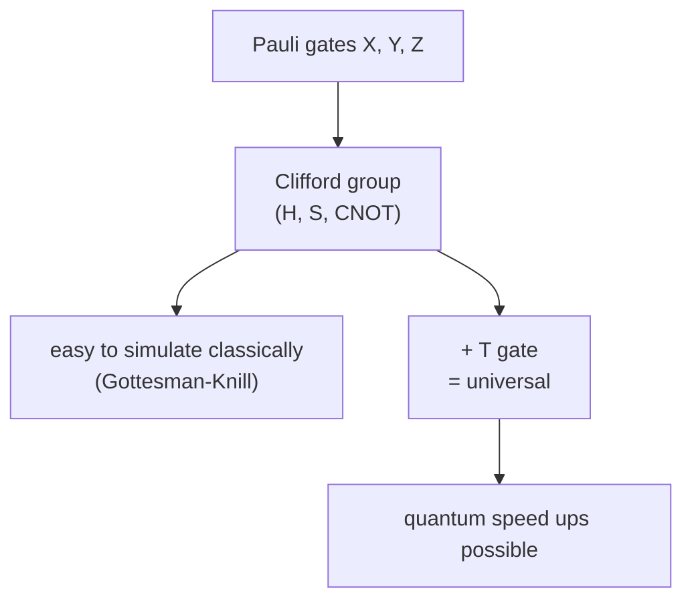

#extra #clifford #pauli #quantum_gates
**extra** (not in the course yet): the gates that turn Pauli operators into Pauli operators. they're the gates [[Stabilizer codes]] handle easily, the ones [[Randomized benchmarking]] picks at random, and exactly the ones that **aren't** enough for a quantum speed up
## the definition
a unitary $U$ is a **Clifford** gate if conjugating any Pauli product by it gives another Pauli product (up to a sign or $\pm i$)
$$
U\,P\,U^\dagger\in\{\pm1,\pm i\}\times\{I,X,Y,Z\}^{\otimes n}\quad\text{for every Pauli product }P
$$
^clifford-definition

products of Cliffords are Cliffords, so they form a **group**. every Clifford is built from just three gates: $H$, $S$ and CNOT
## what the generators do
you only need to know what each gate does to $X$ and $Z$ (then $Y=iXZ$ follows)

| gate | $X\to$ | $Z\to$ |
|---|---|---|
| $H$ ([[Hadamard Gate]]) | $Z$ | $X$ |
| $S=\begin{bmatrix}1&0\\0&i\end{bmatrix}$ | $Y$ | $Z$ |
| CNOT (control 1, target 2) | $X_1\to X_1X_2$, $X_2\to X_2$ | $Z_1\to Z_1$, $Z_2\to Z_1Z_2$ |

^clifford-table

the CNOT row is the "errors spread" rule from [[Transversal gates#towards quantum]]: a bit flip on the control copies forward onto the target, and a phase flip on the target copies back onto the control
## one qubit: 24 gates
ignoring global phases there are exactly **24** single-qubit Cliffords (checked by generating them all from $H$ and $S$). on the [[Bloch sphere]] they're the 24 rotations that map the six points $\pm x,\pm y,\pm z$ onto themselves: 6 places to send $+x$, then 4 places to send $+z$, $6\times4=24$
## not universal
> [!important] the one idea
> ==Clifford gates can make entanglement, superpositions and every Bell state, but on their own they give **no** quantum speed up==: Clifford circuits can be simulated efficiently on a normal computer ([[Gottesman-Knill theorem]])

add any one non-Clifford gate and you get a universal set. the usual choice is $T$ (a $\frac\pi4$ [[Phase shift]]), which turns $X$ into something that isn't a Pauli
$$
TXT^\dagger=\frac{X+Y}{\sqrt2}
$$
^t-not-clifford

so {$H$, $S$, CNOT, $T$} is universal ([[Solovay-Kitaev theorem]] makes it efficient). in fault tolerance the Cliffords are often the cheap part (transversal on the 7 qubit code, [[Transversal gates on stabilizer codes]]) and the $T$ gates are the expensive part

> [!exercise] try these
> ① what does $S$ do to $Y$? (use $Y=iXZ$)
> ② what does $HSH$ do to $X$ and $Z$?
> ③ use the CNOT row to find where an $X$ on the control and a $Z$ on the control end up

> [!answer]-
> ① $SYS^\dagger=i\,(SXS^\dagger)(SZS^\dagger)=iYZ=i(iX)=-X$ (using $YZ=iX$)
> ② $X\xrightarrow{H}Z\xrightarrow{S}Z\xrightarrow{H}X$, and $Z\xrightarrow{H}X\xrightarrow{S}Y\xrightarrow{H}-Y$ (since $HYH=-Y$). so $X\to X$ and $Z\to-Y$: a quarter turn about $x$
> ③ $X_1\to X_1X_2$: the bit flip copies onto the target. $Z_1\to Z_1$: a phase flip on the control stays put

see also [[Gottesman-Knill theorem]], [[Randomized benchmarking]], [[Stabilizer codes]], [[Quantum gate]], textbook: [[Unitary gates and the stabilizer formalism]], maths: [[Pauli matrices]]
